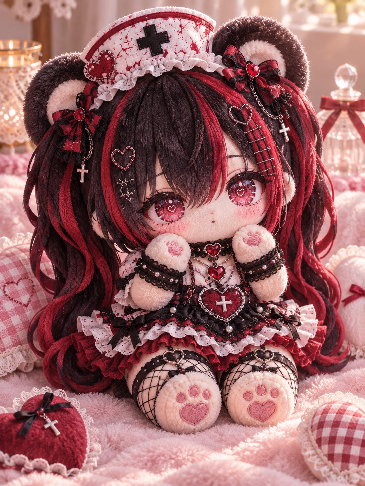
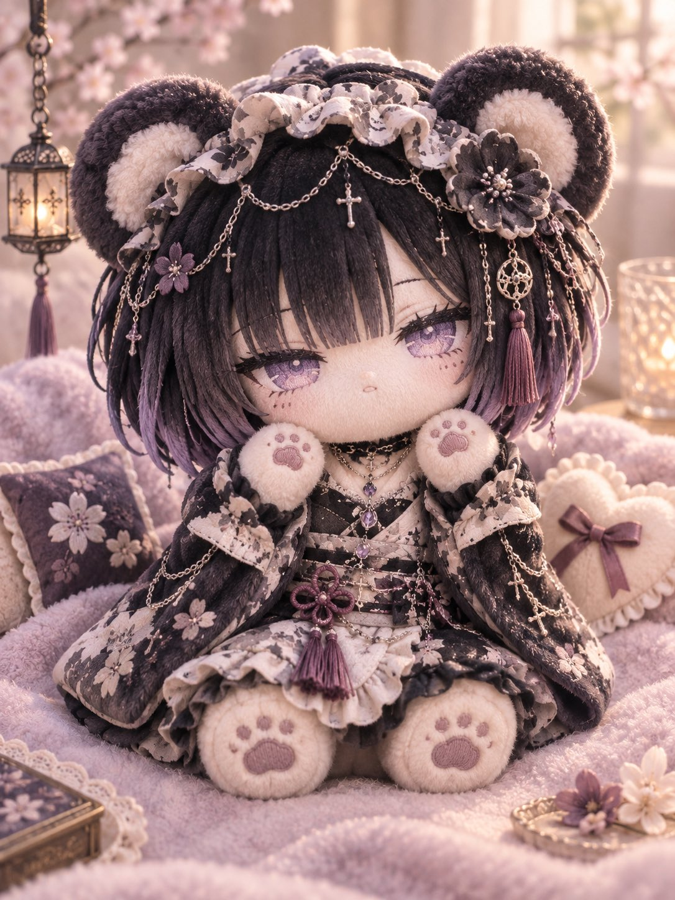
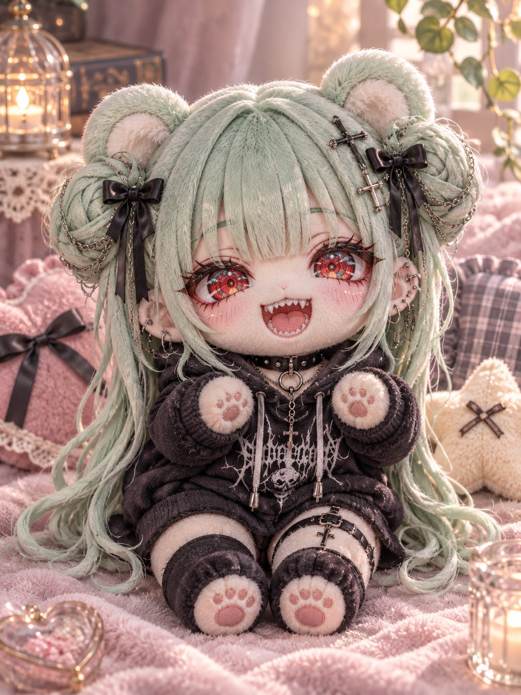
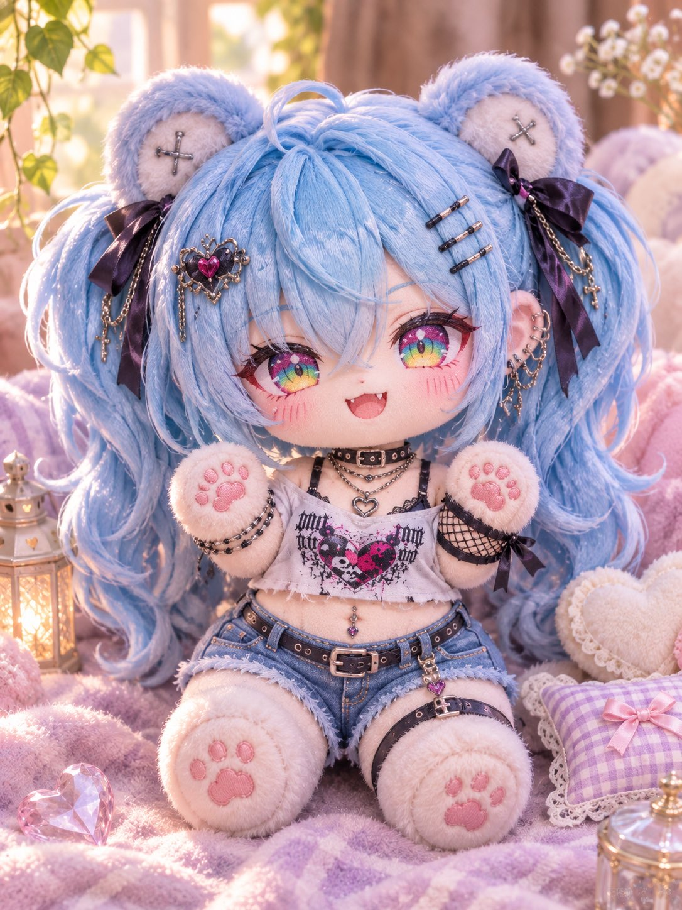

# 把自家角色做成泰迪熊玩偶（#るんプロンプト 第244弾）

- 原帖链接：https://x.com/ENJU1123PIPI/status/2117761242844602433
- 作者：るんちゃん🦋（@ENJU1123PIPI）
- 时间：2026-11-04 07:30 (UTC+8 / Asia/Taipei)
- 互动摘要：点赞 89 · 转发 23 · 回复 6 · 引用 12 · 书签 11 · 浏览 2740（采集快照：2026-11-04 20:10 UTC+8）
- 模型/工具：未注明（角色参考图驱动的通用生图 prompt）
- 标签：二次元
- 媒体路径：
  - `media/images/2117761242844602433_1.jpg`（）
  - `media/images/2117761242844602433_2.jpg`（）
  - `media/images/2117761242844602433_3.jpg`（）
  - `media/images/2117761242844602433_4.jpg`（）
- 入库日期：2026-11-04
- 备注：prompt 在作者自回复；需附上角色参考图使用。

## prompt 原文

```text
TEDDY BEAR HYBRID PLUSH DOLL

Transform the character in the attached image into an irresistibly cute, palm-sized teddy bear hybrid plush doll.

Character Accuracy: Preserve the original face, hairstyle, hair color, eye color, expression, outfit, accessories, and distinctive features. Keep the character instantly recognizable.

Design: Adorable 2-head-tall chibi proportions, oversized round head, tiny chubby teddy bear body, fluffy round bear ears, short stubby paws with pink paw pads, and tiny rounded feet.

Materials: Ultra-soft fluffy minky fabric, realistic plush fur, embroidered eyes, delicate stitching, miniature clothing, ribbons, and detailed accessories matching the original character.

Composition: Single full-body plush doll sitting adorably on a soft pastel blanket, surrounded by tiny cushions and cozy decorations. Warm natural lighting, gentle shadows, shallow depth of field.

Quality: Premium handmade collectible plush, realistic fluffy textures, exceptionally cute, detailed macro photography, vertical 3:4.

Avoid: Generic bear face, realistic human anatomy, plastic textures, extra limbs, multiple characters, text, logos, watermarks.
```

---

个人学习归档，非商业。prompt 与媒体版权归原作者 @ENJU1123PIPI，引用请回到原帖。
