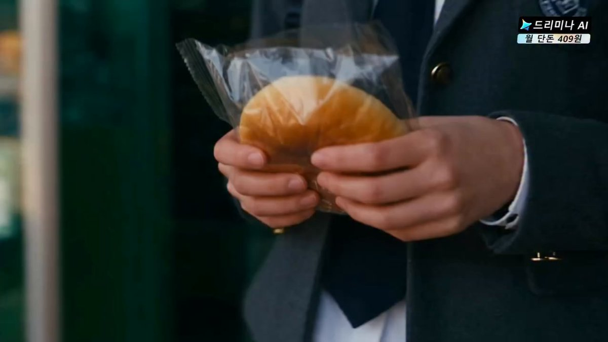
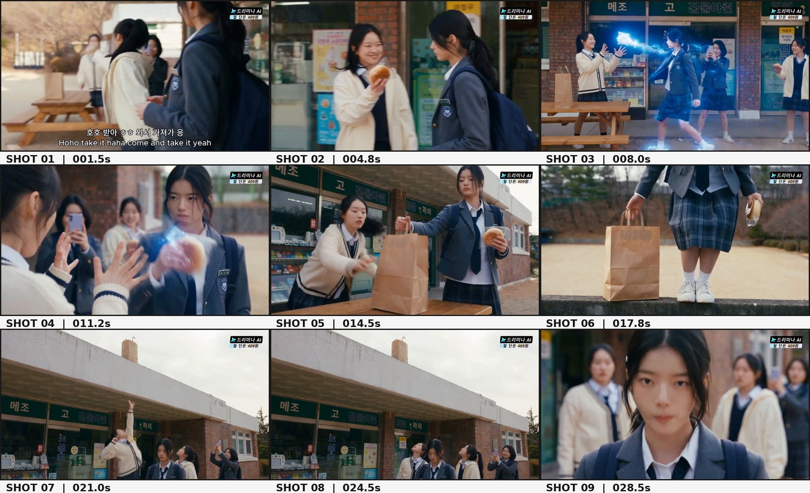

# 韩国校园便利店：面包触发蓝色超能力（Seedance 2.5，30 秒分镜）

- 原帖链接：https://x.com/ElsaSofia__AI/status/2117799763450183756
- 作者：Elsa Ai（@ElsaSofia__AI）
- 时间：2026-11-04 10:03 (UTC+8 / Asia/Taipei)
- 互动摘要：点赞 106 · 转发 5 · 回复 79 · 引用 0 · 书签 21 · 浏览 3307（采集快照：2026-11-04 20:10 UTC+8）
- 模型/工具：Seedance 2.5
- 标签：真人
- 媒体路径：
  - `media/video-stills/2117799763450183756_1.jpg`（）
  - `media/images/2117799763450183756_2.jpg`（）
  - 视频不入库，只保留原帖链接；上面的 `media/video-stills/` 为视频封面截图。
- 入库日期：2026-11-04
- 备注：prompt 在作者自回复（含角色一致性、场景与逐镜分镜）；自回复附带的分镜参考图一并入库。非性内容的校园奇幻喜剧短片。

## prompt 原文

```text
THE MYSTERIOUS BLUE POWER — KOREAN SCHOOLGIRL

Duration: 30 seconds
Aspect Ratio: 16:9

Style: Photorealistic Korean fantasy-comedy short film, live-action cinematic quality.

CHARACTER CONSISTENCY

Main Girl: A young adult Korean schoolgirl with long black hair tied in a low ponytail, a few loose strands framing her face, and a calm expression. She wears a navy-blue school blazer with a school emblem, white collared shirt, dark necktie, blue-gray plaid pleated skirt, white socks, white sneakers, and a dark backpack. Her eyes glow bright electric blue when her supernatural power activates. Preserve her face, hairstyle, uniform, and backpack throughout.

Friend 1: A young Korean schoolgirl with black hair, wearing a cream-colored cardigan over a white school shirt, dark necktie, and dark plaid school skirt. She is cheerful and holds a golden-brown bread roll.

Friend 2: Another Korean schoolgirl wearing a cream or light-colored cardigan and school uniform. She watches the supernatural event with surprise.

Friend 3: A Korean schoolgirl in a dark school uniform who records the event with a smartphone.

Keep all characters' faces, outfits, and hairstyles consistent throughout the video.

LOCATION AND ENVIRONMENT

A Korean school convenience store located in a low brick building. The exterior has large glass shop windows, Korean shop signs, colorful posters, snack displays visible through the windows, and wooden picnic-style tables and benches outside. A paved schoolyard and trees are visible in the background. The scene takes place during a bright, overcast daytime with soft natural light.

Maintain the same shop entrance, brick walls, tables, benches, and surrounding schoolyard throughout.

SHOT 1 — 0–1.5 SECONDS: THE BREAD CLOSE-UP

Begin with an extreme close-up of a person's hands holding a golden-brown bread roll inside a thin transparent plastic wrapper. The person wears a dark school blazer. The camera focuses on the texture of the bread and the hands holding it. The Korean school shop exterior is softly blurred in the background.

SHOT 2 — 1.5–4 SECONDS: FRIEND OFFERS THE BREAD

Cut to a medium shot outside the Korean convenience store. The cheerful girl in a cream cardigan stands facing the main girl in the navy-blue blazer. She smiles and holds out the golden-brown bread roll toward her. The main girl stands calmly with her dark backpack on her shoulders. The shop's glass entrance, posters, and Korean signage are visible behind them.

SHOT 3 — 4–6 SECONDS: THE GIRLS INTERACT

The cream-cardigan girl brings the bread closer to the main girl. The main girl looks at the bread and reaches toward it. In the background, another schoolgirl raises a smartphone and begins recording the interaction. Use a natural medium side-angle shot, keeping both girls clearly visible.

SHOT 4 — 6–8 SECONDS: BLUE EYES AWAKEN

Cut to an extreme close-up of the main girl's eyes. Her eyes initially look completely normal. Suddenly, intense electric-blue light begins glowing inside both irises. Bright blue circular energy patterns appear in her pupils, with tiny glowing particles and subtle reflections on her eyelids. Her expression remains calm and focused.

SHOT 5 — 8–11 SECONDS: THE BLUE ENERGY BURST

Cut to a wide shot of the girls standing outside the store near the wooden picnic table. The main girl extends one arm toward the cream-cardigan girl. A brilliant glowing blue energy sphere appears between their outstretched hands. Electric-blue arcs and swirling light surround the sphere. The cream-cardigan girl raises both hands in surprise. Another girl records the event on her smartphone.

Show the full bodies of both girls and the blue energy clearly. Keep the store facade and outdoor table in the background.

SHOT 6 — 11–14 SECONDS: POWER AND BREAD CLOSE-UP

Cut to a medium close-up of the main girl holding the golden-brown bread roll in one hand. Her expression is serious and composed. The cream-cardigan girl's raised hands are visible in the foreground. A faint blue glow fades around the main girl's hand. The other girls remain surprised in the background.

SHOT 7 — 14–17 SECONDS: SUPERNATURAL ASCENT

The main girl stands beside the wooden picnic table, holding her bread. A powerful blue aura suddenly surrounds a girl standing nearby. The glowing blue energy expands around the girl's body and lifts her upward into the air. A large brown paper shopping bag is visible on the table. The cream-cardigan girl reaches toward the bag while looking up. Show the blue glowing figure rising vertically above the shop exterior.

Use a wide cinematic shot that clearly shows the table, girls, brick storefront, and upward movement.

SHOT 8 — 17–20 SECONDS: THE GIRL RISES ABOVE THE ROOF

Cut to a wider low-angle view of the Korean shop building. A girl is visibly elevated high above the ground near the roofline, surrounded by a fading blue glow. The other schoolgirls stand near the wooden table and look upward in amazement. One of them raises her smartphone to record the airborne figure. The paper bag remains on the table or ledge.

Show the height of the building and the girl above it. Keep the scene bright and realistic.

SHOT 9 — 20–25 SECONDS: EVERYONE LOOKS UP

Continue with a wide exterior shot of the shop entrance. The girls remain gathered near the wooden table, all looking upward toward the sky. One girl points upward with her arm raised. Another continues recording with her smartphone. The main girl in the navy blazer remains calm and stands among them. The airborne figure moves out of the main frame. Preserve the brick building and Korean store signage.

SHOT 10 — 25–30 SECONDS: THE BREAD-EATING ENDING

Cut to a cinematic medium close-up of the main girl standing outside the shop. She holds the golden-brown bread roll with both hands and calmly takes a bite. She chews naturally and looks down at the bread with a relaxed, expressionless face. Behind her, the other schoolgirls are still looking upward in disbelief, with one holding a smartphone.

End with a closer shot of the main girl's calm face as she continues eating the bread, while the surprised girls remain softly blurred in the background.

SUPERNATURAL BLUE ENERGY EFFECTS

Use bright electric-blue and cyan energy. The main girl's eyes must glow with realistic luminous blue circular patterns. The energy sphere between the girls' hands should have a bright core, swirling blue light, small electric arcs, and floating particles. During the airborne sequence, the blue aura should surround the lifted girl and gradually fade. Keep the supernatural effects visually consistent and integrated into the live-action environment.

CAMERA AND CINEMATOGRAPHY

Use cinematic Korean live-action photography. Start with an extreme bread close-up, then medium two-character shots, an extreme eye close-up, wide supernatural energy shots, low-angle upward views, and a final close-up of the girl eating.

Use natural daylight, realistic skin texture, shallow depth of field, smooth camera movement, believable facial expressions, and consistent character positioning.

AUDIO DESIGN

Natural outdoor school ambience, distant student chatter, paper and plastic wrapper sounds, footsteps, soft bread handling, a subtle magical electrical hum when the eyes glow, a rising blue-energy whoosh, surprised reactions from the girls, smartphone handling sounds, and natural chewing sounds in the final shot.

Use natural Korean dialogue where appropriate, with no unnecessary narration.

STRICT NEGATIVE PROMPT

No zombie attack, no fighting, no rooftop chase, no guns, no weapons, no cars, no warehouse, no convenience-store interior scenes, no changing school uniforms, no changing hairstyles, no changing character faces, no extra fingers, no distorted eyes, no duplicated characters, no random people entering the foreground, no random buildings, no nighttime lighting, no fire effects, no purple energy, no red energy, no cartoon style, no anime style, no random subtitles, no watermark.

FINAL OUTPUT: A coherent 30-second photorealistic Korean supernatural school-comedy sequence following the reference video's order: a bread roll is offered outside a Korean school shop, the navy-uniform girl receives it, her eyes suddenly glow blue, she extends her hand and creates a bright blue energy sphere, a girl nearby is lifted into the air, the other students look up and record the event, and the main girl calmly finishes by eating her bread.
```

---

个人学习归档，非商业。prompt 与媒体版权归原作者 @ElsaSofia__AI，引用请回到原帖。
