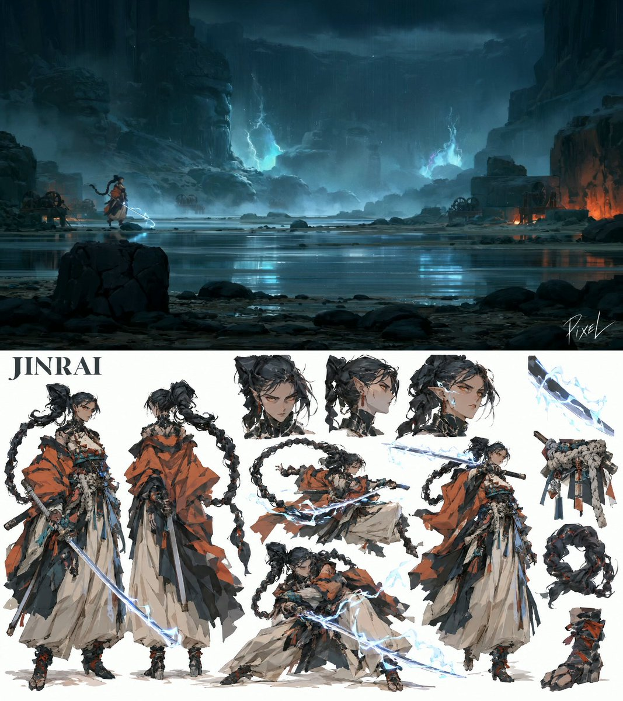
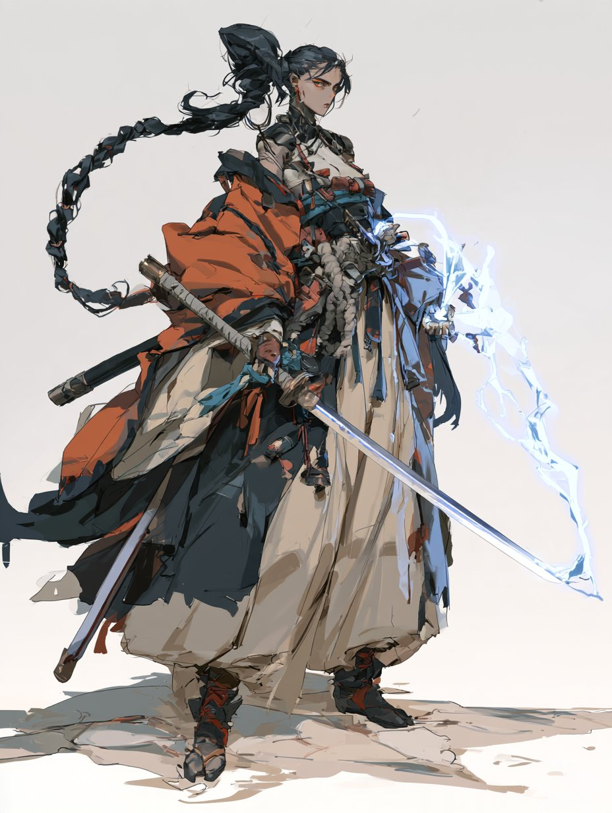
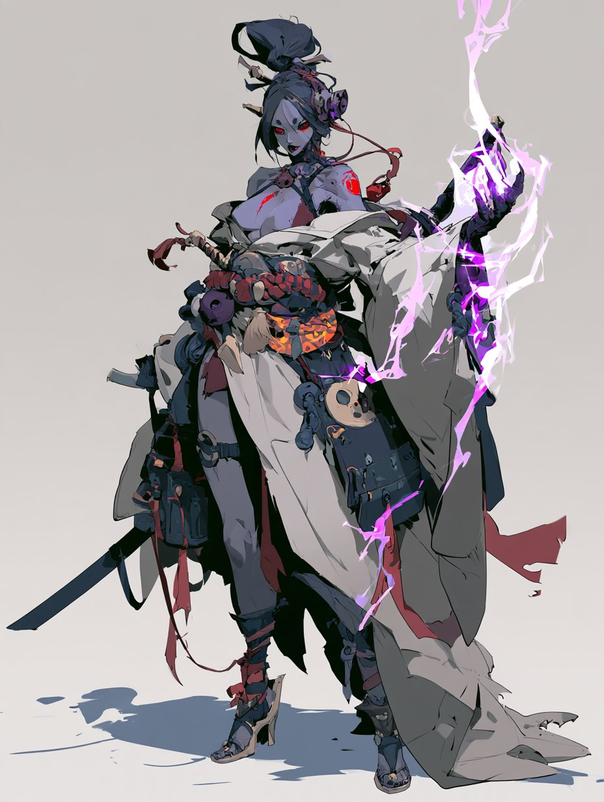
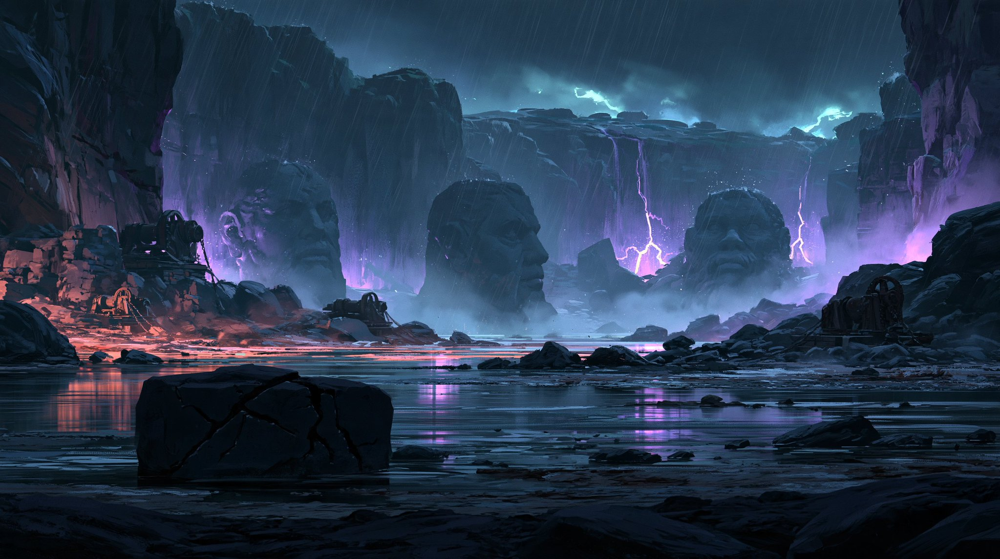
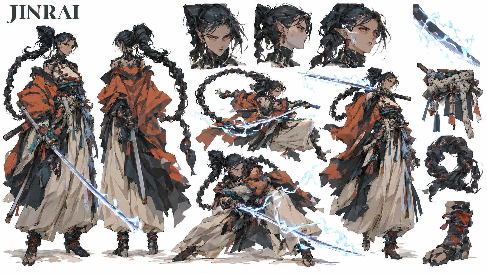
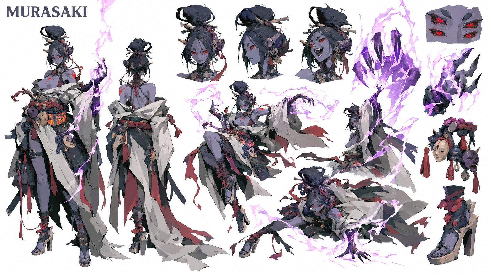

# TEMPEST & VOID：雷暴浪人对决虚空阿修罗（Midjourney v8.2 角色 + GPT Image 2.5 设定表 + Seedance 2.5 动画）

- 原帖链接：https://x.com/itsPixieVerse/status/2117884530933805225
- 作者：PIXEL（@itsPixieVerse）
- 时间：2026-11-04 15:39 (UTC+8 / Asia/Taipei)
- 互动摘要：点赞 30 · 转发 4 · 回复 7 · 引用 1 · 书签 18 · 浏览 997（采集快照：2026-11-04 20:10 UTC+8）
- 模型/工具：Midjourney v8.2 + GPT Image 2.5 + Seedance 2.5（FramiaPro 平台）
- 标签：其它
- 媒体路径：
  - `media/video-stills/2117884530933805225_1.jpg`（）
  - `media/images/2117884530933805225_2.jpg`（）
  - `media/images/2117884530933805225_3.jpg`（）
  - `media/images/2117884530933805225_4.jpg`（）
  - `media/images/2117884530933805225_5.jpg`（）
  - `media/images/2117884530933805225_6.jpg`（）
  - 视频不入库，只保留原帖链接；上面的 `media/video-stills/` 为视频封面截图。
- 入库日期：2026-11-04
- 备注：主帖为视频，prompt 分三条作者自回复；自回复中的角色/场景图与设定表一并入库。风格为 2D 水粉绘画风，非日系动漫，标为「其它」。

## prompt 原文

### Midjourney v8.2 角色/场景 prompt

来源：https://x.com/itsPixieVerse/status/2117884535585280512

```text
Midjourney v8.2 Prompts:

JINRAI (THE STORM RONIN):
Jinrai, the Storm Ronin, lethal duelist. 10 heads tall adult woman, long coiled black dragon-tail hair braid, pointed ears, amber eyes, cybernetic neck collar. Wears an oversized draped terracotta-orange haori, off-white layered hakama trousers, thick knotted rope belt with hanging charms, wrapped tabi boots. Holds a long curved katana crackling with flat-painted cyan lightning. Poised standing stance, hand on hilt, full body, three-quarter view. Palette: terracotta orange, off-white, black; electric cyan lightning accents. Stylized 2D painterly character concept, digital illustration, flat color blocks, artistic thin rough lines, rough random brush work on the edges, graphic fashion silhouette, elongated believable anatomy, angular facial planes, broad opaque brushwork, faceted values, crisp shapes, tactile materials, floor shadow, clean-white background negative: man, male, photorealism, glossy CGI, anime, cute, teenager, petite, text, logo, extra limbs, cropped feet

------

MADAME MURASAKI (THE VOID ASURA):
Madame Murasaki, the Void Asura, four-eyed demon sorceress. 10 heads tall adult woman, pale lavender skin, four glowing red eyes, pointed ears, high architectural black topknot. Wears an open draped off-white kimono with torn train, dark flame-patterned inner sash, thick bead rope belt with hanging miniature mask charms, black high-heeled geta sandals with red ribbons. Left clawed hand channels an arcing ribbon of flat-painted violet lightning. Poised sorcery stance, three-quarter view, full body. Palette: pale lavender, bone white, charcoal; vivid violet lightning accents. Stylized 2D painterly character concept, digital illustration, flat color blocks, artistic thin rough lines, rough random brush work on the edges, graphic fashion silhouette, elongated believable anatomy, angular facial planes, broad opaque brushwork, faceted values, crisp shapes, tactile materials, floor shadow, clean-white background negative: man, male, photorealism, glossy CGI, anime, cute, teenager, petite, text, logo, extra limbs, cropped feet

------

Environment: 
The Quarry of Drowned Monoliths: cyclopean ancient stone quarry submerged in mirror-like shallow black water. Colossal half-carved basalt deity statues, fractured 40m stone blocks, weathered iron winches, driving rainstorm. Empty, no people. Brooding nocturnal tempest, twin cyan and violet lightning flashes illuminating black water reflections, heavy rain mist. Eye-level extreme wide establishing shot, deep three-layer space: foreground silhouette cracked stone chisel block, midground submerged colossal carved heads, background quarry cliff dissolved in 75% dark storm haze. Palette: obsidian black, slate stone, charcoal; electric cyan & violet storm accents. Stylized 2D painterly environment concept, digital illustration, flat color blocks, artistic rough lines, broad opaque brushwork, faceted values, crisp shapes, tactile materials, atmospheric depth. --no torii gate, shrine, temple, trees, photorealism, glossy CGI, anime, text, logo
```

### GPT Image 2.5 角色设定表 prompt

来源：https://x.com/itsPixieVerse/status/2117884541172150399

```text
GPT Image 2.5 Character Sheets:

JINRAI (THE STORM RONIN):
Create a premium, organic studio CHARACTER CONCEPT DESIGN SHEET in a 16:9 widescreen layout on a pure solid white background. THE ATTACHED REFERENCE IMAGE DEFINES THE ART STYLE — treat it as a strict style bible and reproduce its exact rendering technique in every figure on this sheet.

[STYLE — MIRROR THE REFERENCE EXACTLY]: Replicate the reference image's rendering verbatim: painterly matte digital gouache with flat posterized color blocks, shapes defined purely by value and color cuts with NO outlines and NO lineart of any kind, hard-edged brush shapes, muted desaturated palette identical to the reference, identical overall brightness and contrast (light, airy, pure white background — do NOT darken).

[PROPORTIONS & FEMININE ANATOMY LOCK]: Extremely tall adult woman in her early 20s, towering fashion-model anatomy, strictly 10 heads tall. Sculpted athletic feminine frame, defined bust contours, narrow waist, long athletic legs, elongated neck, mature sharp jawline.

[SUBJECT_DESCRIPTION]: High-fashion storm ronin with a colossal coiled black dragon-tail hair braid, pointed ears, amber eyes, cybernetic neck collar. Wears a draped oversized terracotta-orange haori over layered off-white hakama trousers, a thick knotted rope shimenawa belt with hanging charms, and wrapped tabi boots. Holds a katana crackling with flat-painted cyan lightning.
Composition layout:
1. Turnarounds on left: neutral standing stance with katana drawn, and full rear view showing the massive coiled dragon braid and billowing haori drape.
2. Top area features three head studies: cold focused amber glare, profile showing pointed ear and braid root, and intense battle gaze with electric sparks on cheekbones.
3. Center and right showcase dynamic martial stances: low battoujutsu drawing crouch with cyan lightning trails, mid-air spin whipping the heavy braid like a flail, and an upright one-handed parry.
4. Floating isolated detail cutouts on the right: cyan lightning arcing along katana steel, thick knotted rope belt with hanging charms, dragon braid loop structure, wrapped tabi boot with red ties.

[TEXT & PROHIBITIONS — INLINE]: Pure white seamless ground. The ONLY text allowed on the sheet is "JINRAI" in clean bold typography in one corner. Absolutely no metadata boxes, no labels, no bullet points, no panel borders, no outlines, no cel-shading, no 3D render look. BANNED: male chest, flat pectorals, teenager, petite, short stature, cute expressions, photorealism, glossy CGI render. 100% stylized 2D gouache painting.

------

MADAME MURASAKI (THE VOID ASURA):
Create a premium, organic studio CHARACTER CONCEPT DESIGN SHEET in a 16:9 widescreen layout on a pure solid white background. THE ATTACHED REFERENCE IMAGE DEFINES THE ART STYLE — treat it as a strict style bible and reproduce its exact rendering technique in every figure on this sheet.

[STYLE — MIRROR THE REFERENCE EXACTLY]: Replicate the reference image's rendering verbatim: painterly matte digital gouache with flat posterized color blocks, shapes defined purely by value and color cuts with NO outlines and NO lineart of any kind, hard-edged brush shapes, muted desaturated palette identical to the reference, identical overall brightness and contrast (light, airy, pure white background — do NOT darken).

[PROPORTIONS & FEMININE ANATOMY LOCK]: Extremely tall adult woman in her early 20s, towering statuesque build, strictly 10 heads tall. Sculpted feminine bust and core, long slender legs, elongated neck, pale lavender-indigo skin.

[SUBJECT_DESCRIPTION]: Four-eyed asura demon sorceress with pale lavender skin, four glowing red eyes, pointed ears with mechanical earrings, and a high architectural black topknot. Wears an open off-white draped kimono robe with torn trailing hems, a flame-patterned inner sash, a thick dark bead-garland rope belt with hanging miniature mask charms, and black high-heeled geta sandals with red ankle ribbons. Channels an arcing ribbon of flat-painted violet lightning from her left hand.
Composition layout:
1. Turnarounds on left: neutral standing pose channeling violet lightning, and full rear view showing the high topknot, back drapes, and torn kimono train.
2. Top area features three head studies: cold four-eyed sneer, sharp profile showing ear piercings and cheek eyes, and laughing unhinged combat expression.
3. Center and right showcase dynamic sorcery poses: floating mid-air spellcasting stance whipping violet lightning, low evasive side-glide with robes flaring, and summoning a spectral violet asura claw.
4. Floating isolated detail cutouts on the right: four glowing red eyes on lavender face, violet lightning ribbon wrapping clawed hand, hanging miniature noh mask charms, high-heeled geta sandal with red ribbons.

[TEXT & PROHIBITIONS — INLINE]: Pure white seamless ground. The ONLY text allowed on the sheet is "MURASAKI" in clean bold typography in one corner. Absolutely no metadata boxes, no labels, no bullet points, no panel borders, no outlines, no cel-shading, no 3D render look. BANNED: male chest, flat pectorals, teenager, petite, short stature, cute expressions, photorealism, glossy CGI render. 100% stylized 2D gouache painting.
```

### Seedance 2.5 视频分镜 prompt

来源：https://x.com/itsPixieVerse/status/2117884547677438208

```text
Seedance 2.5 Prompts:

#1: THE FACE-OFF & SPOKEN DIALOGUE

Cinematic 2.5D animation in the style of fully painterly rendering, characters and environments look like gouache concept-art paintings in motion, visible brush texture on skin, cloth and buildings, flat posterized color blocks with hard-edged light shapes, matte finish, soft filmic volumetric lighting, shallow depth of field. NOT flat 2D cartoon, NO bold black outlines, NO cel-shading, NOT glossy CGI, NOT Unreal Engine, NO photorealism, no plastic skin.

CHARACTERS:
- @[Image01] (Jinrai): 10-heads-tall storm ronin, coiled black dragon braid, glowing amber eyes, terracotta haori over cream hakama, holding katana crackling with cyan lightning.
- @[Image02] (Madame Murasaki): 10-heads-tall demonic asura sorceress, pale-indigo skin, four glowing red eyes, open white kimono, hand channeling crackling violet lightning ribbons.

SETTING: @[Image03] (The Quarry of Drowned Monoliths). Shallow reflective black water, half-submerged giant stone statues, pouring rain, atmospheric storm lightning.

CINEMATOGRAPHY, ACTING & SPOKEN DIALOGUE (5 SCENES | EXACTLY 30 SECONDS):
00:00-00:07 (Shot 1 | The Water Stride): Wide tracking shot across shallow black water; @[Image01] (Jinrai) strides forward, boots rippling reflections, katana blade humming with cold cyan arcs. Fifty paces away, @[Image02] (Murasaki) floats down atop a half-submerged stone deity head, violet electricity curling around her clawed fingers.
00:07-00:13 (Shot 2 | Jinrai’s Indictment): Low-angle push-in on Jinrai; rain streams down her sharp jawline; long dragon-tail braid whips in the gale as she points her electrified katana forward.
SPOKEN DIALOGUE (Jinrai, cold steel resolve): "You shattered the mountain wards, Murasaki. The abyss is flooding the valley below."
00:13-00:19 (Shot 3 | The Asura’s Mockery): Reverse tight close-up on Murasaki; all four red eyes blink with poisonous amusement, her lips parting into a cruel, fanged smirk.
SPOKEN DIALOGUE (Murasaki, mocking melodic purr): "Your wards were a coward's cage, little storm. I gave this world teeth."
00:19-00:25 (Shot 4 | The Stance Drop): Point-blank cut on Jinrai; amber eyes flare with blinding white-blue voltage; she drops into a low drawing stance, water parting violently beneath her feet from the raw electrical aura.
SPOKEN DIALOGUE (Jinrai, sharp whisper): "Then bleed on them."
00:25-00:30 (Shot 5 | The Ignition Charge): Murasaki laughs hysterically, flaring her massive violet plasma whip high into the rain clouds. Both women launch forward across the water at supersonic velocity, leaving glowing cyan and violet wakes. Freezes at 00:30 on the exact mid-air strike seam.

clear three-layer depth: foreground stone chisel blocks and water ripples cropped in silhouette, both combatants resolved in high-contrast lightning in midground, background submerged monoliths dissolved in 75% dark storm haze. Weighty natural character animation, cloth, long hair, and plasma reacting to storm physics.

AUDIO DESIGN: Heavy downpour, low sub-bass thunder roll, water splashes, distinct spoken dialogue echoing across stone quarry, crackling cyan and violet electrical arcs, ending on a high-voltage sonic boom freeze.

PROHIBITIONS (INLINE NEGATIVES): Torii gates, shrines, temples, trees, ninjas, minions, peaceful resolution, friendly expressions, photorealism, glossy CGI render, smooth 3D plastic skin, anime cel outlines, lineart, camera drift, extra limbs. 100% stylized 2D gouache painting.

-------

#2: THE UNINTERRUPTED BATTLE

Cinematic 2.5D animation in the style of fully painterly rendering, characters and environments look like gouache concept-art paintings in motion, visible brush texture on skin, cloth and buildings, flat posterized color blocks with hard-edged light shapes, matte finish, soft filmic volumetric lighting, shallow depth of field. NOT flat 2D cartoon, NO bold black outlines, NO cel-shading, NOT glossy CGI, NOT Unreal Engine, NO photorealism, no plastic skin.

CONTINUATION: Snaps forward instantly from Part 1’s mid-air collision freeze.

CHARACTERS & ENVIRONMENT: Identical to Part 1. @[Image01] (Jinrai) vs. @[Image02] (Murasaki) fighting across @[Image03] (The Quarry of Drowned Monoliths).

CINEMATOGRAPHY & RAPID 15-CUT COMBAT CHOREOGRAPHY (EXACTLY 30 SECONDS):
00:30-00:32.0 (Shot 1 | Detonation Seam): The frozen impact detonates; cyan lightning and violet plasma collide, blasting a 50-foot circular wall of displaced black water across the quarry.
00:32.0-00:33.8 (Shot 2 | Blade Parry): High-speed ground track; Jinrai slashes with her blue-lightning katana; Murasaki parries with her hip tanto, violet sparks showering across her exposed shoulder.
00:33.8-00:35.5 (Shot 3 | Violet Lightning Arc): Murasaki whips her left hand forward, hurling a jagged ribbon of violet lightning; Jinrai side-slips across the water, cleanly cleaving the bolt in two.
00:35.5-00:37.2 (Shot 4 | Dragon Braid Flail): Dynamic pivot; Jinrai whips her heavy coiled hair braid like an iron flail, shattering a submerged stone statue and forcing Murasaki backward.
00:37.2-00:39.0 (Shot 5 | Asura Teleport): Murasaki dissolves into purple smoke tendrils, materializing directly above Jinrai, executing a diving axe-kick with her pointed geta heel.
00:39.0-00:41.0 (Shot 6 | Waterbed Crater): Jinrai braces her katana horizontally; the impact drives both into the waterbed, sending a shockwave that exposes the dry mud floor for a second.
00:41.0-00:43.0 (Shot 7 | Voltage Burst): Point-blank chest blast; Jinrai unleashes a blinding point-blank burst of cyan electricity from her palm, launching both fighters skidding 30 paces apart.
00:43.0-00:45.0 (Shot 8 | Vertical Monolith Run): Speed-ramp cut; Murasaki runs vertically up the face of a 40-meter carved stone deity head, violet lightning trailing behind her.
00:45.0-00:47.0 (Shot 9 | High-Altitude Pursuit): Jinrai vaults up the stone blocks in a blur of terracotta fabric and electric blue sparks, closing the distance in three leaps.
00:47.0-00:49.0 (Shot 10 | Aerial Climax Clash): Mid-air duel; four hyper-speed parries exchanged in one second high above the flooded quarry, steel screeching against plasma.
00:49.0-00:51.5 (Shot 11 | Phantom Demon Hand): Murasaki’s four eyes flare crimson; an enormous spectral violet asura hand manifests and swats Jinrai downward through the rain.
00:51.5-00:53.5 (Shot 12 | The Skipping Touchdown): Jinrai skips across the surface of the black water like a flat stone, boots digging in, halting her momentum instantly without falling.
00:53.5-00:56.0 (Shot 13 | The Mach-3 Thrust): Jinrai channels maximum storm voltage; her entire blade and hair braid ignite into blinding white-blue fire as she lunges in a supersonic ground thrust.
00:56.0-00:58.0 (Shot 14 | The Severing Impact): Sonic-boom pass; Jinrai blurs clean past Murasaki; an architectural blue lightning wave cleaves through the stone monolith behind them, shattering Murasaki’s violet aura.
00:58.0-01:00.0 (Shot 15 | Poster Hero Frame): Locked low-angle hero shot; Jinrai stands victorious in the reflective water, snapping her katana into its scabbard with a mechanical *click*, while Murasaki collapses to one knee behind her, violet electricity fading into rain. Hold for 2 seconds.

clear three-layer depth: foreground displaced water spray and stone rubble cropped in silhouette, both fighters resolved in midground with maximum value contrast, background flooded quarry walls dissolved in 75% dark tempest haze. Weighty natural character animation, cloth, water, and lightning arcs reacting to violent kinetic momentum.

AUDIO DESIGN: ZERO SPOKEN DIALOGUE. Explosive thunder claps, screaming high-voltage electrical hums, heavy water splashes, blade clash rings, stone splintering cracks, sonic-boom thrust roar, ending on a crisp scabbard click into solitary falling rain.

PROHIBITIONS (INLINE NEGATIVES): Any dialogue, voiceovers, talking, slow-motion combat, sluggish editing, less than 14 cuts, torii gates, shrines, friendly interactions, photorealism, glossy CGI render, smooth 3D plastic skin, anime cel outlines, lineart, camera drift, extra limbs. 100% stylized 2D gouache painting.
```

---

个人学习归档，非商业。prompt 与媒体版权归原作者 @itsPixieVerse，引用请回到原帖。
