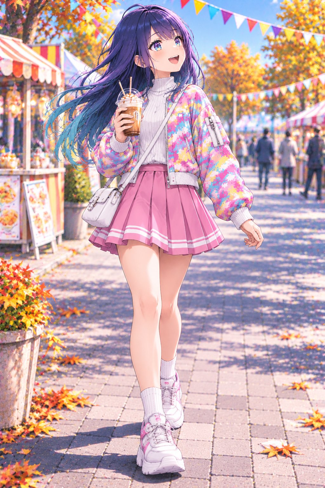
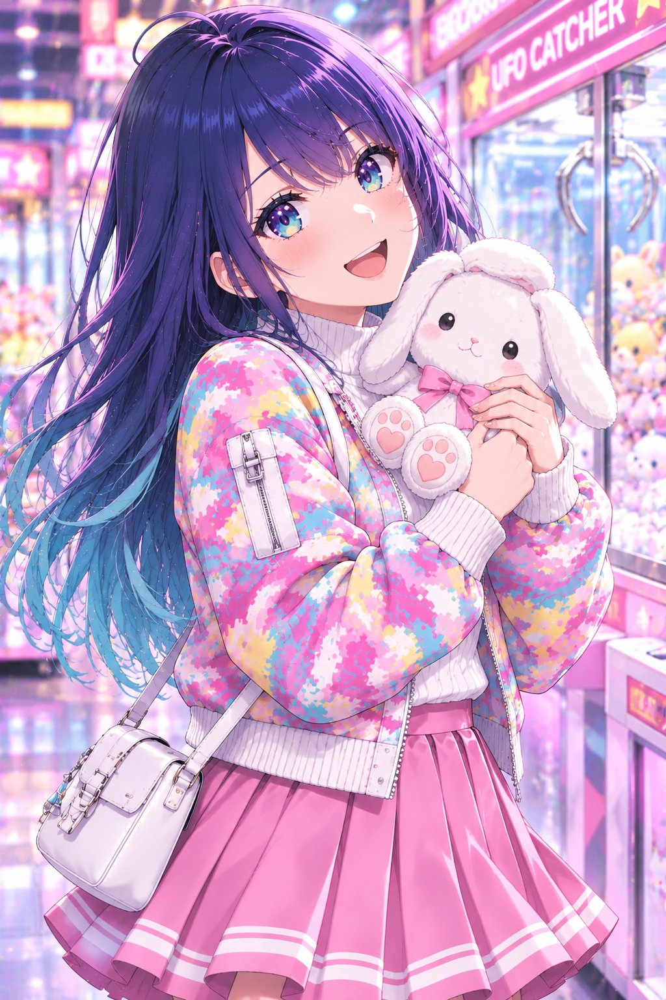
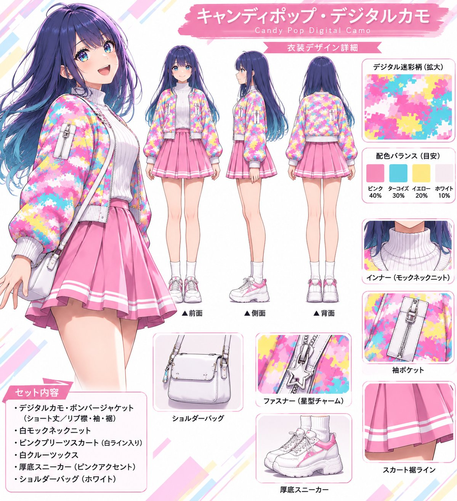

# 糖果色数码迷彩秋季穿搭衣装 prompt（黑川あかね示例）

- 原帖链接：https://x.com/xt9vdi/status/2117796407876964666
- 作者：黒瀬 樹(たつき)（@xt9vdi）
- 时间：2026-11-04 09:49 (UTC+8 / Asia/Taipei)
- 互动摘要：点赞 56 · 转发 1 · 回复 1 · 引用 0 · 书签 7 · 浏览 955（采集快照：2026-11-05 09:15 UTC+8）
- 模型/工具：未注明
- 标签：二次元
- 媒体路径：
  - `media/images/2026-11-05_2117796407876964666_1.jpg`（）
  - `media/images/2026-11-05_2117796407876964666_2.jpg`（）
  - `media/images/2026-11-05_2117796407876964666_3.jpg`（）
  - `media/images/2026-11-05_2117796407876964666_4.jpg`（）
  - `media/images/2026-11-05_2117796407876964666_5.jpg`（）
- 入库日期：2026-11-05
- 备注：prompt 在作者自回复，为只描述服装的通用衣装 prompt；自回复附带的衣装设计稿一并入库（`media/images/2026-11-05_2117796407876964666_5.jpg`）。示例为日常街头穿搭，无性暗示。

## prompt 原文

来源：https://x.com/xt9vdi/status/2117796412184547738

```text
🎨 初めての衣装プロンプト配布！

今回の衣装は「キャンディポップ・デジタルカモ」🌈

カラフルなデジタル迷彩を使った、明るくポップな秋コーデです。

衣装のみのプロンプトなので、お好きなキャラクターに着せたり、ポーズや背景を変えたりして自由に楽しんでください✨

参考用の衣装デザインシートも添付しています。
※画像はイメージ資料です。細部はプロンプトを優先してください。

【Outfit Prompt】

A vibrant, playful autumn fashion outfit combining candy-colored digital camouflage, cute feminine styling, and sporty streetwear aesthetics.

1. Bomber Jacket

A slightly cropped, waist-length bomber jacket with a relaxed, softly rounded silhouette.

The entire outer shell of the jacket features a vivid digital camouflage pattern made of numerous small, sharply defined square and rectangular pixel blocks.

Color palette:

- 40% candy pink
- 30% bright turquoise blue
- 20% soft lemon yellow
- 10% clean white

The colors are distributed in irregular, interlocking pixel clusters, creating a recognizable military-inspired digital camouflage structure reimagined in cheerful pastel colors.

The pattern must have crisp, straight geometric edges. Avoid traditional rounded camouflage shapes, watercolor effects, floral patterns, and random paint splashes.

The jacket features gently puffed long sleeves, softly structured shoulders, a white ribbed stand collar, white ribbed cuffs, and a matching white ribbed waistband.

A white front zipper runs vertically down the center. The jacket is worn partially unzipped, clearly revealing the white inner top.

Include subtle panel seams, fine stitching, and a small zippered utility pocket on one upper sleeve.

A tiny silver star-shaped charm decorates the main zipper pull.

The digital camouflage pattern must remain visible across the jacket's front, back, and sleeves, with consistent colors and pixel scale.

2. Inner Top

A fitted, clean white ribbed knit mock-neck sweater.

Fine vertical ribbing, soft lightweight knit texture, modest neckline, and a smooth silhouette.

The inner top is plain white, without graphics, logos, or camouflage patterns.

3. Pleated Skirt

A high-waisted, soft pastel pink flared mini skirt with a gently structured A-line silhouette.

Evenly spaced, clearly defined vertical pleats create a light, playful shape.

Two thin white horizontal decorative stripes run around the skirt near the hem.

The skirt is entirely solid pastel pink. No camouflage pattern, additional prints, or decorative patches.

Natural fabric folds, modest coverage, and a neatly finished hem.

4. Socks and Sneakers

Clean white crew socks reaching slightly above the ankles.

White chunky platform sneakers with rounded toes, layered soles, white laces, and subtle pastel pink accents.

The sneakers have a sporty yet cute appearance, matching the cheerful streetwear aesthetic.

5. Accessories

A small, minimalist white leather crossbody bag with a slim adjustable shoulder strap.

Smooth leather texture, subtle stitching, silver metallic hardware, and a compact rectangular shape with softly rounded corners.

Keep accessories understated so the colorful digital camouflage jacket remains the visual centerpiece.

6. Overall Styling

A cheerful combination of Japanese-inspired pastel street fashion, sporty casualwear, and soft feminine details.

Bright, playful, youthful, fashionable, and visually balanced.

The colorful jacket is the main focal point, complemented by the clean white inner top, pastel pink pleated skirt, and white accessories.

Maintain consistent garment proportions, construction, colors, pixel camouflage pattern, and accessory placement across different characters, poses, and scenes.

Detailed fabric textures, natural folds, clean stitching, crisp pixel shapes, and a polished high-quality fashion illustration aesthetic.

Important Design Restrictions

- Digital pixel camouflage on the bomber jacket only.
- No traditional organic camouflage shapes.
- No camouflage pattern on the skirt or inner top.
- No additional dominant colors.
- No oversized logos or text graphics.
- No unnecessary accessories.
- Preserve the same outfit design when changing the character, pose, or background.
```

---

个人学习归档，非商业。prompt 与媒体版权归原作者 @xt9vdi，引用请回到原帖。
