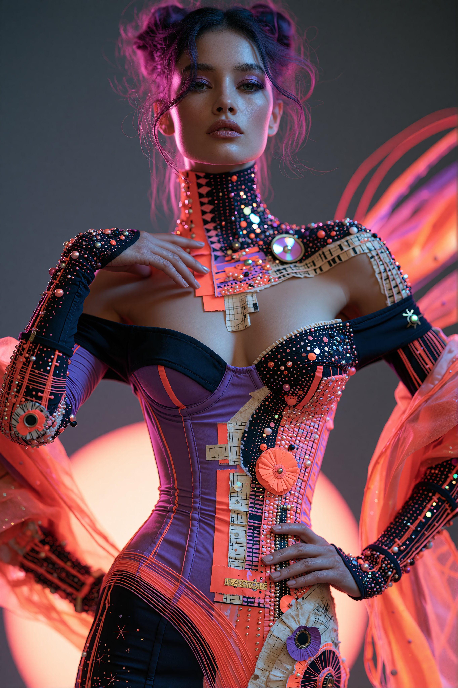

# DIGITAL RELIC COUTURE：后数字高定服装变装 prompt

- 原帖链接：https://x.com/PCasino73066/status/2117807643914117483
- 作者：⟡ 𝕀𝕁 ⟡ ℙ𝕒𝕥 ℂ𝕒𝕤𝕚𝕟𝕠 ⟡ 𝕀𝕁 ⟡（@PCasino73066）
- 时间：2026-11-04 10:34 (UTC+8 / Asia/Taipei)
- 互动摘要：点赞 21 · 转发 4 · 回复 7 · 引用 1 · 书签 3 · 浏览 498（采集快照：2026-11-05 09:15 UTC+8）
- 模型/工具：未注明
- 标签：真人
- 媒体路径：
  - `media/images/2026-11-05_2117807643914117483_1.jpg`（）
- 入库日期：2026-11-05
- 备注：prompt 在作者自回复，用于把参考图人物的服装换成该造型（保留脸与身份）。示例图为写实风成年女性时装照。

## prompt 原文

来源：https://x.com/PCasino73066/status/2117807883576365491

```text
✦ PROMPT SHARE — DIGITAL RELIC COUTURE ✦

Transform the subject's outfit into an avant-garde masterpiece of post-digital luxury fashion.

A sculpted, figure-hugging corset bodysuit constructed from deep violet satin, midnight-black technical fabric, and vibrant electric-coral panels. Asymmetrical architectural seams wrap the torso and hips, embellished with hundreds of tiny luminous micro-beads, reflective chrome studs, precision embroidery, iridescent discs, and intricate circuit-inspired ornamental patterns.

An exaggerated high-neck collar combines black jeweled mesh with geometric coral-pink detailing. Dramatic off-the-shoulder construction reveals the shoulders while retaining structured, embellished long sleeves. Intricate metallic trim, ornamental rosettes, holographic hardware, and delicate reflective inlays create a densely detailed yet intentionally composed luxury surface.

Oversized translucent coral-orange organza wings and flowing sculptural fabric sweep outward behind the silhouette, catching neon-magenta and electric-cyan lighting.

STYLE: Luminous 2.5D anime realism × post-digital couture × futuristic maximalist editorial fashion.

MATERIALS: Satin, technical mesh, translucent organza, micro-pearls, chrome, holographic enamel, and jeweled embroidery.

COLOR PALETTE: Electric coral, violet, black, hot pink, champagne chrome, and subtle cyan.

QUALITY LOCK: Preserve the subject's original face, hairstyle, body proportions, and identity. Transfer the outfit design only. Accurate tailoring, believable fabric physics, precise ornamental details, pristine anatomy, and polished high-end rendering.

NEGATIVE: Random noise, scattered speckles, malformed hands, melted details, distorted anatomy, cheap plastic textures, text, logos, and watermark.

Show me what your character looks like wearing Digital Relic Couture. ✨
```

---

个人学习归档，非商业。prompt 与媒体版权归原作者 @PCasino73066，引用请回到原帖。
