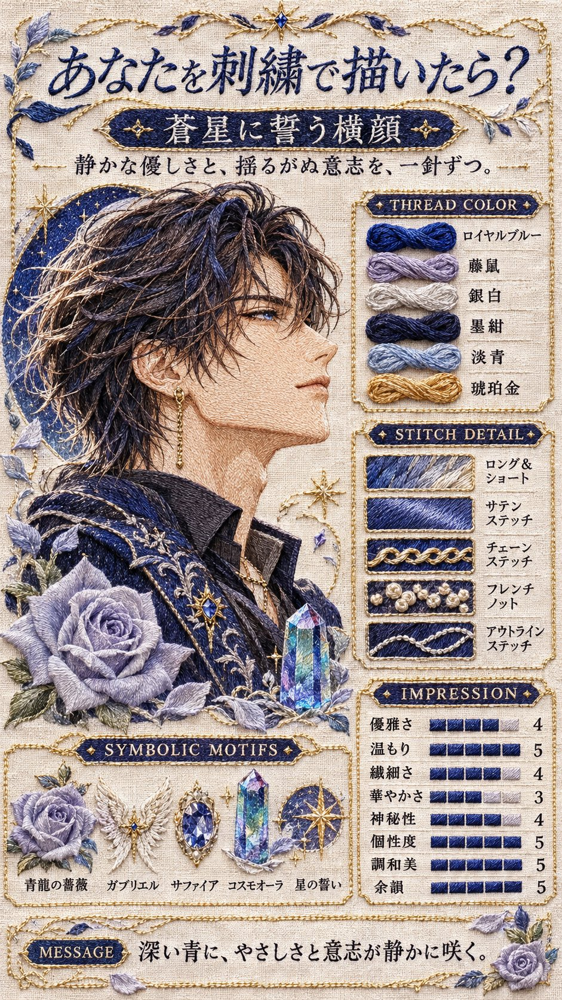
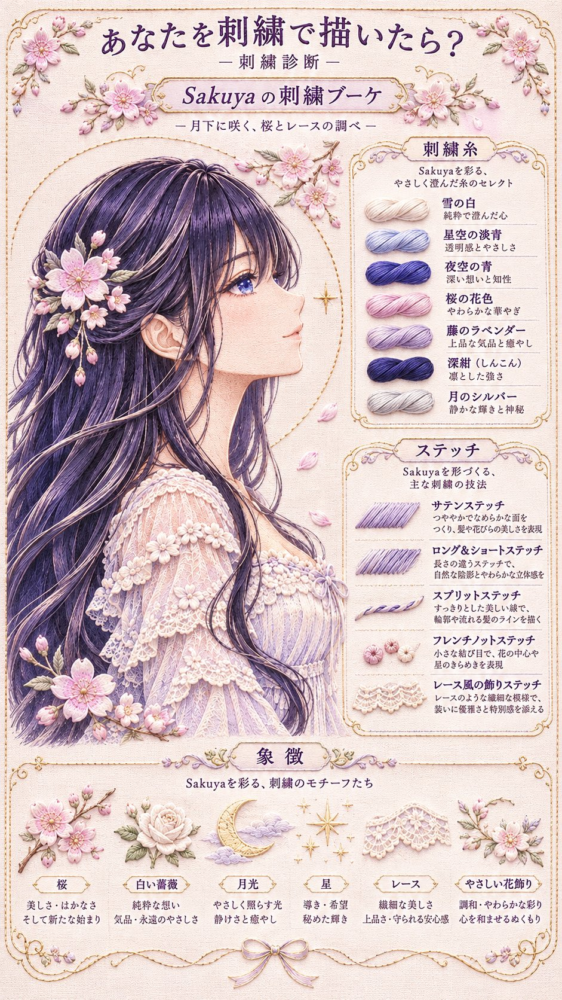

# 【あなたを刺繍で描いたら？】刺绣肖像诊断海报（ChatGPT 图像生成）

- 原帖链接：https://x.com/archanfel000/status/2117808203761369104
- 作者：ある（@archanfel000）
- 时间：2026-11-04 10:36 (UTC+8 / Asia/Taipei)
- 互动摘要：点赞 77 · 转发 8 · 回复 1 · 引用 22 · 书签 64 · 浏览 6099（采集快照：2026-11-05 09:15 UTC+8）
- 模型/工具：ChatGPT（图像生成，帖子未注明具体模型版本）
- 标签：其它
- 媒体路径：
  - `media/images/2026-11-05_2117808203761369104_1.jpg`（）
  - `media/images/2026-11-05_2117808203761369104_2.jpg`（）
- 入库日期：2026-11-05
- 备注：prompt 在作者自回复；为「诊断型」长 prompt，需配合对话历史或参考图使用。示例图为插画角色的刺绣风海报，按海报风格标为「其它」。

## prompt 原文

来源：https://x.com/archanfel000/status/2117808465792139547

```text
【あなたを刺繍で描いたら？】

― あなたの姿と心を、一針ずつ描く。―

会話履歴・入力情報・参考画像から人物の性格、価値観、信念、強さ、優しさ、感性、趣味嗜好、美意識、容姿、雰囲気、隠れた一面を分析し、人物本人の横顔を主役とした精密な刺繍肖像作品を診断・制作してください。

① 必須診断項目

* 作品名・テーマ・キャッチコピー
* 人物の横顔：顔立ち・髪型・瞳・表情・衣装
* 象徴モチーフ3〜6種類：名称・意味・選定理由
* 刺繍糸5〜7色：糸の種類・色名・役割・象徴性
* ステッチ4〜6種類：技法名・使用箇所・仕上がり
* 布地・装飾素材・完成形
* 人物との共通点・選定理由
* 印象ステータス・短いメッセージ

② 人物・刺繍の再現【最重要】

人物の横向きの胸上〜腰上の肖像を中心に大きく描き、顔・瞳・髪・衣装の特徴を忠実に再現してください。

参考画像や人物設定を優先し、性別・顔立ち・髪型・瞳・服装を勝手に変更しないこと。外見情報がない場合は、診断用の創作的な人物像として明示してください。

肌・髪・瞳・衣装はすべて刺繍糸と縫い目で表現し、普通の写真・イラスト・印刷に見せないこと。 糸の流れ・艶・厚み・布の織り目を精密に描写してください。

刺繍技法は、ロング＆ショート、サテン、アウトライン、スプリット、チェーン、フレンチノット、コーチングなど実在する技法から人物に合わせて選定し、糸色・素材・使用箇所を一致させてください。

象徴モチーフは花・宝石・星・動物・道具・自然・装飾などから選び、人物の周囲に小さく添える装飾としてください。人物を隠したり、主役を奪ったりしないこと。

③ 印象ステータス

優雅さ・温もり・繊細さ・華やかさ・神秘性・個性度・調和美・余韻の深さを各5段階で評価してください。

人物に応じて強弱を設け、数値・ゲージ・解説・作品の印象を一致させ、全項目を最高評価に固定しないこと。

④ 9:16刺繍診断ポスター【構図固定】

9:16縦長・超高品質フォトリアルの手刺繍診断ポスターを生成してください。

画面の約60％を人物の横顔刺繍作品に使用し、左側〜中央に大きく配置してください。顔・髪・肩・胸元を繊細な糸で描き、背景は生成り・白・淡色の無地リネンなど、シンプルな布地にしてください。

残り約40％に解説欄を整理して配置します。

* 上部：タイトル「あなたを刺繍で描いたら？」、作品名・キャッチコピー
* 右側上段／THREAD COLOR：刺繍糸5〜7色の実物風の糸束見本・色名・意味
* 右側下段／STITCH DETAIL：4〜6種類の縫い目見本・技法名・用途
* 下部／SYMBOLIC MOTIFS：3〜6種類の小さな刺繍図案・名称・象徴性
* 補足欄：布地・素材・印象ステータス・選定理由・メッセージ

刺繍作品の鑑賞を最優先し、説明欄のために人物を小さくしないこと。 情報量が多い場合は解説を統合・短文化し、詳細は画像外の文章で説明してください。

全体は上品な刺繍図案集・作品展示のように仕上げ、人物の個性に合わせた配色と控えめな装飾を使用してください。人物も小図案も本物の手刺繍として表現してください。

⑤ 品質・最重要指示

人物分析 → 横顔の設計 → 象徴モチーフ選定 → 刺繍糸・技法・布地の決定 → 印象評価 → 解説 → 画像生成の順に構築してください。

* 主役は必ず人物本人の横顔。象徴物を主役に変更しない。
* 刺繍作品は画面全体の約60％を占める。
* 顔立ち・髪・瞳・衣装と人物設定を一致させる。
* 背景はシンプルにし、糸の質感と針目を際立たせる。
* 刺繍糸・ステッチ・モチーフの見本と解説を一致させる。
* 実在する刺繍技法・素材を用い、手作業で制作できる構成にする。
* 文字化け・誤字・脱字・不自然な日本語・意味不明な文章を避け、固有名詞・技法名・色名・数値・評価・設定・画像と解説の表記を正確に統一する。

「その人の姿を糸で描き、その人の心を模様に込める。」

人物の容姿と内面が一目で伝わる、世界に一枚だけの刺繍診断ポスターを完成させてください。
```

---

个人学习归档，非商业。prompt 与媒体版权归原作者 @archanfel000，引用请回到原帖。
