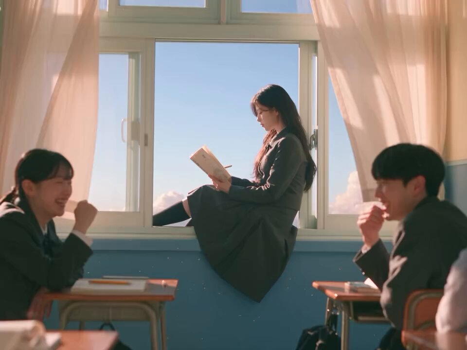

# 离世小狗化作光之灵归来（Seedance 2.5，30 秒韩影风情感分镜）

- 原帖链接：https://x.com/KrishnaBio1/status/2117812457809023213
- 作者：KrishnaG（@KrishnaBio1）
- 时间：2026-11-04 10:53 (UTC+8 / Asia/Taipei)
- 互动摘要：点赞 71 · 转发 7 · 回复 33 · 引用 0 · 书签 17 · 浏览 2689（采集快照：2026-11-05 20:10 UTC+8）
- 模型/工具：Seedance 2.5
- 标签：真人
- 媒体路径：
  - `media/video-stills/2117812457809023213_1.jpg`（）
  - 视频不入库，只保留原帖链接；上面的 `media/video-stills/` 为视频封面截图。
- 入库日期：2026-11-05
- 备注：prompt 在作者自回复，含人物/小狗设定、逐秒分镜、音频与风格段；末尾链接为原文自带，保留。

## prompt 原文

```text
Cinematic ultra-realistic emotional fantasy drama short film, 16:9, 30 seconds, 24fps, shot like a high-budget Korean feature film, the present-day scenes in cold dark blue light inside a quiet apartment and a rain-wet night alley, the memory scenes in warm golden light, a glowing soft white-blue spirit dog, shallow depth of field, crisp detail, subtle film grain, slow gentle camera movement, deeply moving and tender mood.
👩 HEROINE: A young Korean woman in her late 20s, long black hair, soft natural makeup, tired and tender eyes, wearing a beige coat, white boots and a white blouse in the present, and a cozy cream hoodie and jeans in the memory scenes. Keep her face identical in every shot.
🐶 DOG: A small, fluffy cream-and-apricot toy poodle with round dark eyes and a wagging tail. In the present he appears as a glowing spirit, a soft luminous white-blue outline made of floating light particles. In the memories he is a warm, playful real puppy.
🏠 0–4s: A dark apartment entrance. The heroine opens the door and steps inside, a cold blue light behind her. She looks at an empty dog bed beside the sofa and says softly: "I'm home."
💡 4–8s: She sits on the sofa hugging her knees, staring at the empty bed. A faint glow appears on the dog bed, and the spirit poodle slowly forms from drifting light, tail wagging, looking up at her.
🌅 8–13s: Warm golden flashbacks: the puppy runs to greet her at the door, then sleeps peacefully beside her laptop while she works, then curls up with her on a cozy bed as she laughs and kisses his head.
💧 13–18s: Back to the present, close-up. The glowing dog gently touches his nose to her nose. She closes her eyes, tears running down her cheeks, a broken smile on her face. She whispers: "I missed you so much."
🌃 18–23s: A quiet rain-wet alley at night. The heroine walks slowly, and the glowing dog trots ahead of her on a leash made of light. A brief golden flash of the two of them walking together on a sunny street in the past, then back to the dark alley.
🕯️ 23–28s: She kneels down in the alley and the dog leaps into her arms. She hugs him tightly and says through tears: "Thank you for choosing me, every single day." The dog licks her cheek softly.
✨ 28–30s: The dog's body dissolves into glowing particles that rise gently into the night sky. She stays kneeling, watching them go, then smiles through her tears. Slow pull-back to a wide shot of the empty alley and the lone figure. Fade out.
🎧 AUDIO: Soft rain and distant city hum, a slow heartbeat, tiny jingling dog tags, warm piano-and-strings score swelling gently, quiet sobs, clear natural English dialogue.
🎬 STYLE: Realistic emotional fantasy drama, restrained heartfelt performances, cold-blue and warm-gold color contrast, wholesome and non-graphic, consistent faces, no text, no subtitles, no logos, no watermark.

https://t.co/fzSNtrloN0
```

---

个人学习归档，非商业。prompt 与媒体版权归原作者 @KrishnaBio1，引用请回到原帖。
