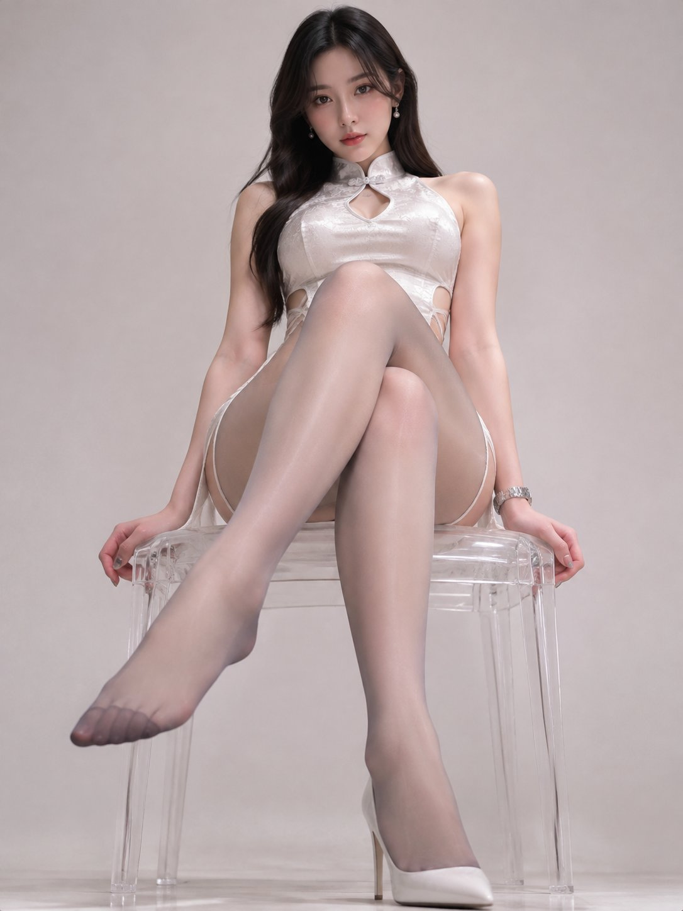

# 「二郎腿战神」：白色改良短旗袍 + 灰丝棚拍人像（中文长 prompt）

- 原帖链接：https://x.com/GenRyoma/status/2117885659742618033
- 作者：YLL·Hara（@GenRyoma）
- 时间：2026-11-04 15:44 (UTC+8 / Asia/Taipei)
- 互动摘要：点赞 528 · 转发 28 · 回复 10 · 引用 2 · 书签 300 · 浏览 18310（采集快照：2026-11-05 20:10 UTC+8）
- 模型/工具：未注明
- 标签：真人
- 媒体路径：
  - `media/images/2117885659742618033_1.jpg`（）
- 入库日期：2026-11-05
- 备注：prompt 即主帖正文，整段摘录（含开头标题行）。prompt 写明「成人东亚女性模特」，并带负面词限制走光/裸露。

## prompt 原文

```text
二郎腿战神Prompt

提示词：

超写实室内人像摄影，干净极简背景，成人东亚女性模特，气质冷艳优雅，五官精致自然，皮肤真实细腻，黑色长发或低盘发，直视镜头。
模特坐在透明亚克力凳子上，身体正对镜头，翘着二郎腿，姿态自然从容。
她身穿一件白色高开叉镂空短旗袍，修身剪裁，现代改良中式设计，面料高级，有轻微光泽感，完整遮挡、不走光。
下身穿15D灰色连裤丝袜，整体轻薄透肤、带细腻丝光，脚尖加固约25D，袜尖区域更清晰细密。
撑地的那条腿穿着一只性感高跟鞋，鞋型修长精致，可为细跟尖头高跟鞋；翘起的那条腿不穿鞋，仅穿丝袜，脚背与脚尖线条自然放松。
镜头为正面近景仰拍，机位略低，从腿部前下方向上拍摄，保留明显的近大远小透视感；画面重点表现人物上半身、旗袍剪裁、交叠双腿和丝袜质感。
整体构图干净利落，背景纯净简约，可为浅灰、米白或奶油白色摄影棚式室内背景，不加入杂乱家具。
光线采用柔和高级的室内人像布光，主光从前上方或侧前方打亮面部与服装，腿部和丝袜表面有细腻高光，肤色自然，旗袍面料与丝袜纹理清晰可见。
风格为高质感时尚写真、超写实真人摄影、电影感轻奢肖像，真实人体比例，真实皮肤纹理，细节清晰，画面高级克制。
负面提示词：
走光、裸露私密部位、夸张色情姿势、过度暴露、畸形双腿、错误脚部结构、多余手指、多余肢体、丝袜破损、鞋子穿模、背景杂乱、动漫脸、塑料皮肤、过度磨皮、低清晰度、文字、水印、logo、错误透视。
```

---

个人学习归档，非商业。prompt 与媒体版权归原作者 @GenRyoma，引用请回到原帖。
