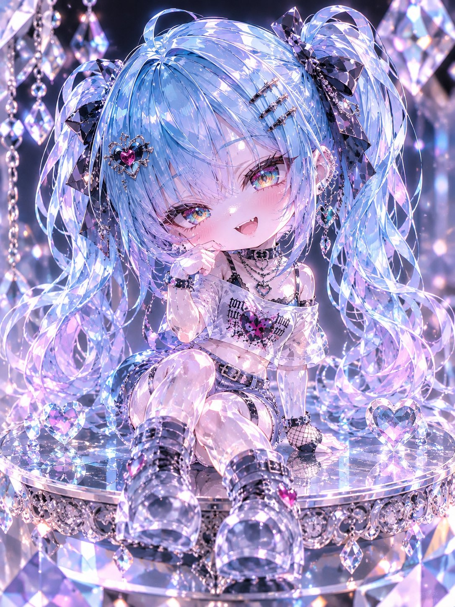
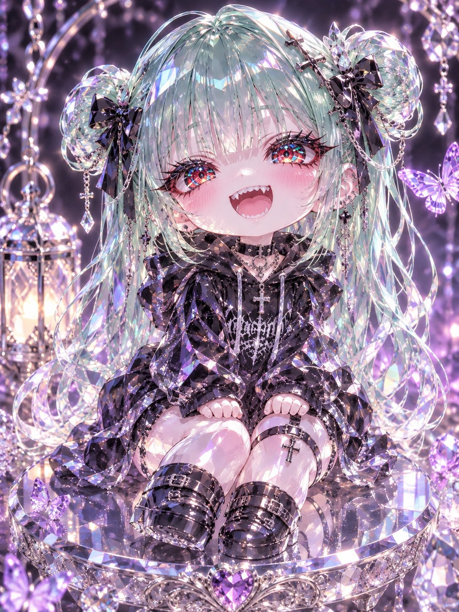
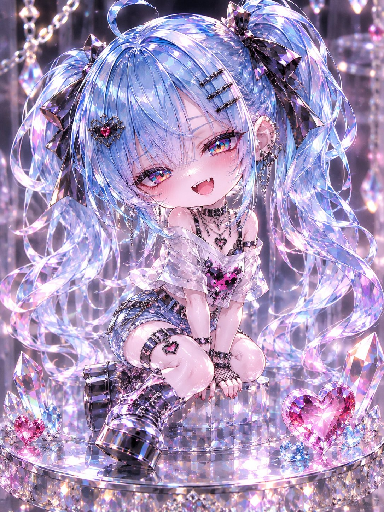
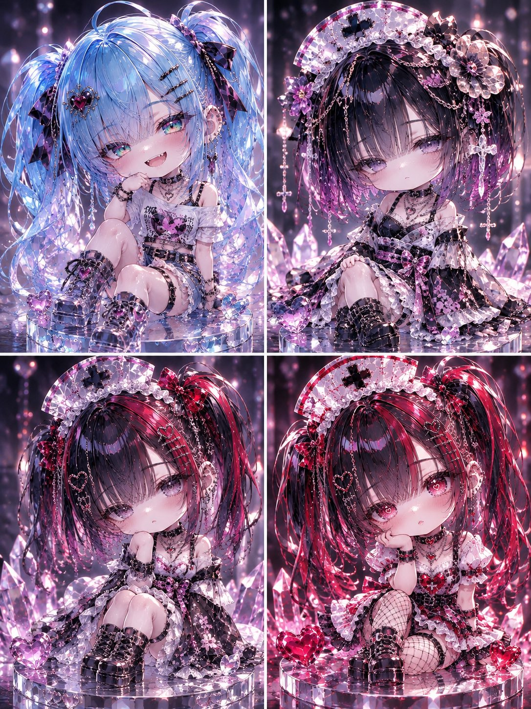

# 把自家角色做成掌上水晶 Q 版人偶（#るんプロンプト 第245弾）

- 原帖链接：https://x.com/ENJU1123PIPI/status/2117949993751281785
- 作者：るんちゃん🦋（@ENJU1123PIPI）
- 时间：2026-11-04 20:00 (UTC+8 / Asia/Taipei)
- 互动摘要：点赞 103 · 转发 28 · 回复 3 · 引用 13 · 书签 14 · 浏览 3199（采集快照：2026-11-05 20:10 UTC+8）
- 模型/工具：未注明（角色参考图驱动的通用生图 prompt）
- 标签：二次元
- 媒体路径：
  - `media/images/2117949993751281785_1.jpg`（）
  - `media/images/2117949993751281785_2.jpg`（）
  - `media/images/2117949993751281785_3.jpg`（）
  - `media/images/2117949993751281785_4.jpg`（）
- 入库日期：2026-11-05
- 备注：prompt 在作者自回复；需附上角色参考图使用。

## prompt 原文

```text
Use the attached character only. Preserve the character’s recognizable face, hairstyle, hair color, eye color, expression, outfit, accessories, body proportions, and overall vibe so they remain instantly identifiable.

Transform the character into an adorable palm-sized crystal chibi doll. Make the proportions super cute: about 2–2.5 heads tall, with an oversized round head, tiny body, short rounded limbs, and soft chubby cheeks.

Render the entire character as translucent crystal, gemstone, and colored glass. Recreate the hair, clothing, and accessories as finely carved crystal details while keeping the original colors and design language. Add beautiful internal refractions, subtle transparency, soft rainbow reflections, sparkling facets, luminous edges, delicate light scattering, and large jewel-like eyes with layered gemstone irises.

Show a single full-body crystal doll sitting gracefully on an elegant mirrored pedestal, surrounded by small gemstones and magical sparkles. Use dreamy pastel lighting, soft backlighting, shallow depth of field, and a luxurious macro-photography feel.

Ultra-detailed, premium collectible quality, brilliant gemstone textures, magical transparency, enchanting fantasy atmosphere, vertical 3:4.

Avoid: ordinary human skin, realistic human anatomy, opaque plastic, cheap toy look, flat 2D illustration, distorted limbs, extra body parts, multiple characters, identity changes, text, logos, and watermarks.
```

---

个人学习归档，非商业。prompt 与媒体版权归原作者 @ENJU1123PIPI，引用请回到原帖。
