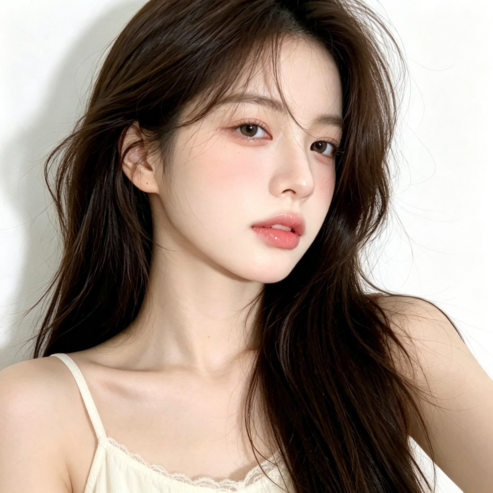

# 韩系清冷奶油白蕾丝吊带近景人像（GPT Image 提示词 45/100）

- 原帖链接：https://x.com/CryY666666/status/2117994338781397496
- 作者：沧瑶（@CryY666666）
- 时间：2026-11-04 22:56 (UTC+8 / Asia/Taipei)
- 互动摘要：点赞 24 · 转发 1 · 回复 8 · 引用 0 · 书签 3 · 浏览 1237（采集快照：2026-11-05 20:10 UTC+8）
- 模型/工具：GPT Image（作者标注）
- 标签：真人
- 媒体路径：
  - `media/images/2117994338781397496_1.jpg`（）
- 入库日期：2026-11-05
- 备注：prompt 即主帖正文，分【整体风格】【人物面容】【发型】【服装】【姿势】【光影】【镜头参数】【负面提示词】八段；写明 23–25 岁成年女性。

## prompt 原文

```text
gpt image prompt 45/100
 gpt image提示词分享

【整体风格】

1:1正方形构图，单幅独立画面，超写实韩系成年女性近距离人像摄影，清冷温柔、自然慵懒的生活写真风格。奶油白背景，柔和明亮的自然光，低饱和暖白色调，真实相机质感。

【人物面容】

一位23至25岁的美丽成年东亚女性，精致小巧的鹅蛋脸，柔和流畅的下颌线，小巧圆润的下巴，清透细腻的冷白肌肤。

深灰棕色杏仁眼，自然双眼皮，细致卧蚕，纤长自然的睫毛，浅粉棕色眼影，柔和微扬的细眼线。

纤细挺直的鼻梁，小巧圆润的鼻尖，双颊带有明显但自然晕染的蜜桃粉色腮红。

柔软饱满的珊瑚玫瑰粉色嘴唇，具有清透水润的玻璃唇光泽，双唇自然微张。

面部神情平静、清冷、略带慵懒感，眼睛直视镜头，保留细腻真实的皮肤微纹理。

【发型——核心】

浓密蓬松的深巧克力棕色长发，带有自然深栗棕色反光。

头顶发根蓬松，采用自然偏分发型，额前几缕轻薄不规则的八字碎发垂落，部分细长发丝自然掠过额头与脸颊。

两侧长发自然披散在肩膀与胸前，整体以柔顺长发为主，发尾具有轻微松散的大弧度波浪。

画面右侧的长发尤其浓密，形成柔和的蓬松发束，保留真实独立发丝、细小飞散碎发和自然光泽。

【服装】

身穿奶油白色细肩带蕾丝吊带上衣。

柔软轻薄的棉质面料，浅弧形领口，领口边缘装饰细腻白色蕾丝花边。

细肩带自然贴合肩膀，露出自然肩颈与锁骨线条。

服装简约、柔软、清新，具有真实布料纹理。

【人物姿势】

人物身体略微侧向镜头约30度，肩膀自然放松。

头部轻轻转向摄影机，下巴略微收起，脸部呈自然三分之四侧脸角度。

眼睛直接凝视镜头，嘴唇微张，表情安静、温柔、略带清冷感。

长发自然垂落在胸前，一侧肩膀略微向镜头靠近。

画面为紧凑的近距离上半身特写，不出现明显手部动作。

【背景与光影】

极简纯白色室内墙壁，具有柔和自然阴影，没有复杂家具和装饰。

明亮柔和的窗边自然光从画面左前方照射，照亮人物额头、鼻梁、脸颊与肩膀。

脸部呈现细腻通透的奶油冷白色高光，蜜桃粉色腮红与水润嘴唇清晰自然。

深巧克力棕色长发具有柔和的栗棕色反光。

整体曝光明亮，柔和对比，真实相机景深，轻微自然柔焦，保留皮肤微纹理和独立发丝。

【镜头参数】

1:1正方形构图，等效50至70mm人像镜头，平视拍摄，近距离头肩特写。

人物面部占据画面主要区域，头顶部分自然裁切，眼睛位于画面中央偏上位置。

背景保持简洁清晰，突出五官、长发和蕾丝吊带的自然质感。

【负面提示词】

动漫，插画，3D渲染，CG假脸，塑料皮肤，过度磨皮，夸张网红脸，异常大眼，过尖下巴，五官错位，眼睛不对称，假发，头发黏连，僵硬卷发，过度整齐的发型，畸形肩膀，身体比例失真，衣服穿模，蕾丝结构错误，过度锐化，强HDR，严重过曝，明显AI生成痕迹，文字，水印，LOGO，拼图。
```

---

个人学习归档，非商业。prompt 与媒体版权归原作者 @CryY666666，引用请回到原帖。
