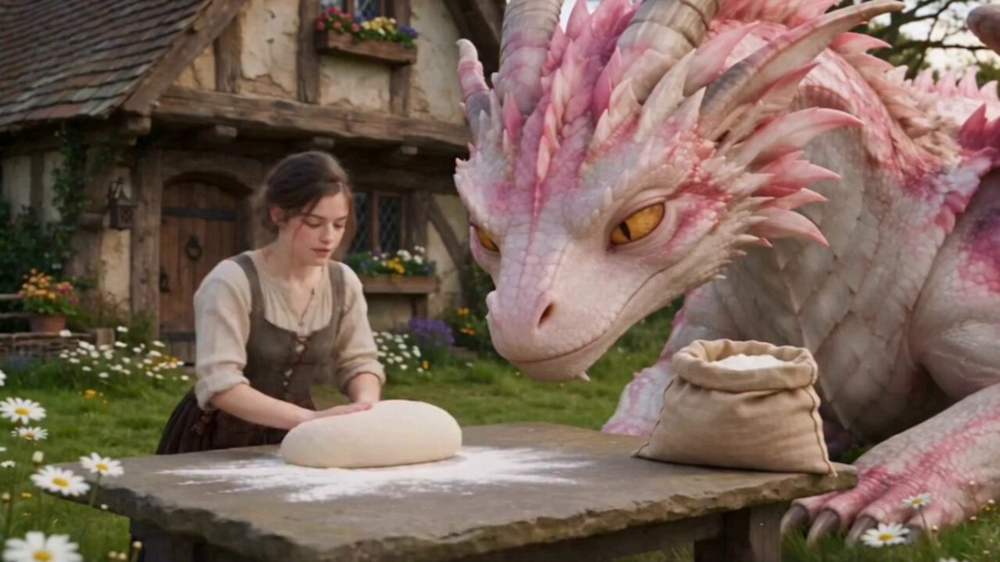
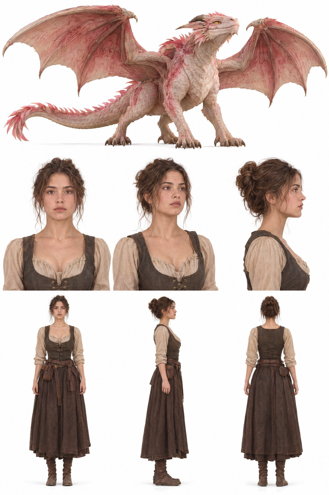

# 与粉龙的日常 Ep 09：中世纪面包坊揉面烤面包（Seedance 2.5）

- 原帖链接：https://x.com/AiWithSaira/status/2118170538539651159
- 作者：Saira（@AiWithSaira）
- 时间：2026-11-05 10:36 (UTC+8 / Asia/Taipei)
- 互动摘要：点赞 77 · 转发 7 · 回复 13 · 引用 0 · 书签 16 · 浏览 2484（采集快照：2026-11-05 20:10 UTC+8）
- 模型/工具：Seedance 2.5
- 标签：其它
- 媒体路径：
  - `media/video-stills/2118170538539651159_1.jpg`（）
  - `media/images/2118170538539651159_2.jpg`（）
  - 视频不入库，只保留原帖链接；上面的 `media/video-stills/` 为视频封面截图。
- 入库日期：2026-11-05
- 备注：prompt 在作者自回复（逐秒分镜 + 一致性/物理/镜头/视觉限制段）；自回复附带的人物与龙设定参考图一并入库。

## prompt 原文

```text
Video Prompt: Photorealistic Hollywood fantasy film, ultra-detailed 35mm cinematic cinematography, premium movie production quality, natural daylight, realistic lighting, soft atmospheric depth, beautiful medieval countryside bakery. A charming young woman with natural facial features, brown hair tied in a loose bun, wearing a simple rustic medieval beige linen blouse and dark brown apron. Beside her is a gigantic adorable pink-and-white fantasy dragon with beautiful golden eyes, delicate white scales, vibrant pink feather-like spines, large expressive ears, powerful pink claws, and elegant wings. The dragon must look like a believable living creature with realistic anatomy, subtle breathing, natural eye movements and expressive facial emotions.

ENVIRONMENT:

A beautiful medieval village bakery with an old rustic wooden cottage, stone walls, wooden roof, flower-covered windows, a traditional outdoor wooden worktable, flour sacks, fresh dough, wooden bowls and a traditional stone bread oven. Peaceful countryside atmosphere with warm natural sunlight. Maintain the exact same woman, dragon, clothing, facial features, dragon colors, anatomy and environment throughout the entire video.

0–4s:
Medium cinematic shot of the young woman standing beside a rustic wooden bakery table, carefully kneading a large piece of fresh white bread dough with both hands. The enormous pink-and-white dragon sits closely beside her, lowering its beautiful head toward the table and curiously watching her hands. The dragon gently moves its head closer, observing the dough with adorable curiosity. Natural character interaction, realistic movements.

4–8s:
Suddenly, the dragon brings its enormous pink claws toward the wooden table, accidentally disturbing a large pile of loose flour. A dramatic cloud of white flour bursts into the air, spreading across the table and partially covering the dragon and the woman. Cinematic wide shot captures the unexpected funny moment with realistic powder physics, floating flour particles and natural reactions.

8–12s:
Extreme close-up of the adorable dragon's face. Its enormous golden eyes blink innocently as it looks directly toward the camera. The dragon slightly tilts its head and gently raises one massive claw near its face. Detailed white and pink scales, expressive golden eyes, subtle nostril movements and realistic creature animation.

12–16s:
Medium-wide shot of the woman laughing and playfully reacting to the flour-covered table. She points toward the dragon with an amused expression, while the dragon lowers its head toward the fresh dough. The dragon gently watches the woman, appearing curious and slightly mischievous. Natural facial expressions and charming comedic interaction.

16–20s:
Close-up of the woman and dragon working together at the wooden bakery table. The woman carefully shapes a smooth round loaf of bread dough while the dragon gently places one enormous pink claw beside it, curiously observing the process. The woman smiles warmly at the dragon. Beautiful detailed hand movements, realistic dough texture and natural interaction.

20–24s:
Cinematic interior close-up of a traditional medieval stone bread oven glowing with warm orange firelight. A perfectly shaped loaf of bread sits inside the oven, gradually turning golden brown. Beautiful realistic flames flicker around the oven, subtle heat distortion and detailed crispy bread texture. Warm cinematic lighting, shallow depth of field.

24–27s:
Beautiful cinematic close-up of freshly baked golden bread resting on a rustic wooden table. The crust is beautifully browned and crispy, with a soft, detailed interior visible as the loaf is gently sliced. Warm sunset lighting creates an inviting medieval bakery atmosphere.

27–29s:
Heartwarming cinematic final wide shot outside the medieval cottage. The young woman sits beside the enormous pink-and-white dragon, lovingly holding a freshly baked loaf of bread. The dragon gently lowers its enormous head beside her and affectionately nuzzles her shoulder. Both appear happy and peaceful. Golden sunset light, beautiful countryside background, magical atmosphere and an emotionally satisfying final frame.

ADDITIONAL PRODUCTION INSTRUCTIONS:

Maintain absolute character consistency across every shot. The woman must retain identical facial features, hairstyle, outfit and body proportions. The dragon must retain identical pink-and-white anatomy, golden eyes, scales, pink spines, wings and claws.

Use physically accurate flour particle simulation, realistic dough deformation, natural hand movements, detailed bread baking, authentic fire physics and believable dragon facial expressions.

Use professional cinematic camera language: medium shots, wide establishing shots, extreme close-ups, shallow depth of field, smooth camera transitions and carefully composed framing.

The overall storytelling should feel like a high-budget Hollywood fantasy movie mixed with adorable creature comedy and heartwarming friendship.

VISUAL RESTRICTIONS:
No cartoon style, no animation-like appearance, no additional characters, no character duplication, no inconsistent dragon anatomy, no changing outfits, no modern objects, no text, no subtitles, no logos, no watermarks, no artificial facial expressions, no distorted hands or extra limbs. Photorealism and cinematic continuity are essential.
```

---

个人学习归档，非商业。prompt 与媒体版权归原作者 @AiWithSaira，引用请回到原帖。
