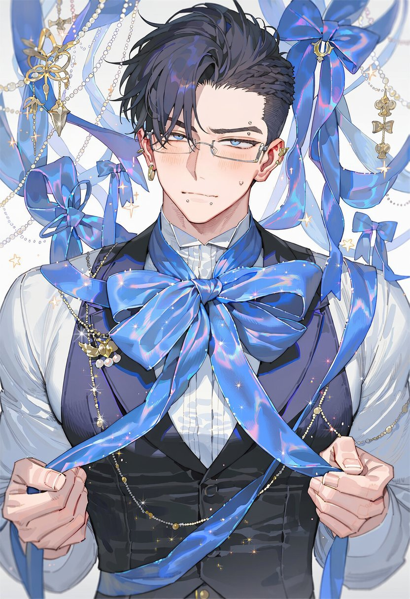
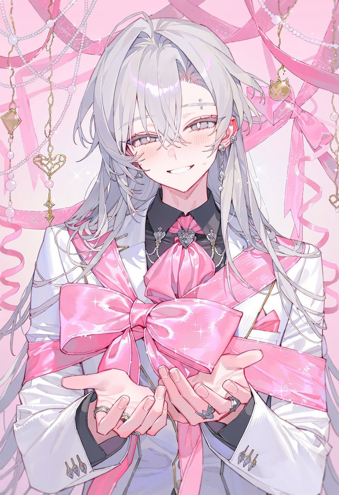
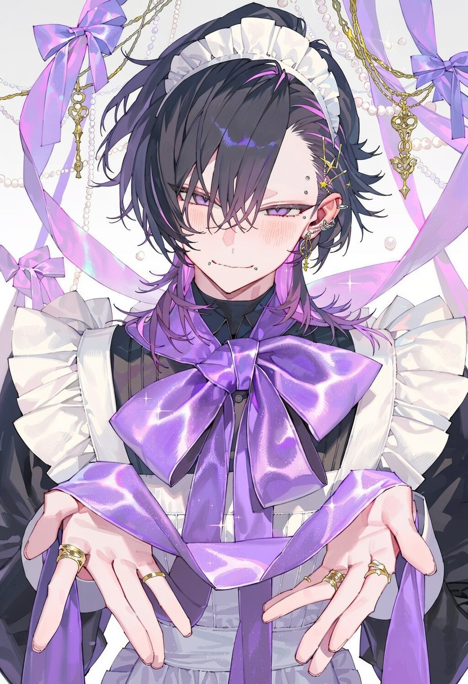
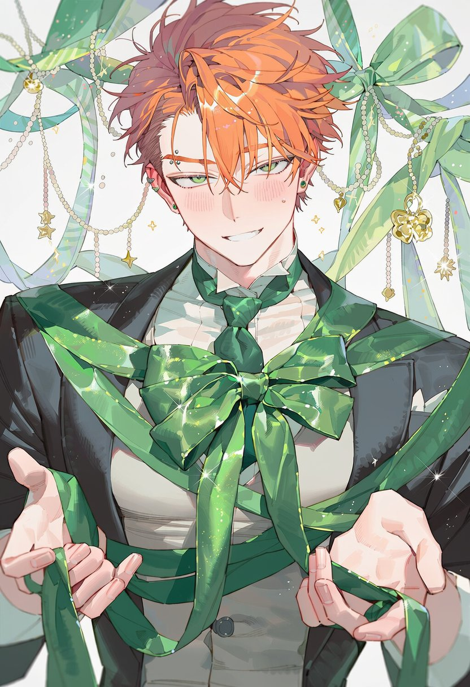
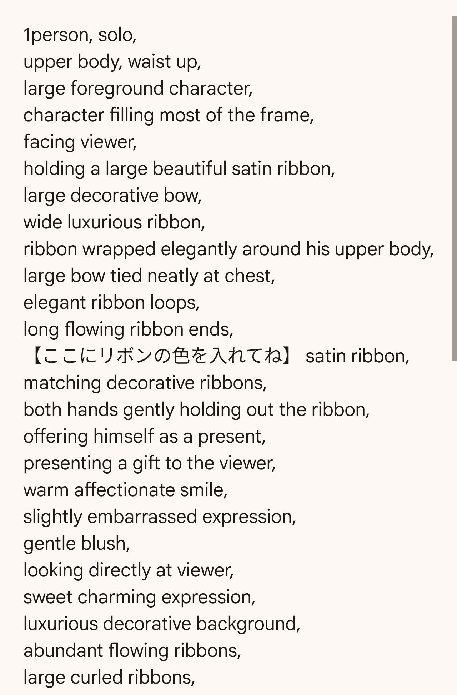
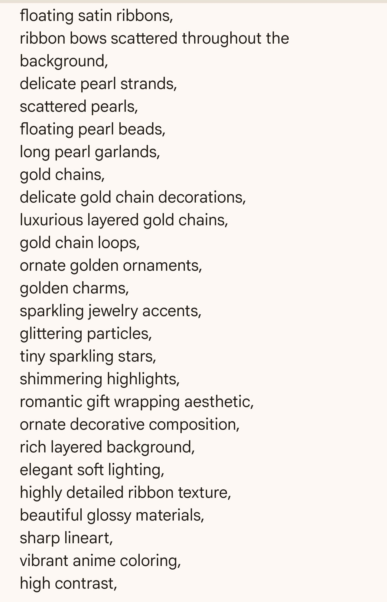

# 「俺がプレゼントだ」：缎带缠身把自己当礼物（tag 式 prompt）

- 原帖链接：https://x.com/shiyuhu_tadano/status/2118209578487947375
- 作者：只野しふゆ（@shiyuhu_tadano）
- 时间：2026-11-05 13:11 (UTC+8 / Asia/Taipei)
- 互动摘要：点赞 34 · 转发 12 · 回复 1 · 引用 4 · 书签 16 · 浏览 980（采集快照：2026-11-05 20:10 UTC+8）
- 模型/工具：NovelAI / TSUBAKI3 / ChatGPT（作者注明）
- 标签：二次元
- 媒体路径：
  - `media/images/2118209578487947375_1.jpg`（）
  - `media/images/2118209578487947375_2.jpg`（）
  - `media/images/2118209578487947375_3.jpg`（）
  - `media/images/2118209578487947375_4.jpg`（）
  - `media/images/2118209578487947375_5.jpg`（）
  - `media/images/2118209578487947375_6.jpg`（）
- 入库日期：2026-11-05
- 备注：prompt 以两张图片形式发在作者自回复（https://x.com/shiyuhu_tadano/status/2118209591544820161），此处按图片逐行转录，原图也一并入库（_5、_6）以便核对；【】处按作者说明填入喜欢的缎带颜色。ChatGPT 用法：贴角色图 + prompt 图并说明缎带颜色。

## prompt 原文

```text
1person, solo,
upper body, waist up,
large foreground character,
character filling most of the frame,
facing viewer,
holding a large beautiful satin ribbon,
large decorative bow,
wide luxurious ribbon,
ribbon wrapped elegantly around his upper body,
large bow tied neatly at chest,
elegant ribbon loops,
long flowing ribbon ends,
【ここにリボンの色を入れてね】 satin ribbon,
matching decorative ribbons,
both hands gently holding out the ribbon,
offering himself as a present,
presenting a gift to the viewer,
warm affectionate smile,
slightly embarrassed expression,
gentle blush,
looking directly at viewer,
sweet charming expression,
luxurious decorative background,
abundant flowing ribbons,
large curled ribbons,
floating satin ribbons,
ribbon bows scattered throughout the background,
delicate pearl strands,
scattered pearls,
floating pearl beads,
long pearl garlands,
gold chains,
delicate gold chain decorations,
luxurious layered gold chains,
gold chain loops,
ornate golden ornaments,
golden charms,
sparkling jewelry accents,
glittering particles,
tiny sparkling stars,
shimmering highlights,
romantic gift wrapping aesthetic,
ornate decorative composition,
rich layered background,
elegant soft lighting,
highly detailed ribbon texture,
beautiful glossy materials,
sharp lineart,
vibrant anime coloring,
high contrast,
```

---

个人学习归档，非商业。prompt 与媒体版权归原作者 @shiyuhu_tadano，引用请回到原帖。
