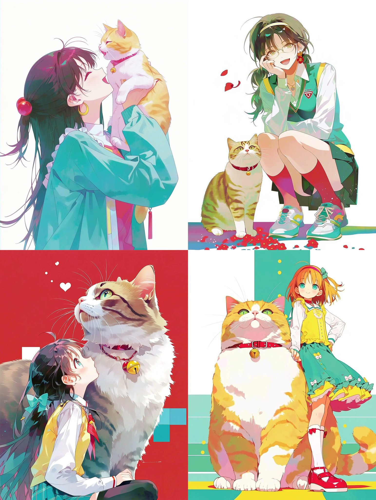

# niji 7 三重 sref 组合：多彩人物与猫插画

- 原帖链接：https://x.com/yumesyokunin/status/2118282187300549092
- 作者：夢職人（@yumesyokunin）
- 时间：2026-11-05 18:00 (UTC+8 / Asia/Taipei)
- 互动摘要：点赞 45 · 转发 5 · 回复 0 · 引用 0 · 书签 1 · 浏览 575（采集快照：2026-11-05 20:10 UTC+8）
- 模型/工具：Midjourney niji 7（nijijourney）
- 标签：二次元
- 媒体路径：
  - `media/images/2118282187300549092_1.jpg`（）
- 入库日期：2026-11-05
- 备注：prompt 只有参数串（3 个 sref 码 + --niji 7），主帖无文字描述。

## prompt 原文

```text
--sref 42560432 2636926059 1100058022 --niji 7
```

---

个人学习归档，非商业。prompt 与媒体版权归原作者 @yumesyokunin，引用请回到原帖。
