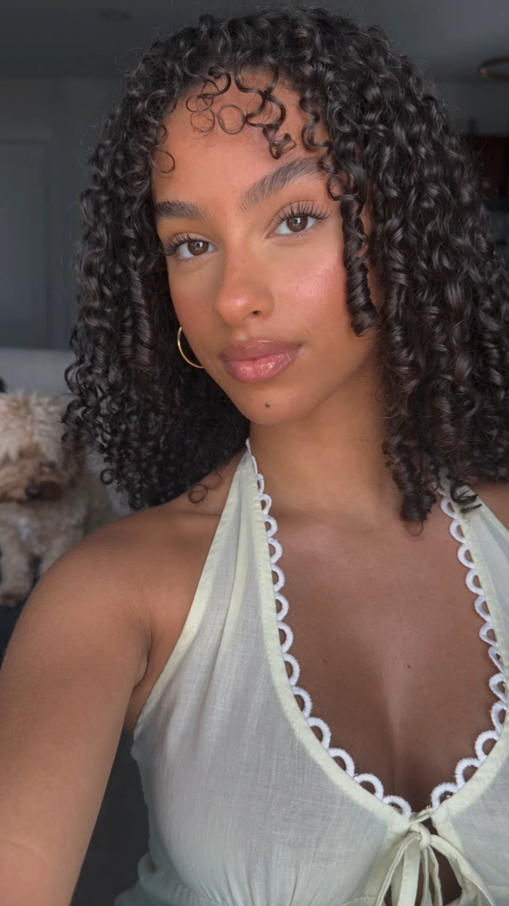

# Seedance 2.5 角色一致性 JSON 自拍 prompt（完整结构）

- 原帖链接：https://x.com/DavidRunsAds/status/2118089803866534118
- 作者：David（@DavidRunsAds）
- 时间：2026-11-05 05:15 (UTC+8 / Asia/Hong_Kong)
- 互动摘要：点赞 161 · 转发 5 · 回复 9 · 引用 2 · 书签 252 · 浏览 10790（采集快照：2026-11-06 20:10 UTC+8）
- 模型/工具：Seedance 2.5
- 标签：真人
- 媒体路径：
  - `media/images/2118089803866534118_1.jpg`（）
- 入库日期：2026-11-06
- 备注：主帖含完整 JSON prompt；方法说明见其引用帖。主体为 young adult。JSON 内含肤色十六进制等细节，原样保留。

## prompt 原文

```text
this Seedance 2.5 character method is STUPIDLY good.

(the full method is explained in the quoted post)

here’s the exact JSON prompt behind this one:

{
  "output": {
    "aspect_ratio": "9:16",
    "style": "Photorealistic vertical indoor front-facing selfie.",
    "image_quality_tier": "Clear face, lightly softened skin texture, mild video compression and softer background.",
    "master_description": "A young adult woman of mixed West African and Latin American appearance has warm light-medium caramel skin in a brightly lit selfie. Her tapered oval face has full cheeks, a narrow rounded chin, dark almond eyes, long curled lashes, shaped brows, a small straight nose with rounded tip, full glossy rose-pink lips and a tiny mark below the lip. Dense near-black rope curls reach her shoulders beneath fine swooped baby hairs. One large thin gold hoop hangs at the viewer's right ear. She wears a pale mint-ivory halter with white scalloped lace edging its deep V and a front tie. Her arm at the viewer's right extends toward the camera. A cream dog and dark chairs sit behind her in a dim gray room."
  },
  "subject": {
    "overview": "Young adult woman, visually early twenties, feminine presentation. She fills the vertical frame, face near center and looking into the lens. Warm light-medium caramel complexion, peachier on face than neck and arms. Medium frame, rounded shoulders, average upper-arm fullness and fuller bust relative to visible torso. Upper body only.",
    "apparent_ethnicity": "Mixed West African and Latin American appearance as a visual impression: caramel-brown skin, dark curls, almond eyes, full lips and rounded nose tip.",
    "skin_color": "Light-medium caramel-brown with warm golden-peach undertones. Approximate display colors: forehead #E4A790, cheek #D18E7B, nose #EBAC96, arm #D0957C. Face is lighter and pinker than arm; neck is shaded. Values include frontal light and processing.",
    "distinctive_traits": [
      "Warm light-medium caramel skin, peach-golden in frontal light.",
      "Soft oval face, full cheeks and narrow rounded chin.",
      "Dark almond eyes looking into the lens.",
      "Long curled upper lashes.",
      "Dark groomed brows with gentle arches.",
      "Small straight-bridged nose with rounded tip.",
      "Full rose-pink lips, fuller lower lip and gloss.",
      "Dense near-black rope curls with shoulder-level ends.",
      "Fine curved baby-hair swoops at the forehead.",
      "One large thin gold hoop at viewer's right ear.",
      "Pale mint-ivory lace-trim halter top with front tie."
    ],
    "body": "Medium frame, rounded shoulders and moderate upper-arm fullness, without sharp muscle definition. Shoulders span about twice head width. Neck is long and narrow with visible collarbones. The arm on the viewer's right is enlarged by lens proximity. Bust is fuller than upper ribcage and supported by the top; only upper contours show. Lower torso is cropped.",
    "hands": "Hands are outside the frame; no fingers or nails are visible.",
    "body_skin": "Neck, upper chest, shoulders and arms are warm caramel-brown with satin highlights. Tiny dark speck on outer viewer's right upper arm. No visible tattoos, scars or prominent veins."
  },
  "face": {
    "structure": "Oval face tapering downward. Widest across upper cheeks; moderately broad curved forehead; softly full cheeks, not hollow. Jaw narrows gradually with a soft angle. Chin is narrow, rounded and not pointed. Cheekbones form a gentle contour.",
    "proportions": "Face length is about 1.6 times cheek width. Forehead and upper cheeks are similar in width; jaw is narrower. Lower face third is slightly shorter. Eyes sit just above midpoint; nose centered between eyes and mouth. Mouth is about 1.4 times nose-base width. Nearly frontal face with mild selfie perspective.",
    "asymmetry": "Viewer's right eye is slightly more open; curl partly interrupts the viewer's left outer eye and cheek edge. Viewer's left brow sits slightly higher. Viewer's right cheek is more exposed. Mouth corners are subtly uneven, the viewer's left corner marginally higher. Nose has no strong deviation.",
    "eyes": "Dark brown almond eyes, horizontally elongated and medium-sized. Outer corners rise slightly, about 2 to 4 degrees; inner corners softly pointed. Natural spacing, about one eye-width between inner corners. Shallow upper-lid crease. Eye on the viewer's right is slightly rounder and more open. Deep brown irises, round pupils, warm off-white sclera and small frontal catchlights. Upper lashes are long, dark, curled and dense with separated tips; lower lashes short and sparse. Mild under-eye shadow, no pronounced bags. Subtle warm lid shading and fine upper-lash definition.",
    "eyebrows": "Dark brown to near-black, medium-thick and groomed. Fuller softly squared inner ends, low smooth arch at outer third and tapered tails. Hairs are blended, not a solid block. Brows sit close to eyes; viewer's left arch is slightly higher, brow on the viewer's right flatter and longer. Color matches hair.",
    "nose": "Small-to-medium nose with straight narrow bridge and softly rounded tip. Narrow highlight along bridge. Moderate rounded alar base, near the distance between inner eye corners. Small dark nostrils, viewer's left more shaded. Mild tip highlight and warm shadow below. No piercing.",
    "lips_and_mouth": "Closed relaxed mouth with mild composed pout, no smile. Full lips; lower lip is rounder and about 1.3 times upper-lip volume. Soft cupid's bow, muted rose-brown edge and pink-rose gloss. Bright glints at lower-lip center and smaller upper lip. Short-to-medium philtrum; corners nearly level with slight asymmetry. No teeth.",
    "ears": "Viewer's right ear partly visible between cheek and curls; lobe carries the hoop, upper ear is covered. Viewer's left ear is concealed. Do not add or mirror a second earring.",
    "expression_and_gaze": "Calm, mildly posed expression. Brows neutral, lids naturally open, cheeks relaxed and lips together with slight forward tension. No teeth or open mouth. Gaze straight into the lens."
  },
  "skin": {
    "texture_by_zone": "Forehead smooth with soft central sheen; temples mostly hidden. Under-eyes softly shadowed. Nose has the brightest bridge and tip highlight. Cheeks are smooth with faint texture and peach-pink blush. Around mouth even; chin smooth with tiny mark; jaw softly shaded. Neck has faint folds at base. Chest, shoulders and arms have satin highlights. Light camera smoothing remains visible.",
    "tone_shifts_by_zone": "Forehead and nose are lightest and peachiest (#E4A790 to #EBAC96); cheek is warm peach-brown (#D18E7B). Opposite cheek darkens at hair. Neck and chest are warmer and darker; upper arm is muted caramel (#D0957C). Frontal light lifts face and shoulders; cool room light neutralizes edges. Keep base complexion unchanged.",
    "marks": "Tiny dark beauty mark below lower lip, slightly viewer's right. Separate tiny brown speck on outer viewer's right upper arm. No clear freckles, acne clusters, scars, tattoos or large patches.",
    "shine": "Medium shine on forehead and nose; low-to-medium on cheeks, neck and arms. Nose has a small bright reflection; cheek highlights are soft, not oily. Lips have high gloss.",
    "makeup": "Light base, warm peach-rose blush high on cheeks, subtle neutral lid shading, fine upper-lash definition, groomed brows, long curled upper lashes, small nose highlight and rose-pink gloss. No heavy contour."
  },
  "hair": {
    "style_and_length": "Very full dark twisted curls made of narrow rope-like sections and corkscrew ends. Dense rounded volume at temples and sides. Length reaches shoulders and upper chest with ends at varied heights. Crown is slightly raised into a small loose tuft at top-back.",
    "parting_and_hairline": "No broad exposed part. Hair is directed back with a small concealed central division. Curved, softly irregular hairline; fine baby hairs form swoops across central forehead and shorter curves at temples. Little scalp shows.",
    "color": "Near-black dark brown (#261F21), with espresso ridges (#3C3234); frontal light makes some ridges look brown-gray.",
    "texture_and_finish": "Compact springy twists with irregular spiral sections, mostly pencil-width or narrower. Raised ridges reflect light; gaps stay dark. Dry-to-satin, dense, little visible frizz.",
    "loose_strands": "Fine laid curves at forehead, short curled temple wisps and separate twist tips around shoulders. One narrow curl falls beside viewer's left cheek. Keep irregular ends.",
    "placement": "Viewer's left curtain falls past jaw toward shoulder, hiding ear and cheek edge. Viewer's right bulk spreads beside cheek and over shoulder, partly hiding chair. Visible ear and hoop sit in a gap; hair overlaps top straps.",
    "facial_hair": "No facial hair."
  },
  "pose": {
    "head": "Head tilted about 3 to 5 degrees toward viewer's right. Face nearly frontal, turned 3 to 6 degrees toward viewer's left. Chin near level with slight downward angle.",
    "torso_and_shoulders": "Torso mostly faces camera, subtly turned viewer's left. Shoulder line slopes down toward viewer's right by 3 to 5 degrees. Shoulder on the viewer's right is closer and larger. Shoulders relaxed and rounded; collarbones visible. Upper torso leans slightly forward.",
    "arms": "Viewer's right upper arm descends diagonally from the shoulder on the viewer's right toward lower edge on the viewer's right, enlarged by proximity. It continues forward beyond crop; forearm and hand are outside frame holding camera. Viewer's left arm is mostly hidden, with a small section at the lower viewer's left.",
    "hands_and_fingers": "No hands or fingers visible. Camera-holding hand stays outside frame; do not show a device.",
    "body_language": "Relaxed deliberate selfie pose, angled shoulders and face toward lens; composed rather than animated."
  },
  "clothing": [
    {
      "garment": "Pale mint-ivory sleeveless halter top, fitted over bust and upper torso. Very pale green with cream cast, not pure white; deep plunging V exposes upper chest.",
      "fabric": "Light stretch knit with fine ribbing, mostly matte with soft sheen on folds; opaque and without visible print.",
      "construction": "Wide halter straps pass behind neck, leaving shoulders bare. White scalloped lace edges the deep V. A small center-front fabric knot has two long narrow tie ends. Curved seams outline bust cups; a horizontal under-bust seam crosses torso.",
      "fit_on_body": "Close fit follows upper torso and bust. Deep V tapers to center tie; lace has fuzzy scallops. Small creases gather at under-bust and lower torso. Viewer's strap on the viewer's right is broad and clear, one on the viewer's left rises diagonally."
    }
  ],
  "accessories_and_objects": [
    {
      "item": "One large thin gold-tone hoop earring at the viewer's right ear.",
      "details": "Thin polished gold-tone hoop, about 5 to 6 cm across, with bright pale-gold and warmer yellow reflections. No stones.",
      "placement": "At viewer's right earlobe in a gap between jaw and hair; lower curve reaches upper-neck level. Ear on the viewer's left is hidden."
    },
    {
      "item": "Fine gold-tone necklace with a small pendant.",
      "details": "Very fine gold chain with a tiny bead-like glint and small curled openwork pendant; no lettering.",
      "placement": "Rests across collarbone and upper chest; small pendant hangs near upper sternum, slightly viewer's left."
    },
    {
      "item": "Small dog in the background.",
      "details": "Small fluffy cream-white dog, beige around head and ears, with dark eyes and nose. Standing on all four paws, facing camera, softly blurred.",
      "placement": "Rear, viewer's right, around 68 to 80 percent frame height, partly behind foreground arm and below chair legs."
    }
  ],
  "environment": {
    "location": "Dim indoor residential dining area with gray-green walls, gray ceiling and pale-gray floor.",
    "objects_by_position": "Gray ceiling with diagonal junction at upper viewer's left. Viewer's left: dark vertical cabinet-like panel, dim ledge with a small reddish-brown object and lower panel edge. Viewer's right: pale-top table and dark rounded-back chairs with slim wooden legs, partly hidden by hair. Plain gray wall has a brighter low patch. Small cream dog stands on pale-gray floor; darker baseboard along wall.",
    "depth_and_blur": "Subject is close and clear; furniture and dog are several feet behind and soft, especially the dog.",
    "edges_and_corners": "Top: gray ceiling; upper viewer's left diagonal ceiling plane, upper viewer's right plain wall. Viewer's left: dark cabinet and reddish object; viewer's right: dining furniture. Bottom crops torso; arm on the viewer's right exits lower viewer's right. Dog and floor remain at the lower viewer's right."
  },
  "lighting": {
    "sources": "Strong frontal light near camera, slightly viewer's left and above eye level (11 to 12 o'clock), like a selfie light. Glossy highlights and soft shadows; dim cool ambient room light.",
    "on_face": "Forehead, nose, upper cheeks and lip center are brightest. Soft shadows under nose, lip, chin and jaw. Hair shades viewer's left temple and cheek; small frontal catchlights.",
    "on_hair_clothing_background": "Curl ridges reflect light; gaps stay near-black. Top approaches ivory in bright folds; arm on the viewer's right is warm-lit. Walls are cool and dim, brighter on the viewer's right; chair and cabinet lose detail in shadow.",
    "color_temperature": "Foreground is neutral-warm, about 4300 to 5000 K; room ambient is cooler gray-green. Skin shifts peach, walls blue-gray, jewelry gold.",
    "exposure": "Face is bright but detailed; nose and lip highlights do not clearly clip. Top approaches white; background shadows are dense."
  },
  "camera": {
    "type_and_lens": "Handheld front-facing selfie camera, small sensor, moderately wide field about 24 to 28 mm equivalent. Camera not visible.",
    "position_and_angle": "Arm's-length distance, roughly 45 to 65 cm. Lens slightly above eye level, angled down slightly; vertical framing, nearly level roll.",
    "perspective": "Mild wide selfie perspective enlarges nose, lips and central face; near shoulder on the viewer's right and arm also enlarge. Background furniture appears smaller.",
    "focus_and_depth": "Face and front hair in focus; near arm softer; dog and furniture blur with distance.",
    "processing": "Compressed selfie-video still with mild facial smoothing, soft background and slight dark-area noise."
  },
  "composition": {
    "framing": "Vertical 9:16 close-medium selfie from crown to upper torso; lower torso cropped. Hair nearly spans width; face upper-center, near arm diagonal at viewer's right.",
    "positions_percent": "Crown 12 to 13 percent from top; eyes 29 to 31 percent down. Face center 44 percent left and 34 percent top; nose 44/36, mouth 44/41, chin 44/47. Shoulder on the viewer's right at 60/56; dog near 88/72.",
    "crop_lines": "Small headroom. Both shoulders partly visible. Arm on the viewer's left is cut at viewer-left and bottom; arm on the viewer's right exits lower viewer's right. Hands and lower body out of frame; crown not clipped.",
    "layers": "Foreground: face, hair, neck, halter and near arm. Behind: furniture, gray wall, cabinet, floor and dog.",
    "hierarchy": "Face and gaze first, then dark curls, glossy lips and hoop. Pale top brightens lower frame; dog and furniture are secondary."
  },
  "color": {
    "palette_with_hex": "Hair #261F21, curls #3C3234, forehead #E4A790, cheek #D18E7B, nose #EBAC96, arm #D0957C, lips #B67D69, top #E1E0D6/#C9CBC6, wall #4E5556/#7F8184, chair #322F37, wood #453B2C, gold jewelry.",
    "white_balance": "Cool gray-green room contrasts with peach skin and ivory-mint top; gold accents remain warm.",
    "contrast_and_saturation": "Medium contrast, stronger in hair and eyes, softer on skin. Warm moderately saturated skin; low-saturation gray room and pale top.",
    "look": "Natural selfie color, bright frontal light, warm skin against cool-gray surroundings."
  },
  "realism_cues": [
    "Tiny beauty mark below lower lip, viewer's right.",
    "Small speck on outer viewer's right upper arm.",
    "Unequal eye openness and uneven brow heights.",
    "Viewer's left cheek edge partly hidden by a dangling curl.",
    "Fine curved baby-hair swoops across forehead.",
    "Irregular twist widths, spiral tips and dark gaps.",
    "Single gold hoop at viewer's right ear.",
    "Bright nose-tip reflection and lip-gloss glints.",
    "Face peachier than the deeper caramel arm and neck.",
    "Near arm enlarged by perspective; dog blurred behind it."
  ],
  "negative_constraints": [
    "No text, captions, logos, UI, icons, borders or watermarks.",
    "No extra people; keep one small cream dog in the rear, viewer's right.",
    "No duplicated accessories; one gold hoop at viewer's right and one fine necklace.",
    "No phone or camera body; camera and holding hand stay outside crop.",
    "No generic face, altered proportions, symmetry correction or beautification.",
    "Do not lighten or even skin; keep caramel tone and face-to-arm difference. No plastic, waxy or airbrushed skin.",
    "No straight hair, uniform curls, different hair color or missing baby hairs.",
    "No open smile or teeth; lips stay closed and gaze on lens.",
    "No different top or room; keep pale lace-trim halter and gray dining background.",
    "No heavy HDR, fake bokeh, oversharpening, strong color grade or lens flare.",
    "No distorted anatomy, extra fingers, visible hand or stretched shoulder."
  ]
}
```

---

个人学习归档，非商业。prompt 与媒体版权归原作者 @DavidRunsAds，引用请回到原帖。
