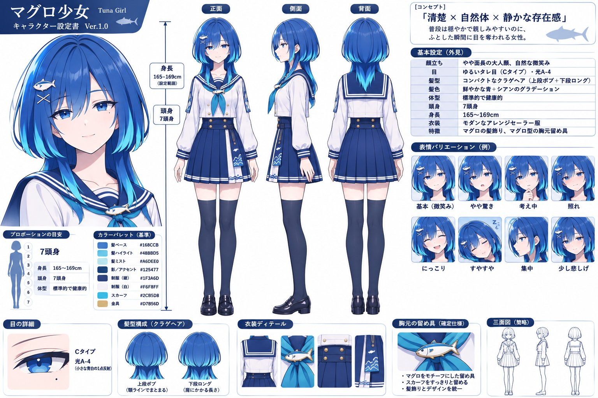
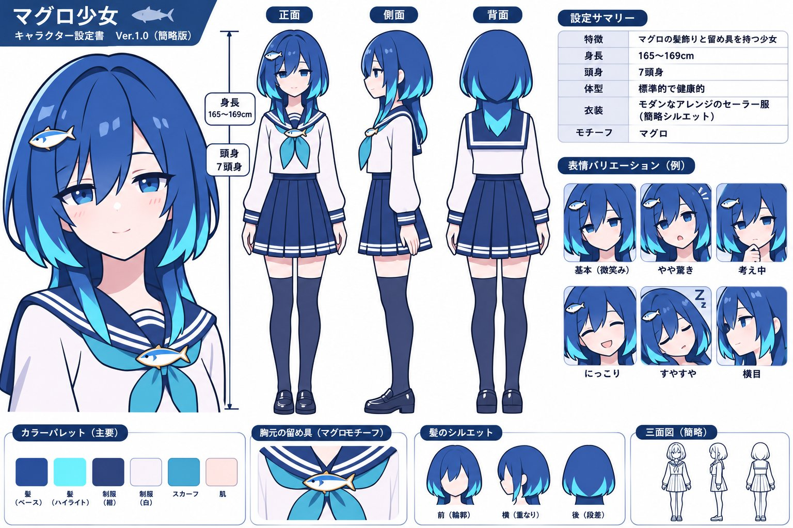

# 图标风角色：大色块头发少画发丝（Before/After + prompt）

- 原帖链接：https://x.com/moltikuji/status/2118154925654131146
- 作者：もる@ポケカ・フロム（@moltikuji）
- 时间：2026-11-05 09:34 (UTC+8 / Asia/Taipei)
- 互动摘要：点赞 1044 · 转发 67 · 回复 5 · 引用 13 · 书签 1347 · 浏览 53077（采集快照：2026-11-06 09:00 UTC+8）
- 模型/工具：未注明（作者讨论 GPT / Stable Diffusion 通用）
- 标签：二次元
- 媒体路径：
  - `media/images/2118154925654131146_1.jpg`（）
  - `media/images/2118154925654131146_2.jpg`（）
- 入库日期：2026-11-06
- 备注：正文还强调「髪は少数の大きな色面で構成し、細かな毛束や髪の線は極力描かない。」对 GPT/SD 图标风去发丝杂乱很有效。

## prompt 原文

```text
# 顔のパーツ・表情
* 元のキャラクターの目の色や形、特徴的な表情を維持する。
* 顔のパーツは適度に簡略化し、目は太めの黒い線とシンプルな色面で表現する。
* 口はできるだけ簡素に描き、鼻は省略してもよい。
頬にはピンク色のチークをラフに少し加える。
* 元のキャラクターらしい表情や雰囲気を保ち、性格や印象が変わるような表情の改変はしない。

# 髪型・服装
* 元のキャラクターを識別するうえで重要な髪型と髪色を忠実に再現する。
* 髪は少数の大きな色面で構成し、細かな毛束や髪の線は極力描かない。
* 服装は元の配色やシルエット、特徴的なアクセサリーを維持する。
* 服のシワや装飾は大胆に簡略化し、必要最小限の線と色面で表現する。
* 服装を独自に変更したり、元のイラストにないアクセサリーを追加したりしない。
```

---

个人学习归档，非商业。prompt 与媒体版权归原作者 @moltikuji，引用请回到原帖。
