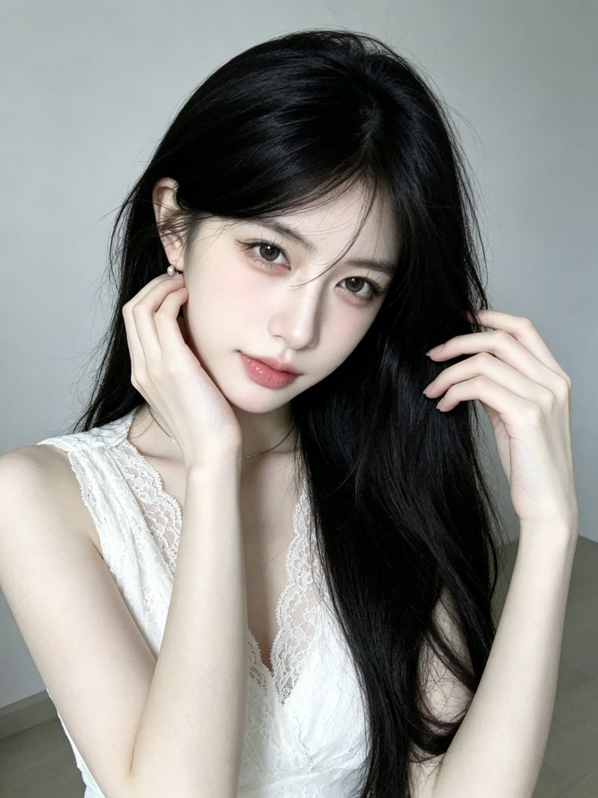

# 奶油白蕾丝 V 领半身人像（GPT Image 提示词 48/100）

- 原帖链接：https://x.com/CryY666666/status/2118175184276648004
- 作者：沧瑶（@CryY666666）
- 时间：2026-11-05 10:54 (UTC+8 / Asia/Hong_Kong)
- 互动摘要：点赞 67 · 转发 2 · 回复 8 · 引用 0 · 书签 15 · 浏览 1819（采集快照：2026-11-06 20:10 UTC+8）
- 模型/工具：GPT Image（作者标注）
- 标签：真人
- 媒体路径：
  - `media/images/2118175184276648004_1.jpg`（）
- 入库日期：2026-11-06
- 备注：prompt 写明「23至25岁的美丽成年东亚女性」。

## prompt 原文

```text
Gpt image prompt 48/100
gpt image 提示词分享
【整体风格】

3:4竖版，单幅独立画面，超写实韩系成年女性室内人像摄影，清冷温柔气质，低饱和冷灰白色调，柔和自然窗光，轻微自然柔焦，真实手机摄影质感。

【人物面容】

一位23至25岁的美丽成年东亚女性，精致小巧的鹅蛋脸，柔和收窄的下颌线，小巧圆润的下巴，清透细腻的冷白瓷肌，淡淡蜜桃粉色腮红。

明亮清澈的灰棕色杏仁眼，自然双眼皮，细致卧蚕，纤长自然的睫毛，浅粉棕色眼影，微微上扬的细眼线。

纤细挺直的鼻梁，小巧鼻尖，柔软饱满的玫瑰豆沙粉色水润嘴唇。

头部轻轻向下倾斜，眼睛微微抬起直视镜头，神情清冷、温柔、略带慵懒感，保留真实皮肤微纹理。

【发型——核心】

极其浓密柔顺的乌黑色及腰长发，带有自然深黑茶色光泽。

自然偏分发型，头顶蓬松，额前几缕细长碎发自然垂落，部分发丝轻轻掠过眉毛与脸颊。

画面左侧头发自然向耳后收拢，露出耳朵和小巧珍珠耳钉。

画面右侧大量乌黑长发自然披散在肩膀和胸前，整体以柔顺直发为主，发尾带有轻微自然弧度。

保留真实独立发丝、自然发束层次和轻微凌乱感，避免假发质感。

【服装与首饰】

身穿奶油白色蕾丝V领上衣，宽肩带设计，领口采用精致细腻的白色花卉蕾丝边缘。

柔软棉质面料搭配不透明内衬，具有真实织物纹理与自然褶皱。

颈部佩戴极细银色锁骨链，一侧耳朵佩戴小巧白色珍珠耳钉。

【人物姿势】

人物坐在简洁室内，身体轻微侧向镜头，上半身自然挺直。

头部稍稍向画面左侧倾斜，下巴微收，双眼直视镜头。

画面左侧的一只手自然抬起，指尖轻轻触碰耳垂与脸颊侧面，手指柔和弯曲。

另一只手抬至头发旁边，轻轻握住一束乌黑长发。

肩膀自然放松，双手姿势优雅松弛，手指结构真实。

【背景与光影】

极简浅灰白色室内空间，干净的浅灰色墙壁与少量浅色地面，背景没有复杂家具。

柔和冷白色自然窗光从画面左前方照射，均匀照亮人物脸部、肩膀和手臂。

肌肤呈现清透冷白色，鼻梁与脸颊具有细腻自然高光。

乌黑长发具有柔和深棕色反光，背景保持低饱和冷灰白色调。

【镜头与画质】

3:4竖版，等效50mm人像镜头，平视略微俯拍，近距离头部至腰部的半身构图。

人物位于画面中央偏左，乌黑长发自然垂落至画面下方。

真实摄影景深，细腻皮肤纹理，真实独立发丝，柔和自然曝光，轻微相机颗粒。

无明显AI生成质感，无文字、无水印、无LOGO、无拼图。

【负面提示词】

动漫，插画，3D渲染，CG假脸，塑料皮肤，过度磨皮，夸张网红脸，异常大眼，过尖下巴，五官错位，假发，头发黏连，僵硬发丝，多余手指，畸形手掌，手腕扭曲，身体比例异常，蕾丝纹理错误，衣服穿模，强HDR，过度锐化，严重过曝，明显AI感，文字，水印，LOGO，拼图。
```

---

个人学习归档，非商业。prompt 与媒体版权归原作者 @CryY666666，引用请回到原帖。
