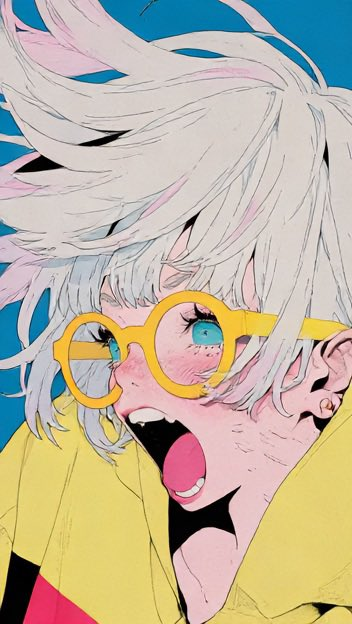
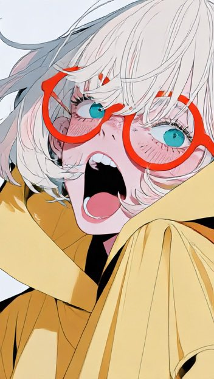
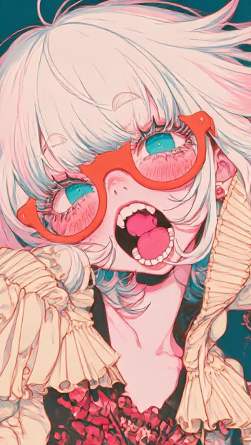
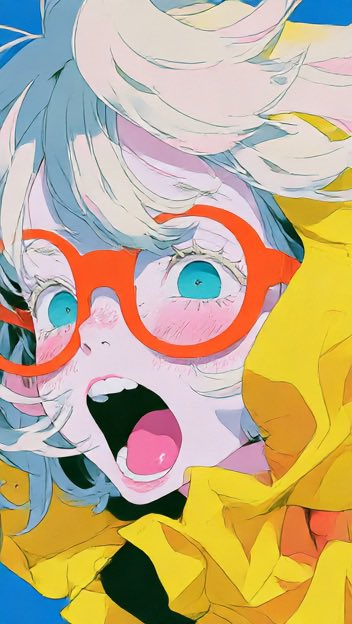

# 日本先锋漫画鱼眼近景：橙眼镜银发少女（Midjourney v8.2）

- 原帖链接：https://x.com/AIGCxxx/status/2118233156457492890
- 作者：就爱迟到（@AIGCxxx）
- 时间：2026-11-05 14:45 (UTC+8 / Asia/Taipei)
- 互动摘要：点赞 18 · 转发 2 · 回复 5 · 引用 0 · 书签 9 · 浏览 781（采集快照：2026-11-06 09:00 UTC+8）
- 模型/工具：Midjourney v8.2
- 标签：二次元
- 媒体路径：
  - `media/images/2118233156457492890_1.jpg`（）
  - `media/images/2118233156457492890_2.jpg`（）
  - `media/images/2118233156457492890_3.jpg`（）
  - `media/images/2118233156457492890_4.jpg`（）
- 入库日期：2026-11-06

## prompt 原文

```text
一张极具视觉冲击力的日本先锋漫画风格插画，Japanese neo-pop art，Y2K Harajuku street fashion，复古日漫美学与现代实验性平面设计相结合，充满活力、幽默、疯狂而时髦的青春气息。 人物主体: 一位年轻的日系动漫少女，银白色略带淡粉色调的凌乱短发，蓬松厚重的刘海，发丝向画面四周自由飞扬，具有极强的线条流动感。戴着一副巨大的亮橙色圆框眼镜，镜片因透视关系产生明显的放大效果，透过镜片可以看到一双清澈明亮的青绿色眼睛。眼睛睁得很大，瞳孔精细，睫毛浓密且富有表现力，眉毛微微上挑，鼻尖小巧，脸颊泛着淡粉色红晕，带有细微雀斑与漫画排线。 少女张大嘴巴，露出粉红色舌头、整齐的白色牙齿和深色口腔，呈现突然惊讶、惊叫或兴奋大笑的夸张表情，充满感染力和戏剧张力。人物脸部被极近距离镜头放大，表情鲜活而自然。 服装造型: 少女穿着明亮柠檬黄色的宽松连帽上衣，夸张的oversized运动服廓形，带有厚重的布料褶皱与黑色手绘排线。前景一只巨大的袖子或手臂直接伸向镜头，袖子采用黑白高对比棋盘格图案，形成强烈的空间遮挡与前后景透视。服装局部带有黄色兜帽、黑白棋盘格布料和街头运动风格元素，整体呈现潮流、俏皮、具有设计感的原宿街头穿搭。 镜头与构图: 极端超近距离特写，仿佛镜头紧贴少女的面部，180度鱼眼视觉效果，强烈的桶形畸变，dramatic foreshortening，extreme perspective，wide angle close-up。人物头部向画面右侧倾斜，面部以大幅度斜向构图占据画面中心，左侧前景巨大的黄色袖子与黑白棋盘格布料产生夸张的近大远小效果。 少女的眼镜、眼睛、鼻子和张开的嘴巴成为主要视觉焦点，面部透视被适度夸张，呈现向镜头凸起的立体效果。发丝向上方与右侧延伸，形成富有速度感的弧形线条。人物脸部、肩部与前景布料相互交叠，画面具有明显的层次纵深与贴近镜头的沉浸式冲击感。 背景设计: 大面积鲜艳的珊瑚橙红色背景，搭配奶油白、黑色与明黄色的大胆几何色块。背景采用不规则的倾斜矩形、锐利的切割边缘与抽象平面图形，形成日本潮流杂志封面般的实验性排版设计。部分区域加入细小的黑色墨点、复古印刷瑕疵、油墨飞溅和细微的纸张颗粒。右下角具有醒目的黑色几何区域与明黄色复古字体图形，整体信息量适中，突出主体脸部的视觉张力。 绘画技法: 日本复古漫画与当代商业插画混合风格，精细的手绘黑色墨线，厚薄不均的轮廓线，具有速度感和节奏变化的发丝排线。面部采用大量细密短线刻画眼眶、睫毛、眉毛、鼻梁、脸颊、下颌与颈部阴影，传统漫画钢笔线描，精致的cross-hatching与ink hatching。色彩处理采用干净的二维硬边平涂，flat cel shading，minimal gradients，crisp black outlines，bold graphic shapes。 配色体系: 珊瑚橙红、柠檬黄、奶油白、粉白肌肤、青绿色眼睛、亮橙色眼镜以及深黑色墨线。高纯度色彩形成强烈互补与对比，画面明快、明亮、锐利，几乎没有真实摄影光影，不使用柔和的三维体积渐变。 整体视觉效果: 极端夸张的五官比例、充满张力的面部表情、强烈透视畸变、鲜明的撞色与高密度漫画排线。结合Japanese underground comic aesthetics，experimental editorial illustration，bold pop graphics，retro manga ink drawing，Y2K graphic design，整体像一张极具个性的日本先锋潮流杂志封面。 横向16:9构图，画面满幅铺开，超高清二维漫画插画，强烈的近景冲击力，无镜头黑边，无写实质感，无3D渲染。 Midjourney 参考提示词和 p 值: Japanese anime composition, extreme fisheye wide angle close up, heavy barrel distortion, dramatic foreshortening. Character's face pressed against the lens, centered, head tilted, bold diagonal composition. Facial features exaggeratedly enlarged, protruding toward camera. Arms/sleeves stretch toward lens, oversized in foreground, emphasizing near far size contrast. Overlapping limbs, face, and shoulders create spatial depth. Subject bursts beyond frame edges with bold cropping for immersive impact. Hair strands and clothing folds radiate outward, guiding gaze to face, enhancing speed and tension. Background features slanted geometric color blocks and sharp cutting lines echoing movement. Black 2D manga ink lines, hard edged flat coloring, high contrast clashing colors convey 3D space through line and color. Horizontal 16:9 full frame. No circular fisheye vignette, no photorealism, no 3D rendering. --chaos 50 --ar 9:16 --raw --profile z6jrcxw lvfb9ko --stylize 400 --v 8.2 --draft
```

---

个人学习归档，非商业。prompt 与媒体版权归原作者 @AIGCxxx，引用请回到原帖。
