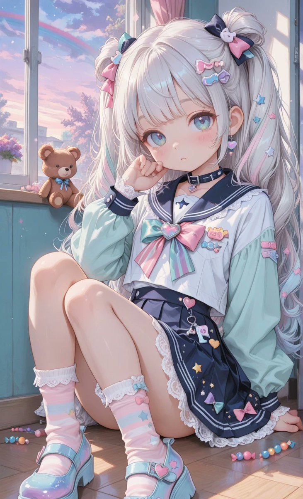
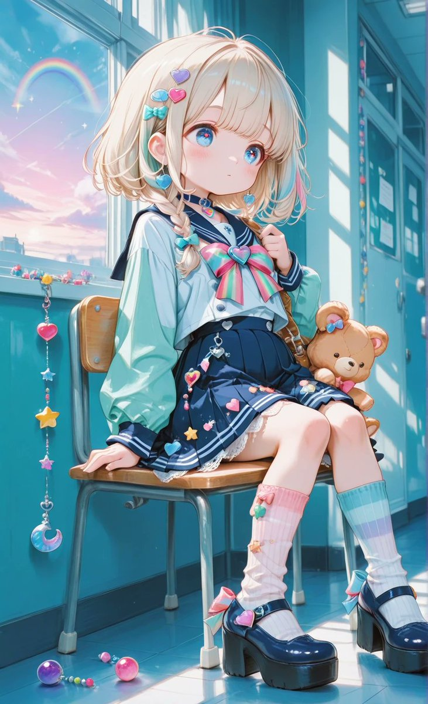
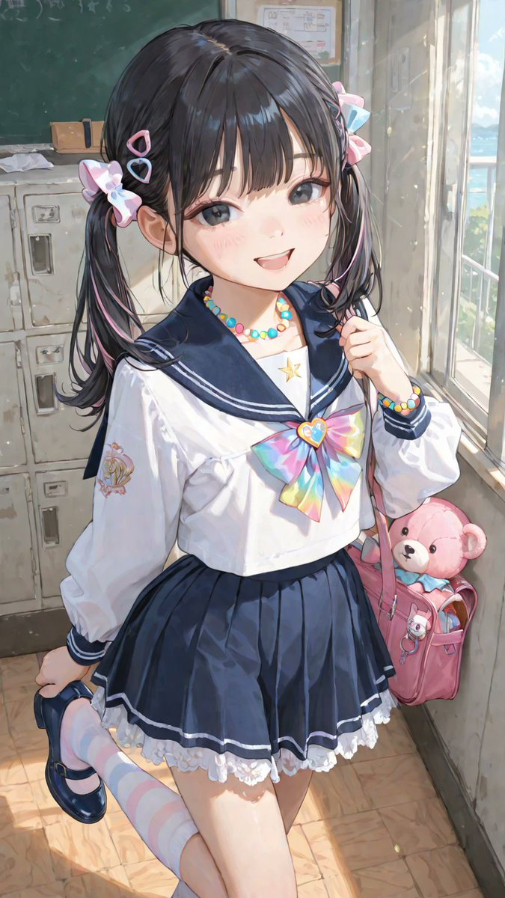
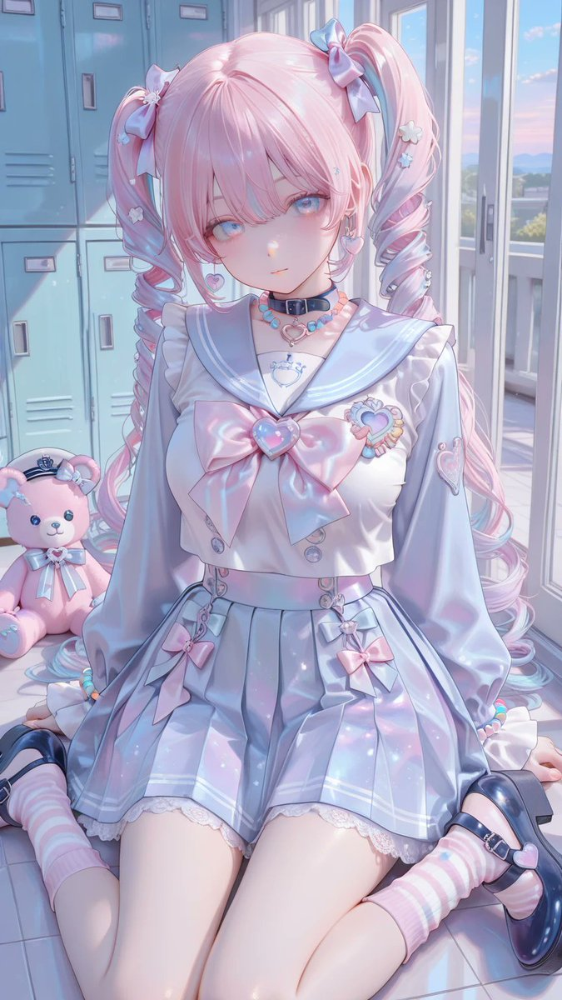

# セーラー服オマージュのデコラコーデ衣装 prompt

- 原帖链接：https://x.com/AliceLavli/status/2118236878688407926
- 作者：アリス服飾店（@AliceLavli）
- 时间：2026-11-05 15:00 (UTC+8 / Asia/Hong_Kong)
- 互动摘要：点赞 345 · 转发 49 · 回复 6 · 引用 24 · 书签 74 · 浏览 10212（采集快照：2026-11-06 20:10 UTC+8）
- 模型/工具：Stable Diffusion / SeaArt / PixAI / ChatGPT / Gemini / Grok / Midjourney / niji•journey（作者注明通用）
- 标签：二次元
- 媒体路径：
  - `media/images/2118236878688407926_1.jpg`（）
  - `media/images/2118236878688407926_2.jpg`（）
  - `media/images/2118236878688407926_3.jpg`（）
  - `media/images/2118236878688407926_4.jpg`（）
- 入库日期：2026-11-06

## prompt 原文

```text
セーラー服オマージュのデコラコーデの衣装プロンプトをどうぞ✨

プロンプトは、Stable Diffusion、SeaArt、PixAI系の他にもChatGPT、Gemini、Grok、Midjourney、niji•journeyなど生成AI全般で使えます☺️

decora sailor outfit, navy blue long sleeve sailor blouse, navy blue square sailor collar with twin white stripes, oversized bright pink chest bow with pastel heart brooch, loose navy blue sleeves extending to wrists, navy blue buttoned wrist cuffs with twin white stripes, navy blue pleated knee length skirt, navy blue lace hem and white ruffled underskirt, colorful ribbon bows clipped along skirt waistband, layered pastel bead chains draped across skirt, clusters of pink lavender mint green and sky blue acrylic charms, star heart candy and teddy bear shaped brooches covering blouse front and collar corners, colorful safety pin decorations, tiny plush mascot clips attached to chest bow and waistband, layered rainbow bead necklaces, stacked pastel bead bracelets, pink and lavender striped knee socks, white lace sock cuffs, black platform Mary Jane shoes with rounded toes and silver heart buckles, pink ribbon bows on shoe straps, colorful detachable shoe charms, navy blue sailor blouse and matching navy blue skirt
```

---

个人学习归档，非商业。prompt 与媒体版权归原作者 @AliceLavli，引用请回到原帖。
