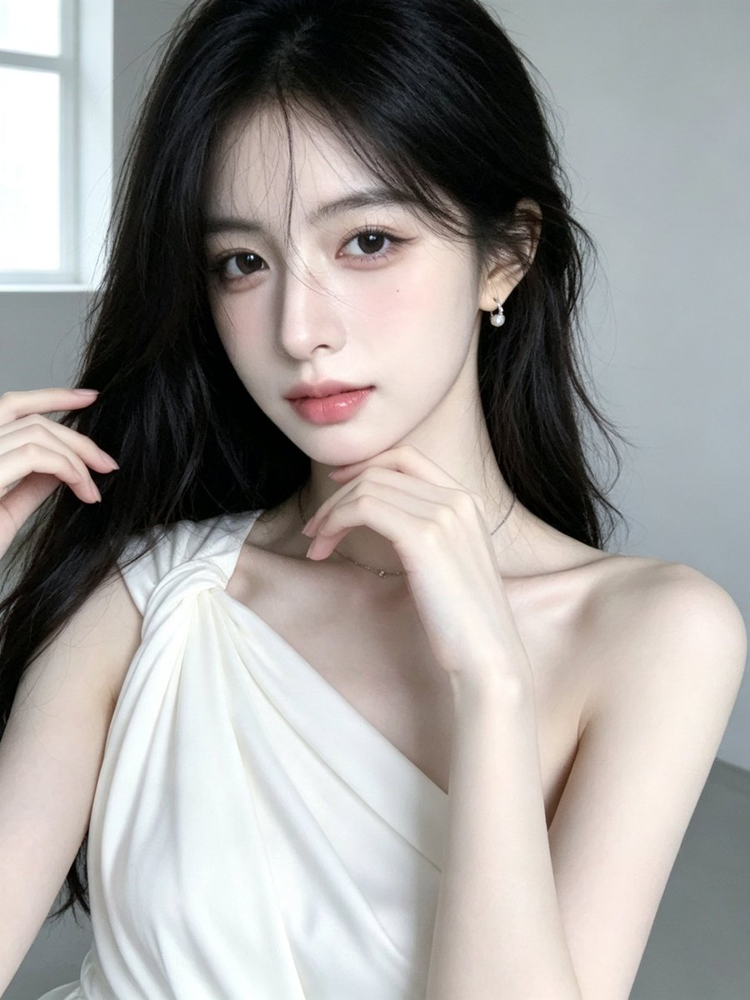

# 单肩缎面托腮近景人像（GPT Image 提示词 49/100）

- 原帖链接：https://x.com/CryY666666/status/2118255485724033500
- 作者：沧瑶（@CryY666666）
- 时间：2026-11-05 16:13 (UTC+8 / Asia/Hong_Kong)
- 互动摘要：点赞 45 · 转发 2 · 回复 12 · 引用 0 · 书签 8 · 浏览 1327（采集快照：2026-11-06 20:10 UTC+8）
- 模型/工具：GPT Image（作者标注）
- 标签：真人
- 媒体路径：
  - `media/images/2118255485724033500_1.jpg`（）
- 入库日期：2026-11-06
- 备注：prompt 写明「23至25岁的美丽成年东亚女性」。

## prompt 原文

```text
Gpt image prompt   49/100
gpt image 提示词分享
【整体风格】

3:4竖版，单幅独立画面，超写实韩系成年女性高级人像摄影，清冷温柔气质，低饱和冷白灰色调，简洁室内环境，柔和自然窗光，真实相机质感，轻微自然柔焦。

【人物面容】

一位23至25岁的美丽成年东亚女性，精致小巧的鹅蛋脸，柔和流畅的下颌线，小巧圆润的下巴，清透冷白瓷肌，淡淡蜜桃粉色腮红。

明亮清澈的深灰棕色杏仁眼，自然双眼皮，细致卧蚕，纤长卷翘睫毛，浅粉棕色眼影，眼尾微微上扬。

纤细挺直的鼻梁，小巧鼻尖，柔软饱满的玫瑰豆沙粉色水润嘴唇。

双唇自然闭合，头部轻轻倾斜，双眼平静地直视镜头，神情清冷、温柔，保留真实皮肤微纹理。

【发型——核心】

极其浓密柔顺的乌黑色长发，自然深黑茶色光泽，头顶蓬松，采用自然偏中分发型。

额前几缕轻薄细长碎发自然垂落，部分发丝轻轻掠过额头、鼻梁与脸颊。

画面左侧大量长发披散在肩膀前方，右侧部分头发自然收拢至耳后，露出小巧珍珠耳坠。

长发整体柔顺，发尾具有轻微松散波浪，保留真实独立发丝和自然凌乱感。

【服装与首饰】

身穿奶油白色单肩斜领缎面上衣。

柔软细腻的象牙白丝绸缎面，从画面左侧肩膀自然斜向包裹身体，形成优雅的不对称领口。

肩部具有精致的布料扭结与垂坠褶皱，另一侧肩膀自然露出，锁骨线条清晰柔和。

面料具有真实丝绸光泽、细腻褶皱和柔软垂坠感。

佩戴小巧白色珍珠耳坠与极细银色锁骨链。

【人物姿势】

人物正面略微侧向镜头，上半身自然挺直，肩膀放松。

头部轻轻向画面左侧倾斜，下巴略微收起，双眼直视镜头。

画面中央的一只手自然抬至下巴下方，手指柔和弯曲，指尖轻轻托住下颌。

另一只手从画面左侧抬起，轻轻整理肩前的乌黑长发。

双手动作轻盈自然，指尖纤细，手腕和手臂比例真实。

【背景与光影】

极简现代室内空间，浅灰白色墙壁。

画面左上角有一扇明亮的白色窗框，透入柔和的冷白色日间自然光。

背景简洁干净，没有复杂家具与装饰。

自然窗光从画面左前方照亮人物额头、鼻梁、脸颊、肩膀与锁骨。

肤色呈清透冷白色，鼻梁与唇部具有细腻自然高光，黑色长发保留柔和深棕色反光。

整体低对比、低饱和、自然曝光，轻微数码相机颗粒，不过度磨皮。

【镜头与构图】

3:4竖版，等效50mm人像镜头，眼睛高度平视，近距离胸部以上半身构图。

人物面部位于画面中央偏上，头顶略微裁切，乌黑长发自然延伸至画面底部。

面部、手指与缎面衣服清晰，背景轻微柔化，保留真实相机景深。

【负面提示词】

动漫，插画，3D渲染，CG假脸，塑料皮肤，过度磨皮，夸张网红脸，异常大眼，过尖下巴，五官错位，假发，头发黏连，僵硬发丝，多余手指，手掌畸形，肩膀错位，身体比例失真，单肩服装结构错误，缎面变成塑料，衣服穿模，严重过曝，强HDR，过度锐化，明显AI感，文字，水印，LOGO，拼图。
```

---

个人学习归档，非商业。prompt 与媒体版权归原作者 @CryY666666，引用请回到原帖。
