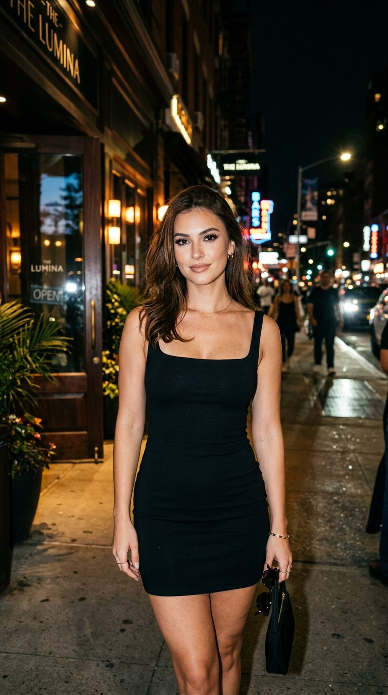

# 夜店门口直闪社交人像：黑裙模板化参数 prompt（Nano Banana 2）

- 原帖链接：https://x.com/dreamydigiarts/status/2118297282567176331
- 作者：dreamy digital arts（@dreamydigiarts）
- 时间：2026-11-05 19:00 (UTC+8 / Asia/Taipei)
- 互动摘要：点赞 38 · 转发 1 · 回复 6 · 引用 1 · 书签 18 · 浏览 1001（采集快照：2026-11-06 09:00 UTC+8）
- 模型/工具：Nano Banana 2（@weryai）
- 标签：真人
- 媒体路径：
  - `media/images/2118297282567176331_1.jpg`（）
- 入库日期：2026-11-06

## prompt 原文

```text
A photorealistic social media portrait of one young adult woman with a youthful, fresh-faced, strikingly beautiful appearance, dressed in the Aesthetic and wearing the Dress Color Dress Style. Apply the Glam Makeup with polished creator-style beauty retouching while preserving real pores, fine skin texture, natural highlights, and individual hair strands. Show her waiting casually outside the restaurant in the Setting, standing near the entrance with a confident, relaxed expression and her gaze toward the camera. Capture the scene as a direct on-camera flash photograph at night, with crisp highlights on her face and dress, deep ambient shadows, subtle background bokeh, realistic city light spill, and a hint of natural film grain. Fashion-forward, believable phone-camera realism with correct hands and natural proportions, composed in the Format. No other people, text, logos, usernames, watermarks, or borders.  Use these details: Aesthetic:  glamorous night out  Dress Color:  black  Dress Style:  body-skimming mini dress with a square neckline  Glam Makeup:  defined brows, dramatic lashes, softly contoured cheeks, and glossy nude lips  Setting:  the entrance of an upscale restaurant on a lively city street at night  Format:  4:5 vertical social media portrait
```

---

个人学习归档，非商业。prompt 与媒体版权归原作者 @dreamydigiarts，引用请回到原帖。
