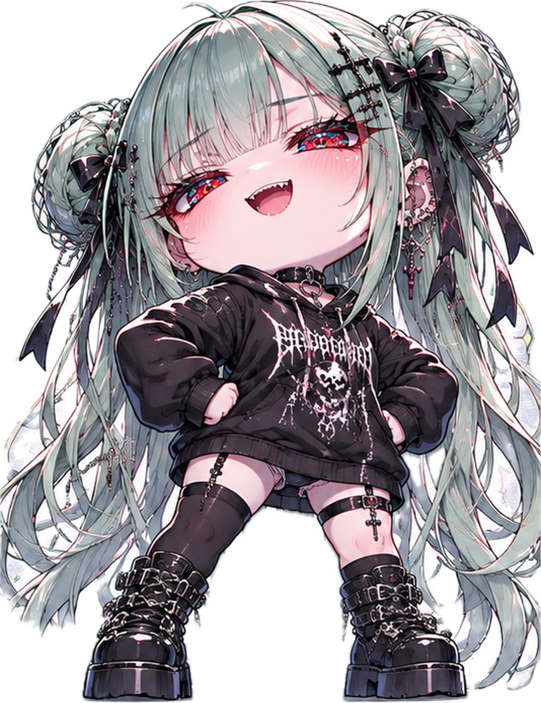
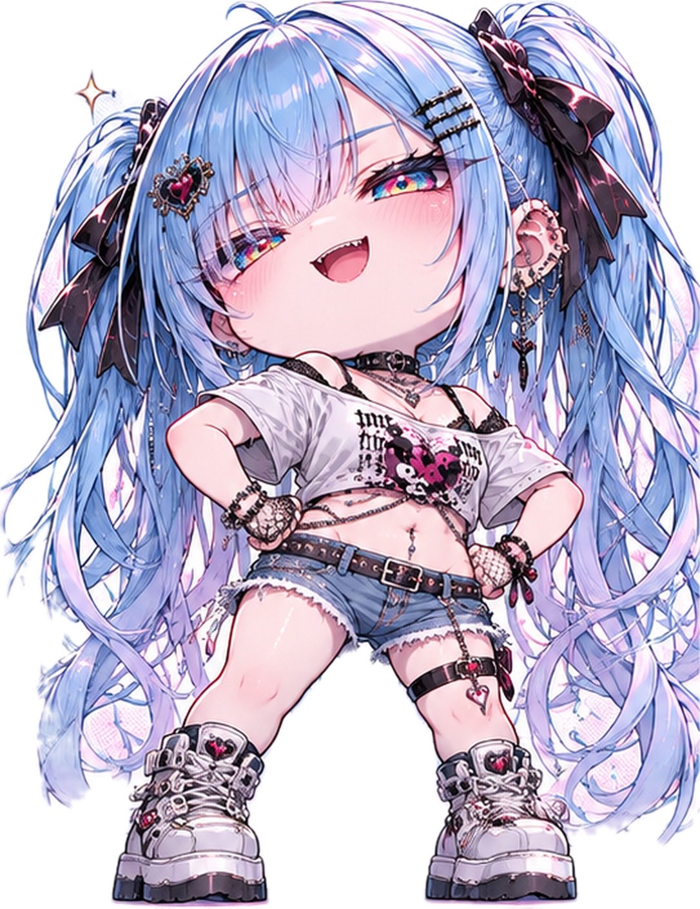
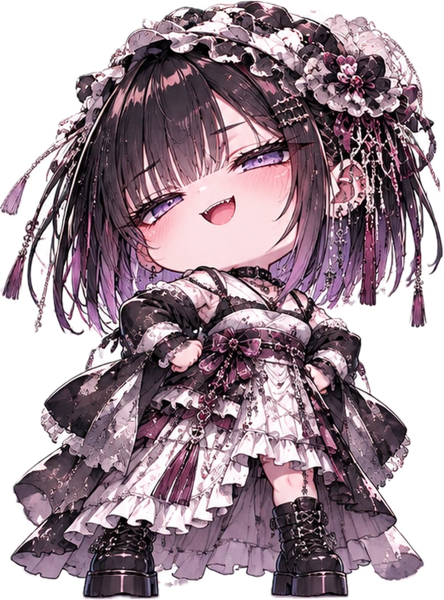
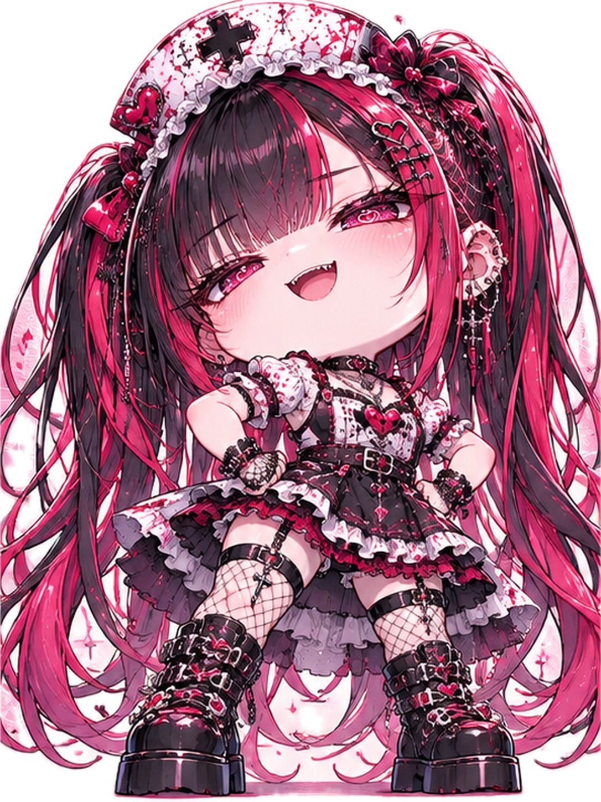

# 「どやぁ〜！」叉腰得意脸 Q 版（#るんプロンプト 第247弾）

- 原帖链接：https://x.com/ENJU1123PIPI/status/2118312380967059899
- 作者：るんちゃん🦋（@ENJU1123PIPI）
- 时间：2026-11-05 20:00 (UTC+8 / Asia/Taipei)
- 互动摘要：点赞 126 · 转发 35 · 回复 4 · 引用 19 · 书签 18 · 浏览 3617（采集快照：2026-11-06 09:00 UTC+8）
- 模型/工具：未注明（角色参考图驱动的通用生图 prompt）
- 标签：二次元
- 媒体路径：
  - `media/images/2118312380967059899_1.jpg`（）
  - `media/images/2118312380967059899_2.jpg`（）
  - `media/images/2118312380967059899_3.jpg`（）
  - `media/images/2118312380967059899_4.jpg`（）
- 入库日期：2026-11-06
- 备注：prompt 在作者自回复；需附上角色参考图使用。

## prompt 原文

```text
Transform the attached character into an irresistibly cute 2.5–3-head-tall chibi illustration. Faithfully preserve their original face, hairstyle, hair color, eye color, accessories, outfit design, color palette, and personality. The character must remain instantly recognizable.

Expression — “DOYAA~!”

Give the character an exaggerated smug, proud expression, as if celebrating a tiny achievement like a legendary victory. Half-lidded sparkling eyes, slightly raised eyebrows, a mischievous asymmetrical grin, softly puffed cheeks, rosy blush, and a proudly lifted chin. The expression should be hilariously confident yet overwhelmingly adorable.

Pose & Proportions

Oversized round head, squishy cheeks, tiny compact body, short limbs, and miniature feet. Both hands firmly on the hips, elbows outward, chest puffed proudly, legs slightly apart. Add a playful backward lean and subtle head tilt for a dynamic, comically triumphant silhouette.

Art Quality

Premium Japanese anime chibi illustration with bold, varied outer linework, delicate facial details, crisp cel shading, dimensional shadows, and luminous skin highlights. Beautiful multilayered glass-like irises with crystalline reflections, refined hair strands, glossy highlights, and intricately rendered clothing, lace, chains, ribbons, and metallic accessories.

Composition & Effects

Full-body composition with a slightly low camera angle. Clean pastel background matching the character’s aesthetic, tiny sparkles, playful comic impact rays, and a miniature floating crown emphasizing their imaginary victory. Soft directional lighting, subtle rim light, and balanced contrast.

Maximum cuteness, expressive comedy, vibrant yet controlled colors, professional illustration quality.

Single character, vertical 3:4, no text, no collage, no extra limbs, five fingers per hand, accurate anatomy.
```

---

个人学习归档，非商业。prompt 与媒体版权归原作者 @ENJU1123PIPI，引用请回到原帖。
