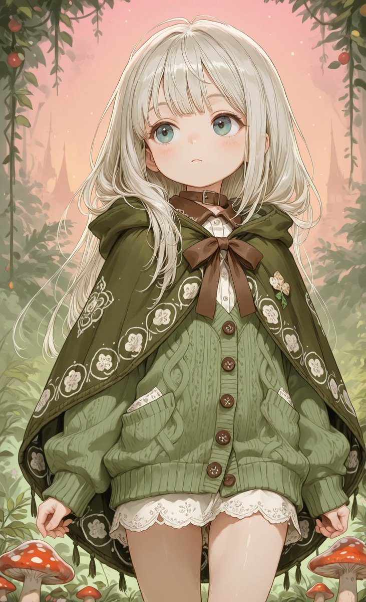
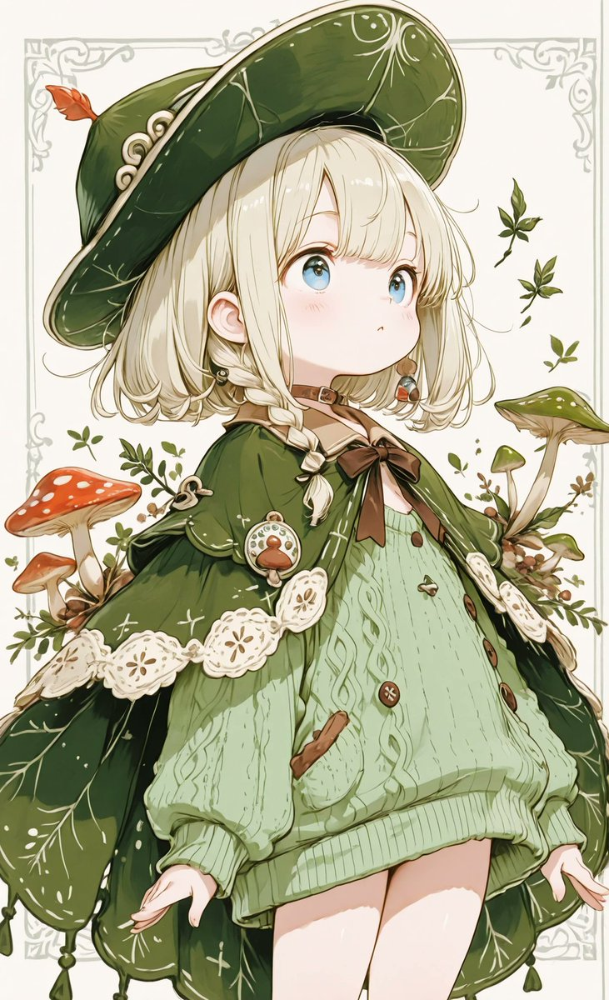
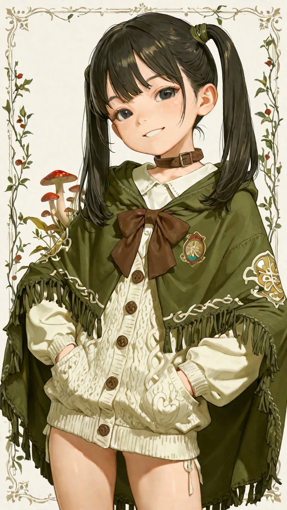
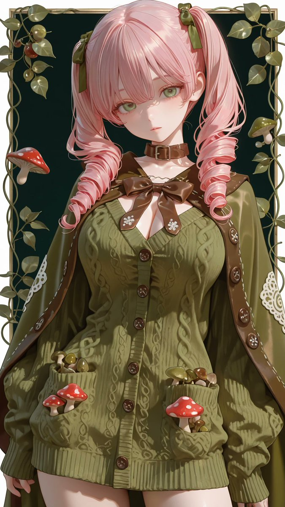

# キノコとケープのセーターワンピース衣装 prompt

- 原帖链接：https://x.com/AliceLavli/status/2118448275300700628
- 作者：アリス服飾店（@AliceLavli）
- 时间：2026-11-06 05:00 (UTC+8 / Asia/Hong_Kong)
- 互动摘要：点赞 177 · 转发 35 · 回复 9 · 引用 13 · 书签 42 · 浏览 3782（采集快照：2026-11-06 20:10 UTC+8）
- 模型/工具：Stable Diffusion / SeaArt / PixAI / ChatGPT / Gemini / Grok / Midjourney / niji•journey（作者注明通用）
- 标签：二次元
- 媒体路径：
  - `media/images/2118448275300700628_1.jpg`（）
  - `media/images/2118448275300700628_2.jpg`（）
  - `media/images/2118448275300700628_3.jpg`（）
  - `media/images/2118448275300700628_4.jpg`（）
- 入库日期：2026-11-06

## prompt 原文

```text
キノコとケープのセーターワンピースの衣装プロンプトをどうぞ✨

プロンプトは、Stable Diffusion、SeaArt、PixAI系の他にもChatGPT、Gemini、Grok、Midjourney、niji•journeyなど生成AI全般で使えます☺️

olive green knitted cape cardigan, wide flowing poncho silhouette, hip length cape with continuous fabric draping from shoulders to hem, broad sloping sides and loose open lower edges, round neckline with warm chestnut brown knitted Peter Pan collar, two rounded collar lobes with scalloped edges, layered textured brown knitting across collar, small embroidered red mushrooms with white spotted caps and ivory stems on both collar tips, chestnut brown knitted cords tied in a long loose bow at center neckline, long brown cord ends hanging down chest, olive green center front button band, single vertical row of small round ivory buttons with decorative silver rims, two raised olive green cable knit columns flanking button band, dense horizontal knit stitches across cape body, raglan style knitted shoulder lines, scattered red and ivory mushroom embroidery near both lower front sides, dark green embroidered winding stems and tiny leaves, gently flared olive green hem, brown collar and olive green cape body
```

---

个人学习归档，非商业。prompt 与媒体版权归原作者 @AliceLavli，引用请回到原帖。
