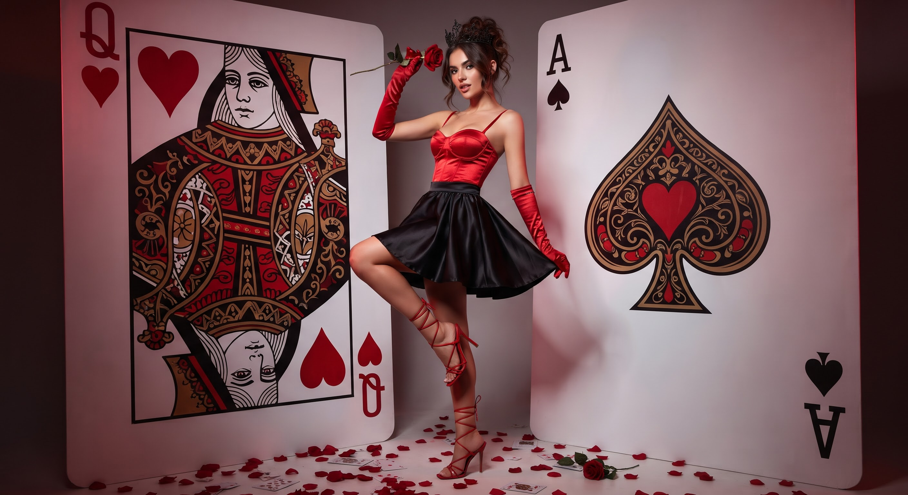

# 红心皇后：巨型扑克牌夹角中的幻想时装人像

- 原帖链接：https://x.com/Monaqbuv/status/2118463377479762221
- 作者：Mona（@Monaqbuv）
- 时间：2026-11-06 06:00 (UTC+8 / Asia/Taipei)
- 互动摘要：点赞 16 · 转发 1 · 回复 2 · 引用 0 · 书签 2 · 浏览 327（采集快照：2026-11-06 09:00 UTC+8）
- 模型/工具：未注明（作者示例 Midjourney / DALL-E / Stable Diffusion）
- 标签：真人
- 媒体路径：
  - `media/images/2118463377479762221_1.jpg`（）
- 入库日期：2026-11-06

## prompt 原文

```text
A striking and dramatic fantasy editorial portrait of a captivating woman styled as the Queen of Hearts. She poses dynamically inside a corner formed by two giant, oversized playing cards featuring ornate red patterns, a Queen of Hearts design, and an Ace of Spades/Hearts motif. She has a graceful posture, with one leg lifted and resting slightly up, wearing a glossy red satin spaghetti-strap corset top, a flared black satin mini skirt, long crimson red satin opera gloves, and red lace-up strappy high heels. She wears a delicate black crown in her dark-brown styled updo hair and holds a single red rose near her head. The floor around her is scattered with fallen red rose petals. Moody crimson and white cinematic studio lighting, photorealistic high-end fantasy fashion photography, 8k resolution.
```

---

个人学习归档，非商业。prompt 与媒体版权归原作者 @Monaqbuv，引用请回到原帖。
