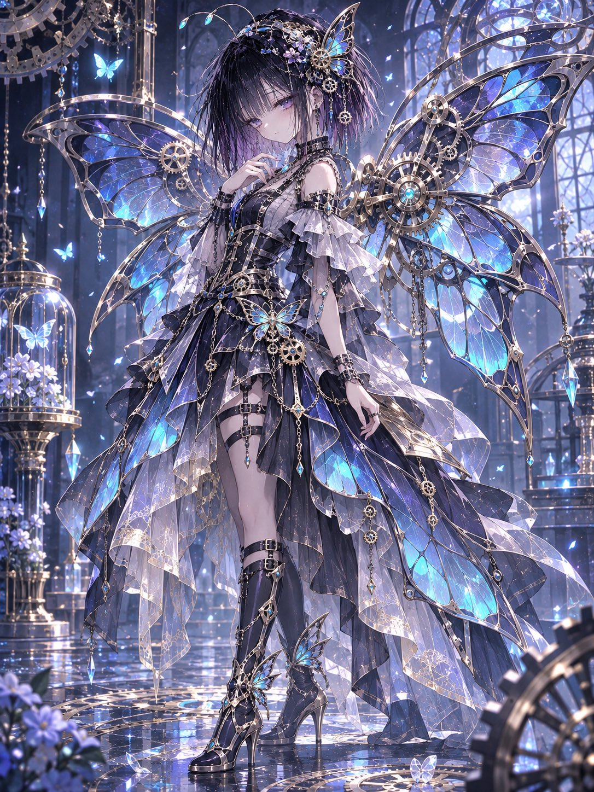
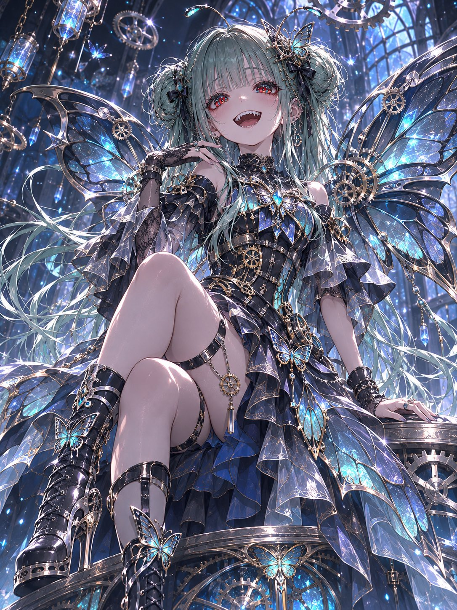
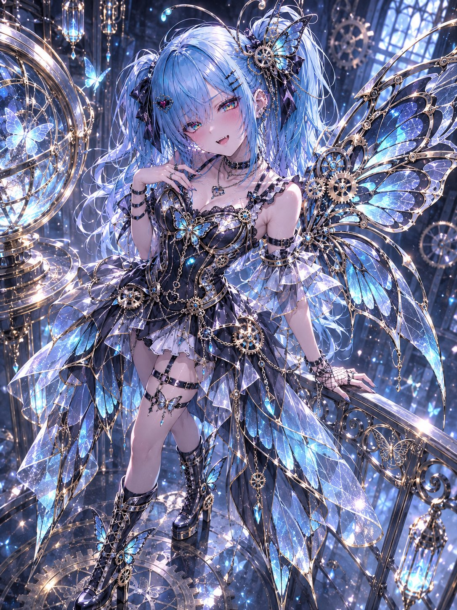
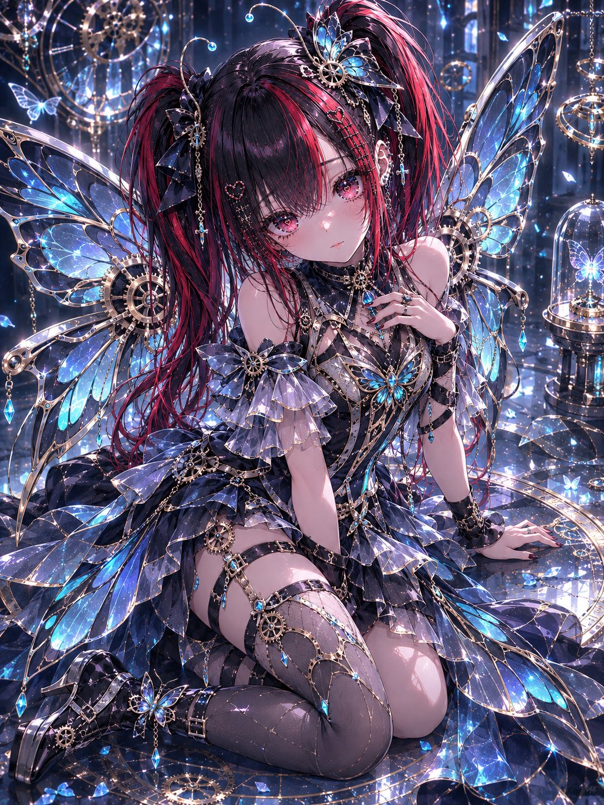

# 机械蝶翼哥特礼服衣装（#るん衣装プロンプト 第259弾）

- 原帖链接：https://x.com/ENJU1123PIPI/status/2118474690738188555
- 作者：るんちゃん🦋（@ENJU1123PIPI）
- 时间：2026-11-06 06:45 (UTC+8 / Asia/Taipei)
- 互动摘要：点赞 54 · 转发 13 · 回复 3 · 引用 5 · 书签 4 · 浏览 807（采集快照：2026-11-06 09:00 UTC+8）
- 模型/工具：未注明（角色参考图驱动的通用衣装 prompt）
- 标签：二次元
- 媒体路径：
  - `media/images/2118474690738188555_1.jpg`（）
  - `media/images/2118474690738188555_2.jpg`（）
  - `media/images/2118474690738188555_3.jpg`（）
  - `media/images/2118474690738188555_4.jpg`（）
- 入库日期：2026-11-06
- 备注：prompt 在作者自回复；需附上角色参考图使用。作者自嘲「腕は見ないで」。

## prompt 原文

```text
MECHANICAL BUTTERFLY COUTURE

Mechanical Wings × Gothic Fantasy × Elegant Clockwork

Transform the character in the attached image into an elegant mechanical butterfly-inspired fantasy character.

Character Preservation:
Faithfully preserve the original face, hairstyle, hair color, eye color, body proportions, accessories, and recognizable personality. Completely redesign the outfit while maintaining the character’s identity.

Outfit Design:
Create an intricate gothic-fantasy couture outfit combining delicate butterfly wings, elegant machinery, and luxurious tailoring.

Fitted corset or tailored bodice with engraved metallic details.
Asymmetrical layered skirt, translucent wing-shaped panels, and flowing mechanical coat tails.
Large articulated butterfly wings extending from the back, constructed from polished metal frames, intricate gears, delicate hinges, and translucent stained-glass membranes.
Fine clockwork mechanisms, glowing cyan seams, silver filigree, pale-gold ornaments, and suspended crystal pendants.
Decorative belts, chains, clasps, butterfly-shaped jewelry, and mechanical antenna hair ornaments.
Elegant high-heeled boots with metallic armor, miniature gears, and butterfly-wing embellishments.

The wings must form a magnificent mechanical silhouette rather than appear as simple decorative patterns.

Color Palette:
Black, silver, pale gold, midnight blue, and luminous cyan. Preserve the character’s original hair and eye colors.

Pose & Composition:
Create a visually striking full-body or three-quarter composition with a dynamic camera angle. Slightly turn the character to reveal the mechanical wings. Use an elegant, natural pose with expressive body language and carefully drawn hands.

Background & Atmosphere:
A magnificent fantasy clockwork workshop filled with floating gears, enormous mechanical rings, suspended glass crystals, luminous butterflies, and sparkling particles. Cinematic blue-silver lighting, atmospheric depth, and beautiful metallic reflections.

Art Quality:
Masterpiece anime illustration, 3:4 vertical composition, ultra-detailed 8K aesthetic, precise expressive linework, bold outer contours, delicate internal lines, refined cel shading, intricate mechanical engineering, realistic metal and glass reflections, brilliant multilayered gemstone irises, elegant fabric textures, and dramatic cinematic lighting.

Negative Prompt:
Extra characters, altered identity, malformed hands, extra fingers, distorted anatomy, broken wings, inconsistent mechanical structures, excessive blur, muddy details, text, logos, watermarks.
```

---

个人学习归档，非商业。prompt 与媒体版权归原作者 @ENJU1123PIPI，引用请回到原帖。
