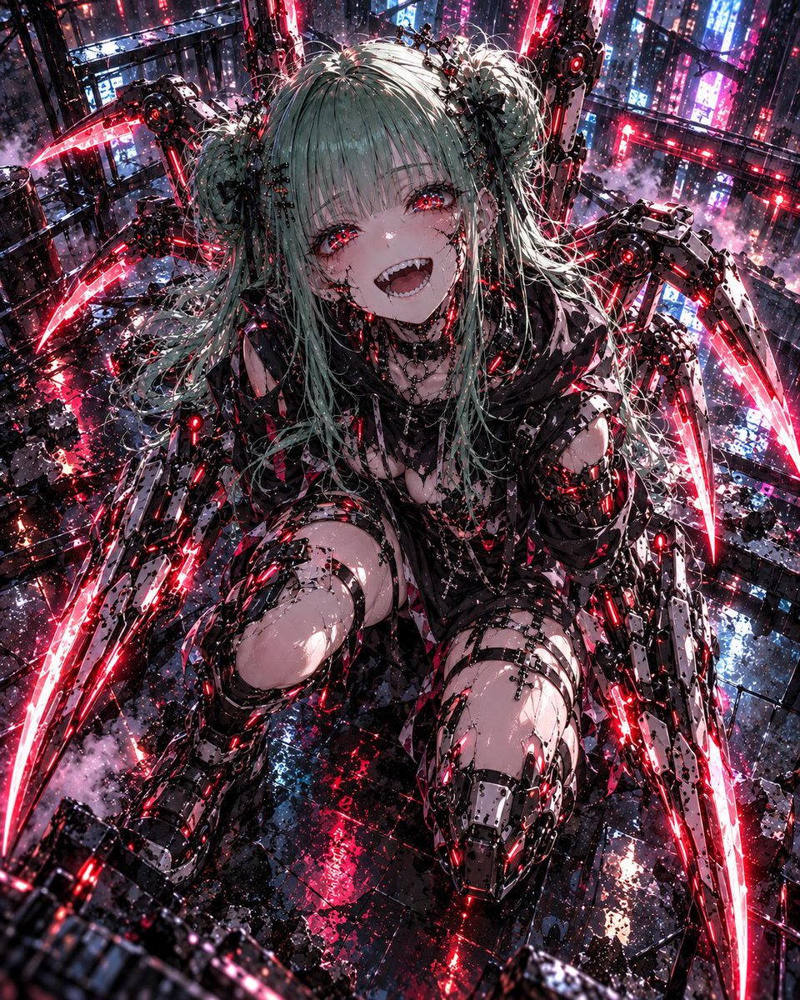
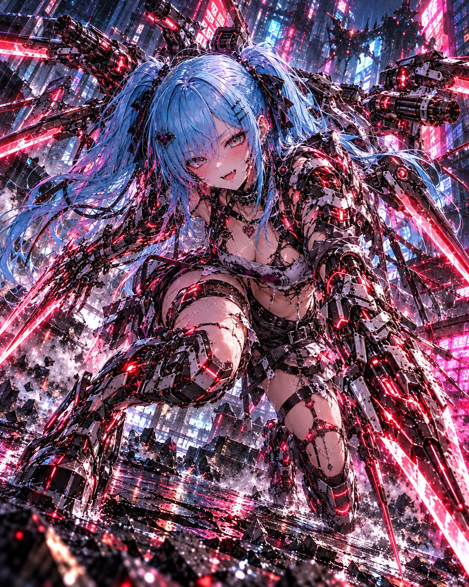
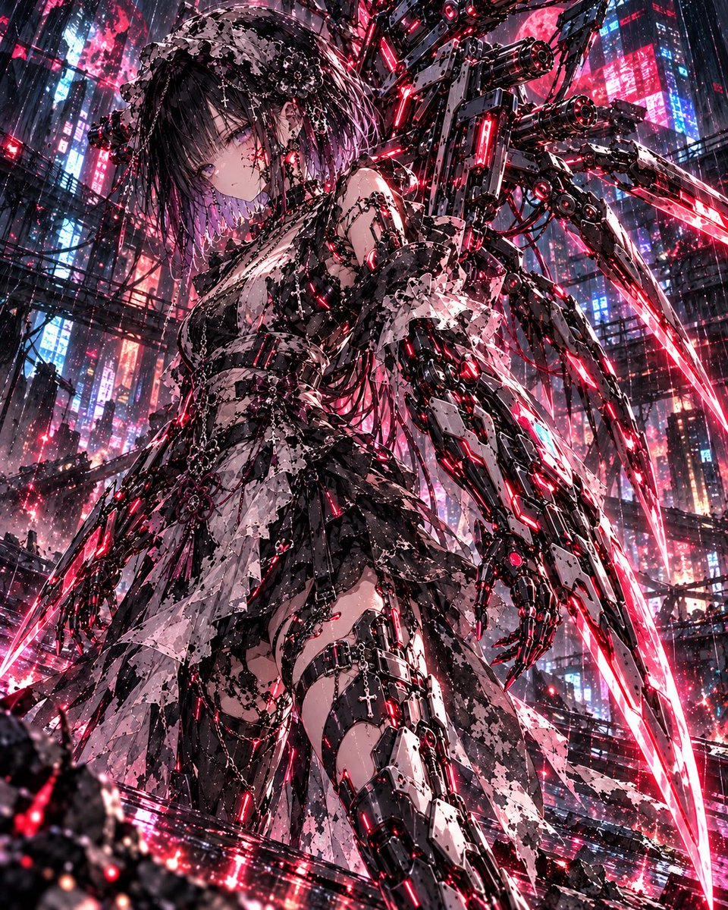
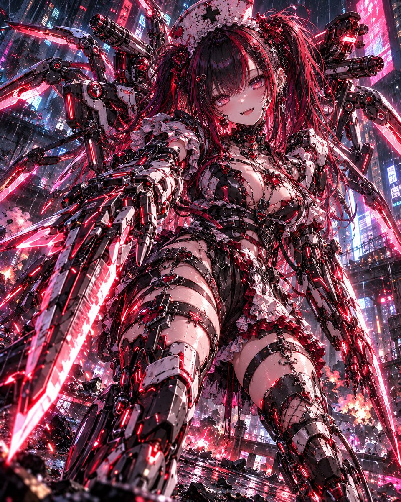

# 赛博精神病边缘的重武装改造（#るんプロンプト 第248弾）

- 原帖链接：https://x.com/ENJU1123PIPI/status/2118489790589079750
- 作者：るんちゃん🦋（@ENJU1123PIPI）
- 时间：2026-11-06 07:45 (UTC+8 / Asia/Hong_Kong)
- 互动摘要：点赞 67 · 转发 23 · 回复 3 · 引用 8 · 书签 6 · 浏览 1775（采集快照：2026-11-06 20:10 UTC+8）
- 模型/工具：未注明（角色参考图驱动的通用生图 prompt）
- 标签：二次元
- 媒体路径：
  - `media/images/2118489790589079750_1.jpg`（）
  - `media/images/2118489790589079750_2.jpg`（）
  - `media/images/2118489790589079750_3.jpg`（）
  - `media/images/2118489790589079750_4.jpg`（）
- 入库日期：2026-11-06
- 备注：prompt 在作者自回复；需附上角色参考图使用。

## prompt 原文

```text
Use the attached character as the only character and preserve their recognizable identity.

Create an original ultra-detailed cyberpunk anime illustration of the character on the verge of cyberpsychosis — a terrifying loss of control caused by excessive military-grade cybernetic augmentation.

Preserve the original face, facial proportions, hairstyle, hair color, eye color, body proportions, height impression, gender presentation, signature accessories, and overall personality. The character must remain clearly recognizable, not replaced by a generic cyborg.

Transform the character into a heavily augmented combat cyborg while keeping the human face clearly visible. Integrate military-grade cybernetic systems into the shoulders, spine, arms, legs, and torso: segmented armor plating, exposed pistons, hydraulic actuators, intricate cables, neural connectors, glowing circuitry, and reinforced mechanical structures. Add subtle illuminated seams around the neck, jawline, and temples.

Deploy large retractable mechanical combat blades from the forearms, with layered metallic segments and glowing cutting edges. Add integrated weapon systems on the shoulders and upper back, such as compact rotary cannons, articulated support arms, stabilizers, and glowing targeting sensors. Additional segmented blade mechanisms should emerge from the spine and back like predatory mechanical appendages. All weapons must visibly originate from the body, with believable joints, hinges, and locking structures.

Give the character an unstable, unnerving expression: a distorted smile, exhausted eyes, and sudden violent intensity. Preserve the original eye color while adding crimson electronic reflections, irregular pupil illumination, broken digital interference, flickering neural effects, and fragmented red holographic distortions. The character should look like they are losing control while still retaining traces of their humanity.

Redesign the outfit into a battle-damaged futuristic techwear combat outfit that matches the character’s original aesthetic and gender presentation. Use black tactical fabric, asymmetrical armor, reinforced straps, neon cybernetic accents, torn sections around exposed implants, metallic buckles, and industrial combat footwear. Blend fashion and weaponized cyberware rather than making a full-body robot suit.

Set the scene in a dystopian Japanese cyberpunk megacity at night: a devastated rain-soaked neon intersection with towering buildings, holographic advertisements, shattered pavement, mechanical debris, steam, electrical sparks, and red emergency lighting mixed with cyan-magenta neon. The character stands at the center of destruction with weapons fully deployed, surrounded by shockwaves, sparks, broken HUD fragments, and unstable holographic afterimages.

Use a cinematic low-angle three-quarter full-body composition with strong depth, dynamic foreshortening, dramatic backlighting, and a powerful silhouette. The character should lean slightly forward as if about to launch a devastating attack.

Art style: premium Japanese cyberpunk action anime illustration, razor-sharp expressive linework, variable line thickness, bold cel shading, deep graphic shadows, polished metallic highlights, aggressive high-contrast lighting, complex mechanical design, and crisp facial detail.

Color palette: black chrome, gunmetal silver, electric cyan, neon magenta, violent crimson, amber sparks, and deep midnight blue.

One character only. No additional characters. No readable text. No watermark. No gore.

Avoid: generic humanoid robot, fully enclosed helmet, completely replaced face, bulky shapeless armor, oversized mechanical torso, unrelated character design, extra biological limbs, disconnected floating weapons, incoherent machinery, blurry linework, excessive bloom, low detail, and muted colors.
```

---

个人学习归档，非商业。prompt 与媒体版权归原作者 @ENJU1123PIPI，引用请回到原帖。
