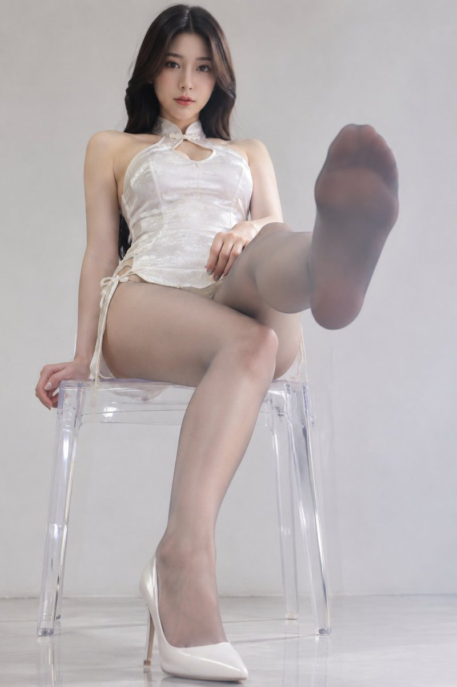

# 「踢死你」：白色短旗袍 + 灰丝仰拍踢脚构图

- 原帖链接：https://x.com/GenRyoma/status/2118549401765654544
- 作者：YLL·Hara（@GenRyoma）
- 时间：2026-11-06 11:41 (UTC+8 / Asia/Hong_Kong)
- 互动摘要：点赞 99 · 转发 4 · 回复 9 · 引用 1 · 书签 57 · 浏览 3401（采集快照：2026-11-06 20:10 UTC+8）
- 模型/工具：未注明
- 标签：真人
- 媒体路径：
  - `media/images/2118549401765654544_1.jpg`（）
- 入库日期：2026-11-06
- 备注：prompt 写明「24岁成年东亚女性模特」，并带负面词限制未成年/走光。

## prompt 原文

```text
踢死你，你没有心😠

提示词：

室内时尚人像摄影，干净极简背景，超写实真人风格，近景仰拍视角。
一位24岁成年东亚女性模特坐在透明亚克力凳子上，正对镜头，身材修长匀称，双腿线条流畅，气质轻熟时尚。
模特穿着一件白色高开叉镂空短旗袍，面料精致贴身，剪裁利落，整体呈现现代改良旗袍的时尚感。
双腿穿着15D灰色超薄丝袜，丝袜整体通透细腻、轻微柔光质感，脚尖加固约25D，脚尖区域更细密结实，不显脚趾分割感，没有明显脚趾轮廓，整体保持平滑统一的袜面效果。

姿势设定：
模特坐在透明凳子上，身体微微后仰，一条腿自然下垂，脚穿一只高跟鞋撑地支撑身体重心；另一条腿朝镜头方向抬起，做出轻微踢出/前伸动作，让穿灰丝的脚底正对镜头，重点展示丝袜包裹下的脚底轮廓、脚尖加固细节与腿部线条。
上半身保持自然端正，一只手可轻扶凳面或大腿，另一只手自然放松，表情冷静、自信，略带时尚感，不夸张卖弄。
镜头语言：
摄影机位于模特前方偏低位置，采用近距离仰拍，突出前景抬起的脚底、修长美腿与透明凳子的空间层次。
画面完整呈现人物上半身、旗袍裙摆、撑地高跟鞋、以及朝镜头抬起的丝袜脚底。
重点表现：白色短旗袍 + 灰色薄丝袜 + 单只高跟鞋撑地 + 一脚朝镜头踢出的构图张力。

灯光与质感：
柔和室内棚拍光或落地窗自然光，人物皮肤质感真实细腻，不过度磨皮；丝袜纹理清晰，脚尖加固细节明确；高跟鞋材质精致，透明凳子边缘有干净反光。
整体风格为高级时尚写真、干净、克制、真实。
负面提示词：
未成年、幼态、走光、私密部位暴露、脚趾分叉明显、脚部畸形、多余脚趾、多余肢体、丝袜破损、鞋子穿模、透明凳子结构错误、低俗风、夸张透视变形、塑料皮肤、动漫感、CG感、文字、水印。
```

---

个人学习归档，非商业。prompt 与媒体版权归原作者 @GenRyoma，引用请回到原帖。
