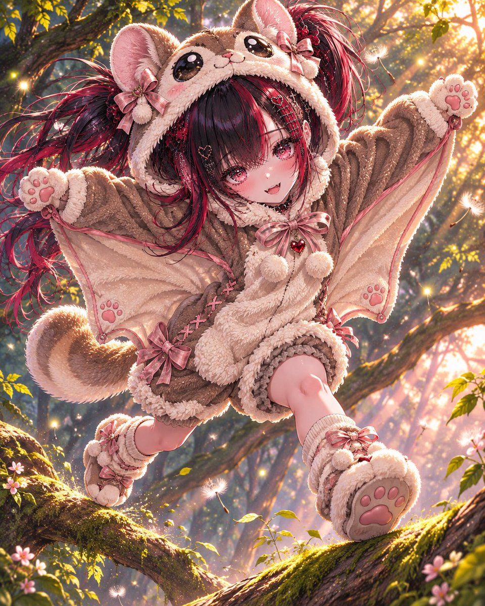
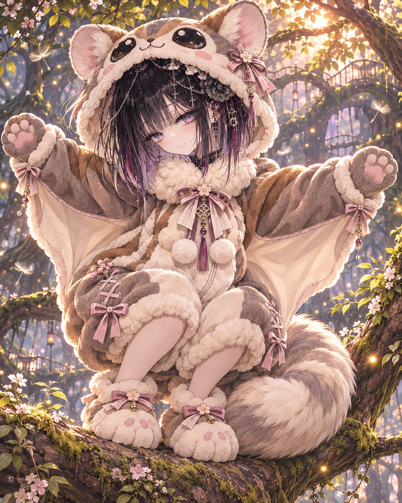
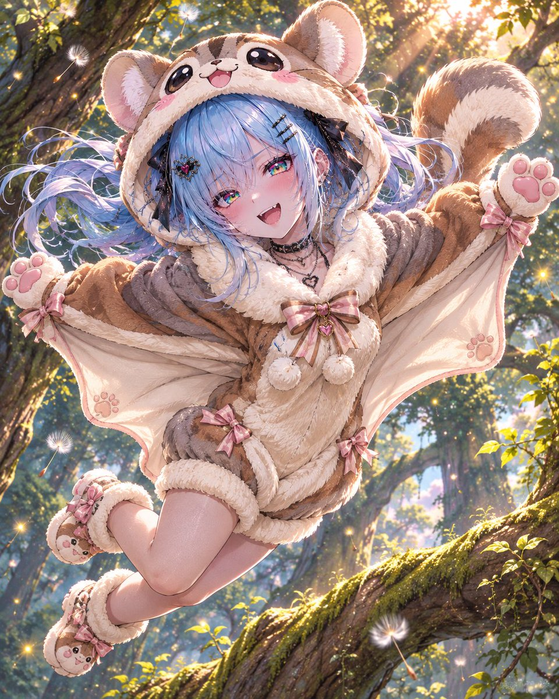
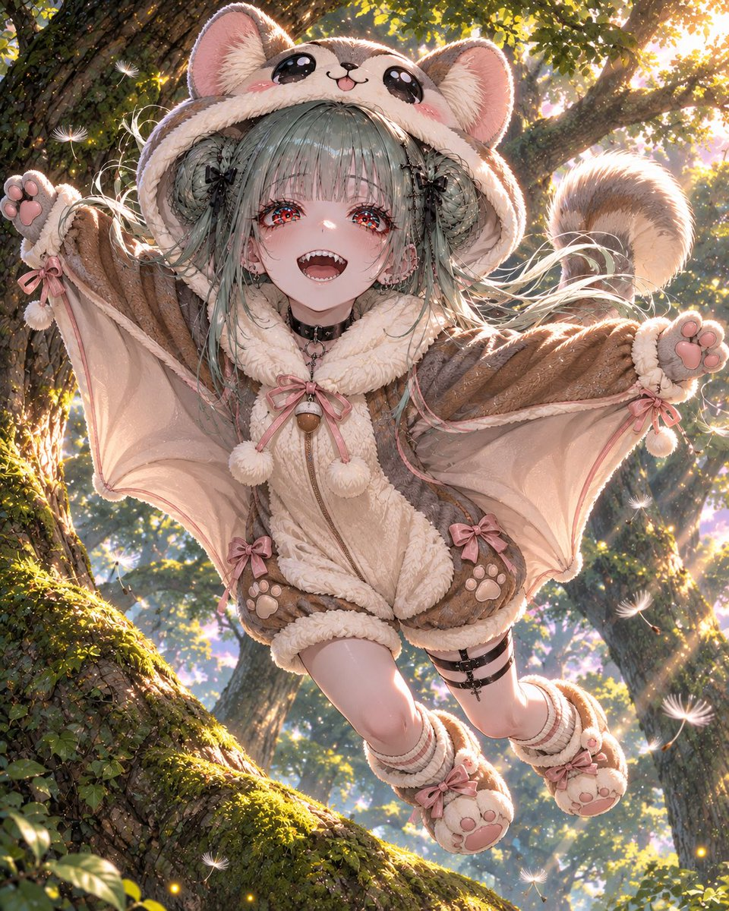

# 飞鼠（ももんが）毛绒连体装衣装（#るん衣装プロンプト 第260弾）

- 原帖链接：https://x.com/ENJU1123PIPI/status/2118659674430210380
- 作者：るんちゃん🦋（@ENJU1123PIPI）
- 时间：2026-11-06 19:00 (UTC+8 / Asia/Hong_Kong)
- 互动摘要：点赞 33 · 转发 9 · 回复 4 · 引用 5 · 书签 4 · 浏览 694（采集快照：2026-11-06 20:10 UTC+8）
- 模型/工具：未注明（角色参考图驱动的通用生图 prompt）
- 标签：二次元
- 媒体路径：
  - `media/images/2118659674430210380_1.jpg`（）
  - `media/images/2118659674430210380_2.jpg`（）
  - `media/images/2118659674430210380_3.jpg`（）
  - `media/images/2118659674430210380_4.jpg`（）
- 入库日期：2026-11-06
- 备注：prompt 在作者自回复；需附上角色参考图使用。标签为衣装改造系。

## prompt 原文

```text
FLYING SQUIRREL KIGURUMI

Momonga × Fluffy Animal Costume × Cute Fantasy

Use the attached character as the sole reference. Faithfully preserve their face, hairstyle, hair color, eye color, body proportions, accessories, and personality. Completely redesign the outfit.

OUTFIT DESIGN

Dress the character in an irresistibly cute, premium Japanese flying squirrel (momonga) kigurumi.

Color palette: Caramel brown, warm gray, creamy ivory, soft beige, and pastel pink accents.

Oversized fluffy hood featuring large rounded ears with pink inner fur and an embroidered momonga face with enormous glossy black eyes.
Thick ivory faux-fur collar, soft belly panel, and cozy oversized one-piece romper with puffy shorts.
Wide plush sleeves ending in rounded paw mittens with pink paw pads.
Large, soft gliding membranes naturally connecting both wrists to the sides of the waist, with brown outer fabric and creamy ivory inner panels.
Short, thick, rounded fluffy tail attached at the back.
Chunky animal-paw slippers, fluffy cuffs, tiny ribbons, pom-poms, and delicate embroidered details.
Luxuriously soft fleece, realistic plush textures, rounded silhouettes, and natural fabric folds.

Keep the original hairstyle and face clearly visible beneath the hood.

The gliding membranes are the signature feature. They must form an adorable flying-squirrel silhouette when the character spreads both arms, seamlessly integrated into the costume rather than appearing as separate wings or a cape.

POSE & COMPOSITION

Dynamic full-body illustration of the character playfully gliding through a magical forest.

Both arms spread outward, displaying the wide fabric membranes. Legs lifted naturally behind, fluffy tail floating upward, and hair flowing in the breeze.

Use a dramatic diagonal composition with a slightly low camera angle, emphasizing airborne movement and the costume’s rounded silhouette.

Expression: Sparkling eyes, delighted smile, rosy cheeks, and playful excitement.

Alternatively, create a charming crouching pose on a massive moss-covered tree branch, with the fluffy tail curled beside the character.

BACKGROUND & ATMOSPHERE

Enchanted forest at golden hour, enormous ancient trees, moss-covered branches, lush green foliage, warm sunlight filtering through leaves, floating dandelion seeds, glowing fireflies, and soft atmospheric depth.

Create a whimsical, heartwarming fantasy atmosphere with cinematic lighting and gentle motion.

ART STYLE

Masterpiece-quality anime illustration, bold clean outlines, refined dimensional cel shading, exquisite multilayered glass-like irises, delicate facial details, beautifully rendered fluffy fur, realistic fabric construction, soft subsurface scattering, luminous highlights, expressive posing, dynamic perspective, and rich environmental detail.

Final impression: An incredibly adorable, fluffy momonga character joyfully gliding through a magical forest, combining premium costume design, playful movement, and breathtaking anime artistry.

Negative: Multiple characters, altered identity, extra limbs, malformed hands, detached membranes, bird wings, incorrect anatomy, text, logos, watermarks, collage.
```

---

个人学习归档，非商业。prompt 与媒体版权归原作者 @ENJU1123PIPI，引用请回到原帖。
