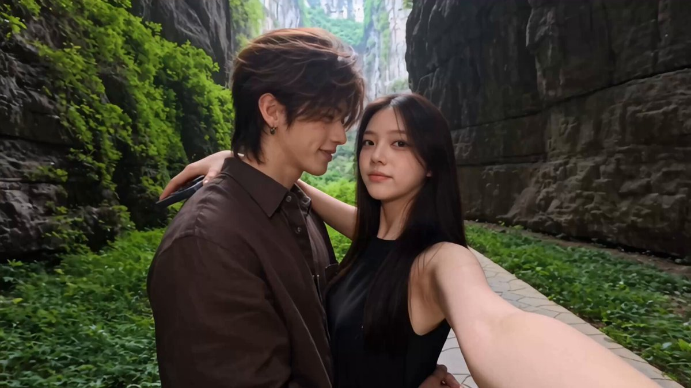

# 「吻遍山海」双人旅行接吻匹配剪辑导演提示词（Seedance 2.5，15 秒）

- 原帖链接：https://x.com/johnAGI168/status/2118685315741470926
- 作者：John（@johnAGI168）
- 时间：2026-11-06 20:41 (UTC+8 / Asia/Taipei)
- 互动摘要：点赞 151 · 转发 21 · 回复 6 · 引用 4 · 书签 82 · 浏览 12696（采集快照：2026-11-09 09:10 UTC+8）
- 模型/工具：Seedance 2.5
- 标签：真人
- 媒体路径：
  - `media/video-stills/2118685315741470926_still.jpg`（视频封面截图，）
  - 视频本体未入库，仅保留原帖链接：https://x.com/johnAGI168/status/2118685315741470926
- 入库日期：2026-11-09
- prompt 来源：https://x.com/johnAGI168/status/2118685808043446747
- 备注：prompt 在作者自回复（中英混排长文：角色绑定、亲吻连续性、剪辑、6 个地点、分镜），原样摘录。角色设定明确为成年男女主，需配两张角色参考图（@图片1/@图片2）。视频仅保留原帖链接。

## prompt 原文

```text
SEEDANCE 2.5 / 吻遍山海 / 双人旅行亲吻导演提示词

Duration：15秒
Aspect ratio：16:9横屏
Overall style：真实情侣旅行自拍，风景优美、地标清楚、亲吻自然投入。用不同旅行地点中“已经吻在一起”的片段进行匹配剪辑。人物有真实呼吸和细微动作，每个吻都有明确接触，不是两张脸摆出接吻姿势。

SUBJECT / 角色绑定：
@ 图片1＝陆景川，成年男主，面容与身份遵循角色卡。
@ 图片2＝沈清禾，成年女主，面容与身份遵循角色卡。
正文只使用人物名字，不额外描述长相。

GLOBAL CONTINUITY / 自拍与人物关系：
陆景川始终在画面左，沈清禾始终在画面右。
沈清禾右臂伸向镜头持机，前臂自然进入右下角，手机在画外；左臂搭在陆景川肩后。陆景川自然环住她腰侧，两人肩胸贴近。
相机位于两人侧前方，略高于眼睛，以双人胸上中近景为主，能够同时看清两人的侧脸、嘴唇接触处和身后地标。
人物保持画面中心位置，地标从头顶和两侧露出。不能为了展示风景，把脸拍得太小。

KISS CONTINUITY / 核心亲吻要求：
只有开场呈现一次靠近过程，后续所有旅行镜头的第一帧，两人就已经双唇贴合。
每一段都截取一个真实持续的吻的中间部分：切入时正在吻，镜头停留期间继续吻，切出时仍在吻。
两人的头轻轻向相反方向偏，鼻尖自然错开，上下唇柔和贴合，接触处有自然的轻微受压变化。双唇之间没有空气缝隙，不能只碰鼻子或把嘴停在对方脸旁。
亲吻期间双眼自然闭合，下颌放松，有很小的贴近与回应；身体、手指和发丝仍在轻微运动，不能像静止照片。
可以在保持唇部接触的情况下轻微调整头部角度，但不反复分开再碰上，不频繁啄吻，不夸张张嘴、不伸舌。
两人共同投入：陆景川轻轻环紧她的腰，沈清禾搭肩的手自然收拢，身体主动贴近，没有单方面追着另一人的嘴。
摄影机必须看得到唇部贴合的位置，不能用后脑、头发或手挡住，靠遮挡假装已经亲吻。

CAMERA CONTINUITY / 剪辑：
28mm左右自然广角自拍，轻微持机晃动，不做第三人称环绕。
切景使用吻姿匹配硬切（Match cut），切点前后保持男左女右、相近的头部角度、脸部大小与嘴唇接触位置。
每个地点都是分别拍摄的情侣接吻片段，不是把同一张接吻截图贴到不同背景上。
地点变化时，现场光线、衣服与发丝受风状态自然改变；嘴唇接触和人物身份始终清楚。
没有闪白、溶解、背景变形或旋转转场。

LOCATIONS / 场景与穿搭：
A｜张家界峡谷：高耸石壁、浓绿植物、木质步道。男主深棕衬衫，女主黑色无袖上衣。
B｜重庆洪崖洞：层叠吊脚楼与暖金灯火，夜景有清楚纵深。男主白色Polo衫，女主黑色连衣裙。
C｜芙蓉镇瀑布：古镇建筑、暖灯、流动瀑布与薄水雾。男主浅蓝衬衫，女主灰蓝轻薄外搭。
D｜上海外滩：蓝调天空、黄浦江、清楚的陆家嘴天际线。男主浅蓝衬衫，女主黑色上衣。
E｜张家界峰林：开阔观景台、石柱峰林与层层薄雾。男主深棕衬衫，女主米白薄开衫。
F｜丽江古城：木质屋檐、石板街、向远处延伸的红灯笼。男主米白衬衫，女主深色外搭。
同一地点再次出现时，服装与光线保持对应；服装只随硬切改变。

────────────────────

SHOT 1（0.0—3.0秒）｜靠近，然后真正吻住

Subject：陆景川、沈清禾。
Environment：地点A，张家界峡谷步道，自然日光从峡谷上方落下。
Action：
0.0—0.8秒，两人相拥站立，沈清禾举着镜头，转脸看陆景川。他低头看她，两人的目光短暂相遇。
0.8—1.5秒，沈清禾轻抬下巴，陆景川稍低头，两人共同靠近，头部轻偏，鼻尖错开。
1.5—3.0秒，双唇明确贴合，轻轻压住并维持接触；两人闭眼，腰肩贴近，进入自然持续的吻。
Camera：侧前方双人自拍中近景（Medium close-up），拍清从靠近到嘴唇接触的过程，不在接触前切走。
Style：真实肤色、自然日光，石壁与绿色植物仍能辨认。
Performance / Dialogue：靠近时笑意慢慢收住，吻住后眉眼放松、呼吸轻缓；无对白。
Constraints：必须在这一镜看清两人确实吻在一起，随后保持接触直到切镜。

SHOT 2（3.0—12.0秒）｜换了风景，仍然吻在一起

Subject：陆景川、沈清禾。
Environment：六组旅行场景交替出现。
Action：12个片段，每段0.75秒。每一段都从双唇已经贴合的状态开始，到结束仍然贴合；不再重复对视、靠近、寻找嘴唇的动作。

镜头顺序：
3.00—3.75秒：B，洪崖洞灯火下，已经闭眼吻住。
3.75—4.50秒：E，峰林云雾前，保持贴唇，微风吹动发梢。
4.50—5.25秒：C，瀑布夜景前，相拥接吻，水流在身后持续落下。
5.25—6.00秒：D，外滩蓝调时刻，女主搭肩的手轻轻收紧，唇部仍贴合。
6.00—6.75秒：A，峡谷日光中，男主稍贴近，女主自然回应，接触不断。
6.75—7.50秒：F，灯笼夜街里，维持柔和、稳定的吻。
7.50—8.25秒：C，回到瀑布场景，换取同一地点另一段持续接吻的活画面。
8.25—9.00秒：B，暖金建筑灯火下，两人肩胸相贴，唇部接触清楚。
9.00—9.75秒：E，峰林远景前，头部极小幅调整，但嘴唇没有分开。
9.75—10.50秒：D，城市天际线前，男主环腰的手轻轻收紧。
10.50—11.25秒：A，峡谷步道上，两人继续闭眼接吻，衣料轻动。
11.25—12.00秒：F，灯笼夜街，落到一个稳定、投入的吻。

Camera：每段保持侧前方自拍角度，让嘴唇接触处可见。切镜依据吻姿匹配，不能靠巨大机位变化掩盖接触。
Style：不同地点有不同光线和穿搭，白天、蓝调、夜景交替；人物始终真实融入现场。
Performance / Dialogue：保持柔和的唇部接触、细微呼吸与自然拥抱。每段是持续动作，不是停住不动的亲吻照片。无对白。
Constraints：每一镜都必须已经吻住。不能出现嘴唇悬停、只碰鼻尖、亲脸颊、临近接触就切走，或切入后重新凑嘴。

SHOT 3（12.0—15.0秒）｜让这个吻完整停留

Subject：陆景川、沈清禾。
Environment：地点F，丽江古城夜街，暖红灯笼向远处延伸。
Action：延续上一段的接吻姿态，不重新开始。
12.0—13.2秒，陆景川轻轻收拢环腰的手，沈清禾自然贴近，搭在他肩后的手指轻轻弯曲。
13.2—15.0秒，两人继续温柔而投入地吻着，双唇维持贴合，只随呼吸和身体靠近产生极小的角度变化。镜头安静停留，拍清一个没有被剪断的持续亲吻。
Camera：稳定的双人自拍中近景（Medium close-up），保持唇部接触可见，不用嘴部极端特写，不拉成远景。
Style：暖灯照亮侧脸，皮肤有自然明暗，背景灯笼与街道保留层次。
Performance / Dialogue：闭眼、放松、彼此回应，肩膀自然下沉，身体相依；无对白。
Constraints：结束时两人仍然吻在一起，不分开微笑、不改成额头相抵、不看镜头摆拍。

────────────────────

AUDIO / 声音：
轻柔浪漫、节拍清楚的旅行配乐，剪辑点跟随音乐。
结尾音乐稍舒展，让持续亲吻停留完整三秒。
保留低音量风声、衣料摩擦与自然呼吸。
无对白、无旁白、无字幕，不添加夸张亲吻音效。

NEGATIVE / 关键约束：
嘴唇未接触，嘴唇之间有缝，鼻尖相碰代替亲吻。
接触前切走，反复凑近，机械啄吻，亲脸颊替代贴唇。
后脑遮挡接触，头发遮嘴，借位假吻。
静止接吻截图，人物抠图，僵硬身体。
嘴部融合，鼻子穿模，夸张张嘴，强压后脑。
换脸，左右站位翻转，多余手臂，手指畸形。
背景融化，地标混合，镜头内自动变装。
字幕，水印，屏幕文字，旁白。
```

---

个人学习归档，非商业。prompt 与媒体版权归原作者 @johnAGI168，引用请回到原帖。
