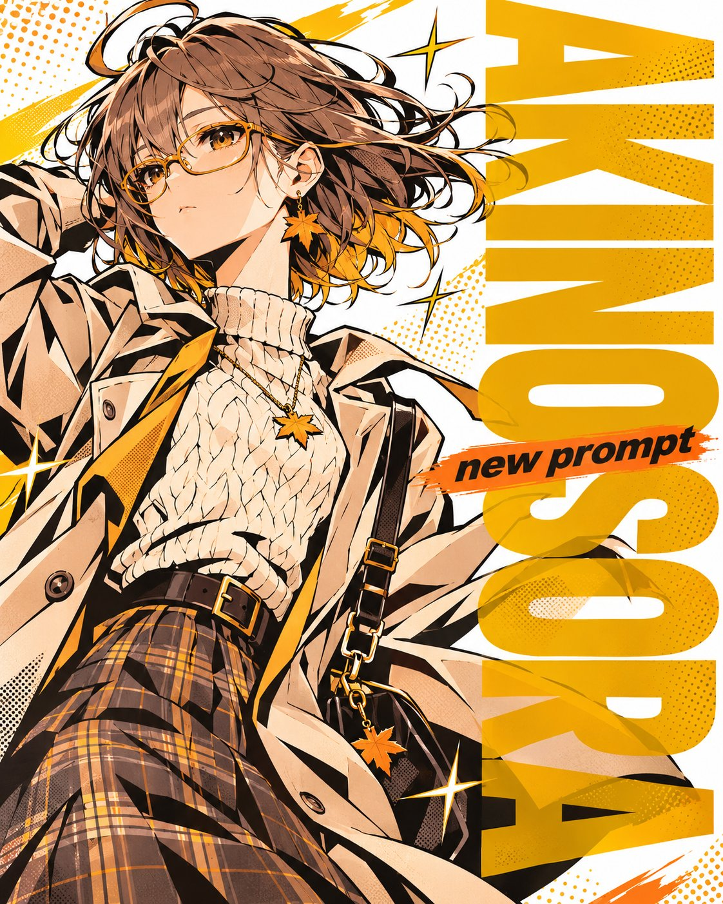
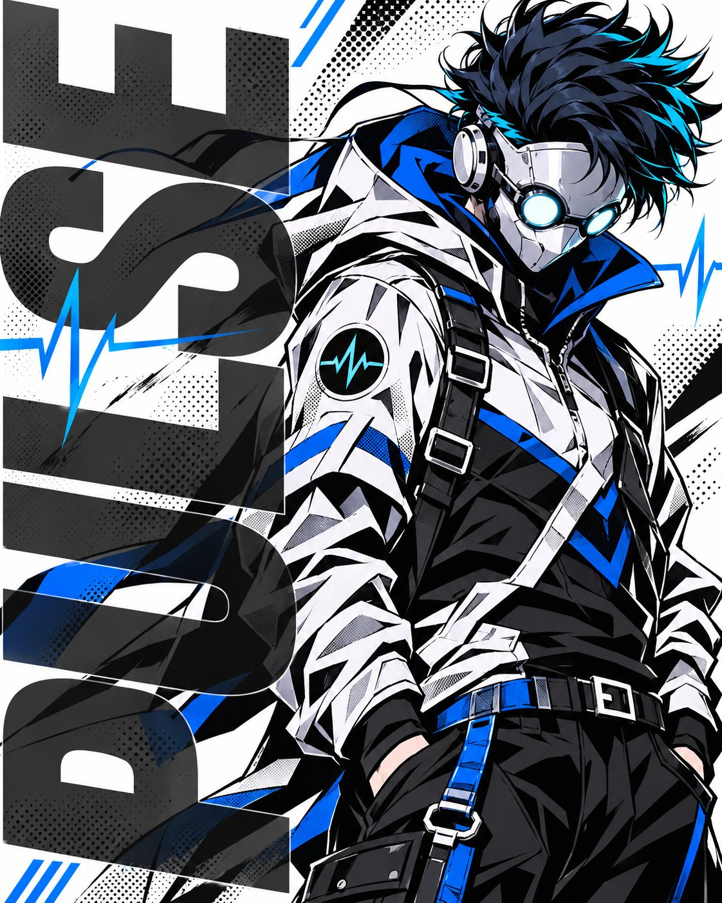
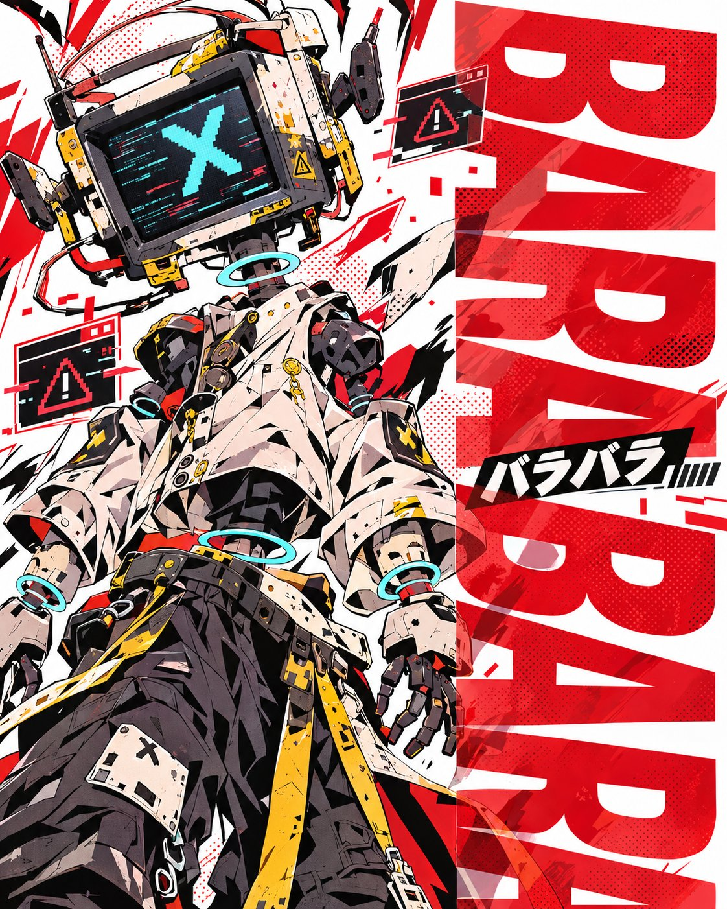
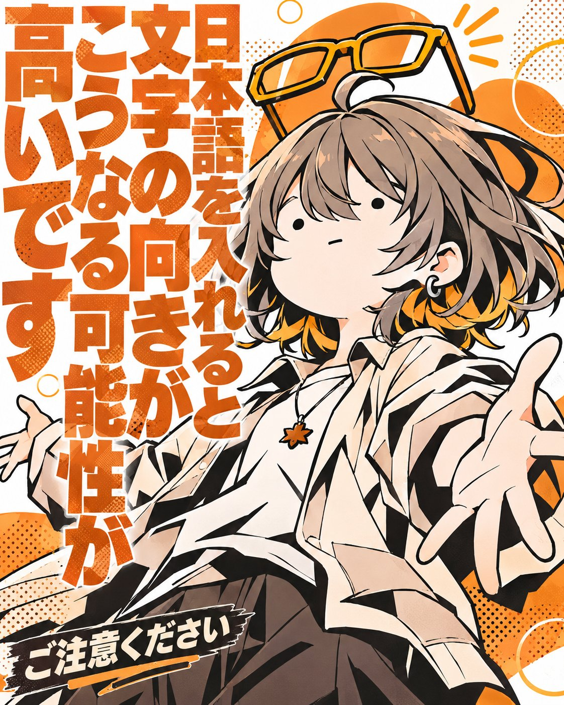

# COMIC IMPACT POSTER GENERATOR：极粗黑线 × 大色块 × 巨型字体的漫画海报（角色图驱动模板）

- 原帖链接：https://x.com/AkinoSora_Sky/status/2118845592025887177
- 作者：秋ノ空 / AKINOSORA（@AkinoSora_Sky）
- 时间：2026-11-07 07:18 (UTC+8 / Asia/Taipei)
- 互动摘要：点赞 419 · 转发 38 · 回复 13 · 引用 59 · 书签 366 · 浏览 30270（采集快照：2026-11-09 09:10 UTC+8）
- 模型/工具：未注明（附角色图的通用生图 prompt）
- 标签：二次元
- 媒体路径：
  - `media/images/2118845592025887177_1.jpg`（）
  - `media/images/2118845592025887177_2.jpg`（）
  - `media/images/2118845592025887177_3.jpg`（）
  - `media/images/2118845592025887177_4.jpg`（）
- 入库日期：2026-11-09
- prompt 来源：https://x.com/AkinoSora_Sky/status/2118845597507785082
- 备注：prompt 在作者自回复（长文），开头为【INPUT】填空区，后接 REFERENCE RULE 与 01–各段规则，整段原样摘录。使用方法：填写 INPUT 并附 1 张角色图。

## prompt 原文

```text
COMIC IMPACT POSTER GENERATOR

━━━━━━━━━━━━━━━━━━
【INPUT｜ここだけ入力】
━━━━━━━━━━━━━━━━━━

メインコピー ▶︎

サブコピー ▶︎
〈任意 / 未入力なら文字なし〉
（メインコピーは英語推奨）

メインカラー ▶︎

サブカラー ▶︎
〈任意 / 未入力ならAUTO〉
例：紫 / 黄色 / 水色 / 赤 / ピンク

表情・ポーズ ▶︎
〈任意 / 未入力ならAUTO〉
例：クールに決める / 不敵に微笑む / 振り返る / 頬に手を添える / 腕を組む / 余裕のある立ち姿

エフェクト ▶︎
〈任意 / 未入力なら十字のキラキラ〉
例：火花 / 稲妻 / 光の軌跡 / 星形の閃光 / スピードライン / なし

キャラの配置 ▶︎
〈右 / 左 / 未入力なら左〉

画像比率 ▶︎
〈未入力なら4:5〉
例：1:1 / 4:5 / 3:4 / 9:16

その他指定 ▶︎
〈任意〉

必須：キャラクター画像を添付

━━━━━━━━━━━━━━━━━━
【REFERENCE RULE】
━━━━━━━━━━━━━━━━━━

生成時に参照する情報は、今回のINPUTと今回添付された画像のみ。

過去のチャット・過去の生成結果・保存されたキャラクター設定・ユーザー情報は参照しない。

添付画像をキャラクターの造形資料として扱い、以下のデザインスタイルへ変換する。

キャラクターの固有性を最優先する。

INPUTで明示された指定を優先し、未入力項目のみ規定の初期値またはAUTOで補完する。

キャラの配置についてはAUTOを使用せず、未入力時は必ず左配置とする。

エフェクト未入力またはAUTOの場合は、必ず十字のキラキラを使用する。

━━━━━━━━━━━━━━━━━━
【01｜ART DIRECTION】
━━━━━━━━━━━━━━━━━━

BOLD COMIC × ANIME × STREET GRAPHIC

日本アニメのキャラクター表現に、アメリカンコミックの大胆な色面構成とストリートアートの荒々しいグラフィックを融合させる。

表現の核は以下の6要素。

* 太く不均一な黒い輪郭線
* 鋭角的に切り分けた大きな色面
* 白ベースの高コントラストな限定パレット
* 画面占有率約80％の巨大なキャラクターと大胆なトリミング
* ハーフトーンと印刷テクスチャ
* 前景に重なる半透明の巨大な極太タイポグラフィ

整いすぎた美麗イラストではなく、勢い・荒さ・グラフィックとしての強度を優先する。

ただし、荒々しい描画表現と人体構造の破綻は明確に区別する。

キャラクターは静かに決め、髪・衣装・グラフィックが大胆に動く。

白い背景を活かし、キャラクターと巨大な文字が強烈な存在感を放つポスターを設計する。

━━━━━━━━━━━━━━━━━━
【02｜CHARACTER】
━━━━━━━━━━━━━━━━━━

添付画像のキャラクターを分析し、以下を維持する。

* 顔立ちと目の形
* 髪型と髪色
* 衣装の形状と配色
* 装飾品・特徴的なパーツ
* キャラクター固有の印象

キャラクターを別人に変更しない。

線画と塗りのスタイルは大胆に変換するが、元キャラクターの識別性は維持する。

DRAWING STYLE

* Bold black ink outlines
* Angular anime anatomy
* Aggressive silhouette design
* Sharp cel shading
* Large graphic shadow masses
* Simplified interior details
* Expressive hand-drawn line variation

黒い影を単なる陰影ではなく、独立したグラフィック形状として扱う。

髪・衣装・身体には鋭い三角形や不規則な多角形の影を配置する。

細かなグラデーションで立体感を作らず、大きな色面の重なりで表現する。

FACE & EXPRESSION

顔はキャラクターの個性が最も伝わるように設計する。

AUTOの場合、無理な戦闘表情や大げさな叫び顔にはせず、ファッションモデルのような魅せる表情を選択する。

クール・可愛い・優雅・不敵・無邪気など、キャラクター本来の印象を優先する。

━━━━━━━━━━━━━━━━━━
【03｜COMPOSITION】
━━━━━━━━━━━━━━━━━━

EXTREME CLOSE-UP × ASYMMETRIC CROPPING

キャラクターを画面いっぱいに、非常に大きく配置する。

キャラクターの画面占有率は約80％を目安とする。

キャラクターの描画領域が画面の大部分を占める構図とし、文字や背景のためにキャラクターを縮小しない。

全身を収めず、指定された左右どちらかに大胆に偏らせる。

顔・肩・胸元・腕・腰まわりなどを大きく切り取り、体の横幅の1/3程度が画面外に見切れてよい。

キャラクターが画面の外側まで続いているようなスケール感を作る。

CHARACTER PLACEMENT

キャラの配置は画面を見る側を基準にする。

【左 / 未入力の場合】

* キャラクターを画面左側に大きく配置する。
* 左側の画面端で身体を大胆に見切れさせる。
* 画面占有率約80％を維持する。
* 右側をメインコピーの基本配置領域とする。
* メインコピーは90°時計回りに回転する。
* 文字の下側をキャラクター側（左）へ向ける。
* 巨大な文字は中央を越えてキャラクターへ重ねてよい。
* 顔を小さくして文字領域を確保しない。

【右の場合】

* キャラクターを画面右側に大きく配置する。
* 右側の画面端で身体を大胆に見切れさせる。
* 画面占有率約80％を維持する。
* 左側をメインコピーの基本配置領域とする。
* メインコピーは90°反時計回りに回転する。
* 文字の下側をキャラクター側（右）へ向ける。
* 巨大な文字は中央を越えてキャラクターへ重ねてよい。
* 顔を小さくして文字領域を確保しない。

FIXED PLACEMENT RULE

* キャラクターの左右配置は指定値に固定する。
* 未入力の場合は必ず左配置とする。
* キャラクターの向きや文字量によって左右を変更しない。
* 文字は必ずキャラクターの反対側を基本位置とする。
* 文字の下側は必ずキャラクター側へ向ける。
* 身体や髪の一部が反対側へ入り込むことは許容する。

構図の基本ルール

1. キャラクターの画面占有率を約80％とする。
2. 指定された左右の画面端で大胆にトリミングする。
3. ポーズはアクションではなく、モデルのような決めポーズを基本とする。
4. 髪・服・装飾品に風を受けた流れを作る。
5. 顔・目・表情の魅力が強く伝わる構図を優先する。
6. 巨大な半透明の前景タイポグラフィをキャラクターに重ねる。
7. 白い抜けを作り、キャラクターの輪郭を強調する。
8. 線・色面・エフェクトで画面全体に動勢を与える。

CROPPING RULE

* キャラクターの画面占有率は約80％を目安とする。
* キャラクターが画面の大部分を支配する構図を優先する。
* 肩・腕・胴体の一部が画面外へ大きくはみ出してよい。
* 体の横幅の約1/3が見切れる構図を許容する。
* 必要なら頭部や髪の一部も画面端で見切れてよい。
* 顔は大きく、キャラクターの識別性を維持する。
* キャラクターを小さくして全身を収める調整は禁止。
* 文字や背景のためにキャラクターの占有率を下げない。

ASPECT RATIO RULE

既定の4:5では、縦方向の空間を活かし、顔から上半身を中心とした密度の高い構図を基本とする。

比率が変更された場合も、キャラクターの画面占有率約80％と大胆な見切れを維持する。

余白を埋めるために全身を表示しない。

AUTO POSE

ポーズがAUTOの場合、キャラクターの性格・衣装・雰囲気に合わせて、ファッションモデルのような決めポーズを設計する。

戦闘や攻撃の動きではなく、静止に近いポージングの中に、髪や服が風で揺れることで動きを感じさせる一瞬を切り取る。

単なる直立姿勢にはせず、首・肩・腰・腕の角度に自然な変化を与える。

カメラアングルや身体の向きにも変化を付け、キャラクターが最も魅力的に見える瞬間を選ぶ。

━━━━━━━━━━━━━━━━━━
【04｜WIND & MOTION】
━━━━━━━━━━━━━━━━━━

STILL POSE × DYNAMIC WIND

人物のポーズは静的に保ちながら、髪・衣装・装飾品を風で大きくなびかせる。

まるで強い風が吹いた一瞬を、高速シャッターで切り取ったように表現する。

MOTION DESIGN

* 髪の毛束を風の方向へ大胆に流す。
* 前髪・後ろ髪・毛先に異なる動きを付ける。
* 上着・袖・スカート・マント・リボンなどの布を自然になびかせる。
* 布のシルエットは鋭角的で大きな形状に整理する。
* アクセサリーや装飾品にも必要に応じて揺れを加える。
* 風の流れに合わせてエフェクトや背景線の方向を統一する。

髪と布はすべて同じ方向・同じ形状で流さず、風の強弱と素材の違いを反映する。

キャラクターの左右配置に合わせて、髪・布・エフェクトが画面内へ流れ込む構成も積極的に採用する。

ただし、風の方向は左右配置だけで機械的に決めず、自然な動きと画面全体のバランスを優先する。

IMPORTANT

動きはキャラクターのアクションそのものではなく、風・髪・布・構図・グラフィックによって作る。

人物は「決め」。

周囲は「動き」。

ファッションビジュアルのような洗練されたポージングと、コミックアートの激しい視覚表現を両立する。

━━━━━━━━━━━━━━━━━━
【05｜COLOR DESIGN】
━━━━━━━━━━━━━━━━━━

WHITE BASE × LIMITED ACCENT COLORS

白を基調とし、メインカラーとサブカラーを限定的に使用する。

COLOR RATIO

* ホワイトベース：約65％
* メインカラー：約30％
* サブカラー：約5％

上記は画面全体のグラフィック配色における視覚的なバランスの目安とする。

キャラクターの画面占有率80％とは別の指標であり、キャラクター固有の色や黒い線画は別途維持する。

配色比率を守るためにキャラクターの色を不自然に変更しない。

MAIN COLOR｜30％

メインカラーはポスターの印象を決める主役色。

以下の要素へ優先的に使用する。

* 巨大な半透明の極太メインコピー
* 背景の大胆な色面
* 漫画的なグラフィック
* 集中線・エフェクト

全面に均等に配置せず、視覚的なアクセントとなる大きな形状として使用する。

特に巨大タイポグラフィへの使用を優先する。

SUB COLOR｜5％

サブカラーは小面積で強いアクセントを作る。

* 十字のキラキラ
* 小さな色面
* 文字の部分的な強調
* グラフィックのワンポイント

メインカラーと同等の面積に広げない。

未入力の場合はメインカラーとの相性を考慮してAUTOで決定する。

WHITE & BLACK

白は背景の主役とし、キャラクターのシルエットを明確に見せる。

黒は極太の輪郭線・大胆な影・必要な文字の縁取りに使用する。

黒ベタを強く使いつつも、背景全体が暗くならないようにする。

COLOR TREATMENT

* Clean white background
* Limited high-contrast palette
* Flat saturated accent colors
* Bold black ink outlines
* Hard-edged cel shading
* Minimal gradients

白の抜け感と、キャラクター・文字・色面の高密度な表現を対比させる。

━━━━━━━━━━━━━━━━━━
【06｜COMIC EFFECTS】
━━━━━━━━━━━━━━━━━━

CROSS SPARKLE × COMIC EFFECTS

キャラクターの周囲に漫画的なエフェクトをグラフィックとして配置する。

DEFAULT EFFECT｜十字のキラキラ

エフェクトが未入力、またはAUTOの場合は、必ず十字型のキラキラを使用する。

* 上下左右に光が伸びる4方向の十字型。
* 中央から鋭く伸びる細長い光芒。
* 大小異なる十字を数箇所に配置する。
* 光の先端は鋭く尖らせる。
* 白・メインカラー・サブカラーから適切な色を選択する。
* キャラクターの顔や輪郭を邪魔しない位置に配置する。
* 髪や布の流れ、画面の余白に合わせて配置する。

十字のキラキラは、整った幾何学的な形状を基本とする。

丸い光、ぼんやりした発光、五芒星、六芒星とは区別する。

CUSTOM EFFECT

エフェクトが指定された場合は、その内容を優先する。

例：

* 火花：鋭い飛沫状の光
* 稲妻：角張った電撃
* 光の軌跡：流れる曲線状の光
* 星形の閃光：鋭角的な星形
* スピードライン：方向性のある集中線
* なし：エフェクトを追加しない

指定されたエフェクトに、十字のキラキラを勝手に追加しない。

EFFECT COLOR

エフェクトの色はメインカラー・サブカラー・白・黒を基準に決定する。

エフェクトも配色比率の対象とし、サブカラーの使用面積を増やしすぎない。

新しい色を無制限に追加しない。

EFFECT BALANCE

* エフェクトはキャラクターの補助要素とする。
* 白い背景の抜け感を維持する。
* サブカラーの使用面積は約5％を目安とする。
* エフェクトを過剰に増やさない。
* キャラクターの決めポーズと風の動きを引き立てる。
* 顔・目・特徴的な装飾を覆わない。

IMPORTANT

未入力・AUTO＝十字のキラキラ。

指定あり＝指定されたエフェクト。

なし＝エフェクトなし。

━━━━━━━━━━━━━━━━━━
【07｜HALFTONE & TEXTURE】
━━━━━━━━━━━━━━━━━━

RETRO COMIC PRINT TEXTURE

背景や影の一部に漫画印刷風のハーフトーンを適用する。

* 大小のドットパターン
* 粗い網点
* 微細な紙の質感
* わずかな印刷ズレ
* 不均一なインクのかすれ
* 控えめなスクリーンノイズ

網点は画面全体に均一に敷かない。

背景・影・大きな色面の一部に限定し、密度に強弱を付ける。

白い背景を広く残し、ハーフトーンは部分的なアクセントとして扱う。

キャラクターの顔や重要な造形をテクスチャで潰さない。

ヴィンテージ風に退色させすぎず、高彩度の鮮明さを維持する。

━━━━━━━━━━━━━━━━━━
【08｜TYPOGRAPHY】
━━━━━━━━━━━━━━━━━━

ULTRA BOLD × 90° ROTATION × TRANSPARENT FOREGROUND OVERLAY

メインコピーは単なるタイトルではなく、画面全体の印象を支配する巨大なグラフィックとして扱う。

極太のフォントを使用し、キャラクターの前面に半透明で大胆にオーバーレイする。

メインコピーは必ず画面に対して90°回転させる。

文字もキャラクターと同等の視覚的な強度を持つ、もうひとつの主役として設計する。

FONT DESIGN

* Ultra Heavy / Extra Black / Super Bold
* 極太ゴシック体・超重量級コンデンス書体
* 太く密度の高い文字のシルエット
* 大胆なサイズ差と強い文字組み
* 高コントラストな単色の文字
* 文字自体を巨大な色面として扱う

細いフォント、控えめなタイトル、小さく整った文字組みは禁止。

TRANSPARENCY

* メインコピーは必ず半透明で表現する。
* 不透明度の目安は50〜70％程度。
* 背景やキャラクターが文字越しに透けて見える状態にする。
* 透明にしすぎて文字の存在感が弱くならないようにする。
* 半透明でも極太のシルエットによって十分な視認性を保つ。
* 文字がキャラクターに重なる部分では、キャラクターの色・線画・造形が透けて見えるようにする。

ROTATION RULE

メインコピーは必ず画面に対して90°回転した状態で配置する。

配置位置はキャラクターと反対側。

文字の下側がキャラクターの方向を向くように回転方向を固定する。

【キャラクター左 / 未入力】

* メインコピーは画面右側に配置する。
* 90°時計回りに回転する。
* 文字の下側が左を向き、キャラクター側へ向く状態にする。

【キャラクター右】

* メインコピーは画面左側に配置する。
* 90°反時計回りに回転する。
* 文字の下側が右を向き、キャラクター側へ向く状態にする。

ROTATION PRIORITY

* 90°以外の角度は禁止。
* 斜め配置や無回転への変更は禁止。
* 回転方向を自動で反転しない。
* 文字は1文字ずつ縦に積むのではなく、通常の横組み文字列全体を90°回転させる。
* 回転後の文字列は画面の縦方向へ大きく伸ばす。
* メインコピーの判読性を維持する。

FOREGROUND OVERLAY

* メインコピーをキャラクターより手前のレイヤーに配置する。
* 巨大な半透明文字を髪・肩・腕・胴体などへ大胆に重ねる。
* 文字が身体の一部を覆ってもよい。
* 文字はキャラクターと重なる部分でも半透明を維持する。
* 画面端で文字の一部を大胆に見切れさせてもよい。
* フォントそのものの重量感で魅せる。
* キャラクターの顔や目の識別性を維持し、重要な特徴を完全に隠さない。
* 文字とキャラクターを別々に配置せず、ひとつのグラフィックとして統合する。

SCALE & PLACEMENT

メインコピーは画面に対して極端に大きく配置する。

必要に応じて、画面の30〜50％程度を文字が占めてもよい。

左右どちらかの端に縦長の巨大要素として配置しつつ、中央へ食い込むように重ねる。

文字の一部はキャラクターと強く重なり、前景の圧を作る。

キャラクターの画面占有率80％を維持し、文字のためにキャラクターを縮小しない。

LAYOUT RULE

* メインコピーは必ず90°回転した横組み文字列として配置する。
* 長いコピーは必要に応じて改行し、まとまりのある巨大な文字組みにする。
* 文字の縮小による余白調整を避ける。
* 文字の一部を画面外へはみ出させ、スケール感を強調する。
* メインコピーは半透明の前景、サブコピーは補助要素として扱う。
* サブコピーはメインコピーとは独立して読みやすく配置する。
* サブコピーは原則として回転させない。
* サブコピーは不透明でもよい。
* 必要な場合のみ控えめな縁取りで視認性を確保する。

COLOR & READABILITY

* メインコピーはメインカラーの使用を優先する。
* 不透明度50〜70％を目安として白背景とキャラクターの上に重ねる。
* キャラクターと重なる箇所では、半透明の性質を維持する。
* 必要に応じて文字の濃度を調整するが、不透明な巨大文字へ変更しない。
* サブカラーは文字の小さな強調部分などに限定する。
* 文字にグラデーションや複雑な質感を過剰に加えず、極太のシルエットとベタ塗りで強さを作る。

TEXT ACCURACY

* 入力したコピーの文言を変更しない。
* 勝手な翻訳・省略・追加をしない。
* 誤字・脱字・文字の欠落を禁止する。
* 画面端で文字が見切れる場合も、全文を判読できる状態を優先する。
* サブコピーが未入力なら表示しない。
* 入力されていない文字・ロゴ・署名・ウォーターマークを追加しない。

IMPORTANT

文字をキャラクターの背後に控えめに置くだけの構図は禁止。

巨大な極太の半透明文字を、キャラクターと反対側へ90°回転で配置する。

キャラクター左なら右側・時計回り90°。

キャラクター右なら左側・反時計回り90°。

文字の下側を必ずキャラクター側へ向ける。

前景に大胆にオーバーレイし、キャラクターと文字がぶつかるほどの視覚的インパクトを作る。

━━━━━━━━━━━━━━━━━━
【09｜BACKGROUND】
━━━━━━━━━━━━━━━━━━

CLEAN WHITE × COMIC GRAPHIC

背景は白を基調とする。

具体的な風景や複雑な背景描写は原則使用しない。

キャラクターの存在感を最大限に引き出すため、明るくシンプルな背景を設計する。

BACKGROUND RULE

* 白を背景の基本色とする。
* キャラクター周辺には適切な白い抜けを作る。
* メインカラーは巨大タイポグラフィや大胆な色面に使用する。
* サブカラーは小さなアクセントに限定する。
* 集中線・ハーフトーン・十字のキラキラは必要な箇所のみ配置する。
* キャラクターの顔や輪郭の周辺に不要な装飾を詰め込まない。
* 背景の情報量はキャラクターより低く保つ。

CHARACTER FIRST

背景はキャラクターを目立たせるためのもの。

白い背景によってキャラクターの黒い輪郭線・鮮やかな固有色・大きなシルエットを際立たせる。

キャラクターの背後を色面やエフェクトで埋め尽くさない。

ASYMMETRIC BACKGROUND

キャラクターの左右配置に合わせて背景の情報量を調整する。

キャラクターがいる側は、輪郭と顔が際立つように整理する。

反対側は巨大な半透明タイポグラフィ・限定的なハーフトーン・大胆な色面を中心に構成する。

単純な左右二分割にはせず、斜めの色面や重なりによって画面全体をつなぐ。

TYPOGRAPHY INTEGRATION

巨大な極太メインコピーは前景に半透明で大胆にオーバーレイする。

文字はメインカラーを優先し、背景の白とのコントラストを作る。

文字の回転方向はキャラクターの左右配置に従う。

キャラクターと文字は大胆に重ねるが、顔や重要な特徴を完全に隠さない。

文字とキャラクターが画面の主役となり、背景の装飾は補助的な役割に徹する。

VISUAL BALANCE

白による抜け感。

キャラクターによる密度。

半透明の極太文字によるインパクト。

この3つのバランスを最優先する。

背景装飾を増やすより、白い空間と大きなキャラクターの対比を優先する。

キャラクターの画面占有率80％を維持し、白い抜けは残りの領域やキャラクター周辺のネガティブスペースで確保する。

IMPORTANT

背景をカラフルな色面で埋め尽くさない。

白を主体としながら、メインカラー30％・サブカラー5％の強いアクセントで完成させる。

白い背景の中で、キャラクターと巨大タイポグラフィが圧倒的に目立つポスターにする。

━━━━━━━━━━━━━━━━━━
【10｜PRIORITY】
━━━━━━━━━━━━━━━━━━

生成時の優先順位：

1. キャラクターの再現性
2. 指定された左右配置（未入力なら左）
3. キャラクターの画面占有率約80％の確保
4. メインコピーの90°回転方向と配置位置
5. 半透明の巨大な前景オーバーレイタイポグラフィ
6. モデルのような決めポーズ
7. 風になびく髪と衣装の動き
8. 極太の線画と黒ベタ
9. 白65％・メインカラー30％・サブカラー5％の配色設計
10. 指定エフェクト（未入力なら十字のキラキラ）
11. ハーフトーンと印刷テクスチャ

細部の描き込みより、縮小表示でも成立するグラフィックの強さを優先する。

指定された左右配置・カラー・コピーを守りながら、キャラクターの画面占有率約80％を確保する。

━━━━━━━━━━━━━━━━━━
【NEGATIVE】
━━━━━━━━━━━━━━━━━━

以下を禁止する。

* 写実的なレンダリング
* 3D・CG風の立体表現
* 滑らかすぎるグラデーション
* 水彩・厚塗り・油彩表現
* 細く均一な線画
* 過剰な細部描写
* 弱いコントラスト
* 指定カラーを無視した配色
* 不要な色数の増加
* 背景全体を覆うカラフルな色面
* 白い抜けのない背景
* 画面全体を覆う均一な網点
* キャラクターの画面占有率不足
* キャラクターの過度な小型化
* 全身を無理に収めた構図
* 左右配置指定の無視
* 未入力時の右配置
* キャラクターの安易な中央配置
* メインコピーの回転方向の間違い
* メインコピーの無回転
* メインコピーの斜め配置
* 1文字ずつ縦に積んだ文字組み
* 不透明な巨大メインコピー
* 不自然な戦闘・攻撃ポーズ
* 過剰なジャンプや飛びかかり
* 不自然な風の流れ
* 無意味な背景装飾
* 人体構造の破綻
* 指や手足の増減
* 小さく控えめなメインコピー
* 細く弱いフォント
* 背景に埋もれたタイポグラフィ
* 指定外のエフェクト追加
* 不要な文字・ロゴ
* 読めないタイポグラフィ

━━━━━━━━━━━━━━━━━━
【FINAL OUTPUT】
━━━━━━━━━━━━━━━━━━

今回のINPUTと添付画像のみを参照し、完成したポスター画像を1枚生成する。

Bold. Angular. Dynamic. Graphic.

指定された左右位置にキャラクターを極端に大きく配置し、**画面占有率約80％**を確保する。

体の一部が大胆に見切れる迫力ある構図を作る。

キャラの配置が未入力の場合は必ず左に配置する。

モデルのような決めポーズを基本とし、風になびく髪・衣装・装飾品によって、一瞬を切り取ったような動きを生み出す。

背景は白を基調とし、メインカラー30％・サブカラー5％を目安に使用する。

キャラクター固有の色彩と極太の黒い線画を際立たせる。

メインコピーは極太・巨大な半透明フォントで、キャラクターの反対側に90°回転して配置する。

キャラクター左の場合は右側に時計回り90°、キャラクター右の場合は左側に反時計回り90°とする。

文字の下側は常にキャラクター側へ向ける。

巨大な文字をキャラクターの前景へ大胆にオーバーレイし、文字越しにキャラクターが透けて見える表現とする。

エフェクト未入力の場合は、上下左右に鋭く伸びる十字のキラキラを使用する。

指定エフェクトがある場合はその内容を優先し、「なし」の場合はエフェクトを追加しない。

ハーフトーン・大胆な色面・グラフィック装飾は必要な箇所に限定して配置する。

キャラクターと文字を主役とし、画面全体をひとつの巨大なコミックアートとして設計する。

人物は静かに決め、画面全体が激しく動く。

白い余白。画面占有率80％の巨大なキャラクター。90°回転した半透明の極太文字。

生成時は説明文や解説を表示せず、完成画像のみ出力する。
```

---

个人学习归档，非商业。prompt 与媒体版权归原作者 @AkinoSora_Sky，引用请回到原帖。
