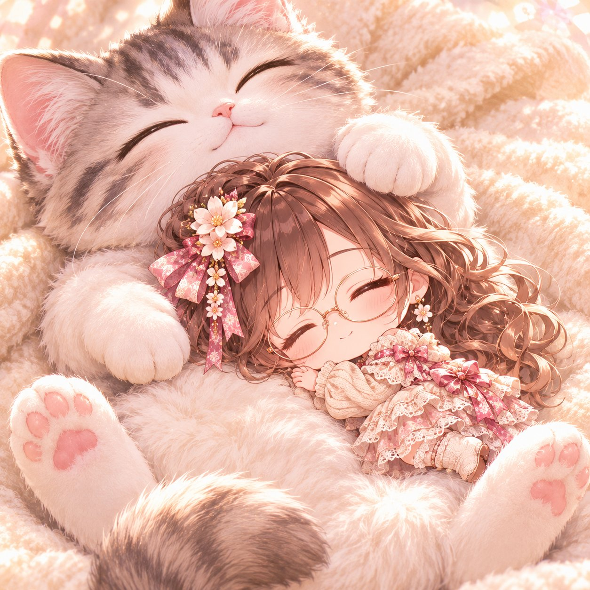
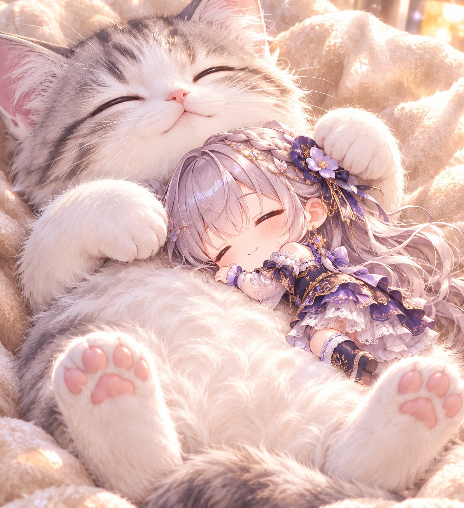

# 「子猫のおなかでお昼寝」二头身迷你角色枕着小猫午睡（#ゆきプロンプト）

- 原帖链接：https://x.com/AIXyu1v/status/2118867845354570170
- 作者：ゆき　AIイラストXで収益化（@AIXyu1v）
- 时间：2026-11-07 08:47 (UTC+8 / Asia/Taipei)
- 互动摘要：点赞 132 · 转发 14 · 回复 10 · 引用 39 · 书签 44 · 浏览 8390（采集快照：2026-11-09 09:10 UTC+8）
- 模型/工具：未注明（附角色图的通用生图 prompt）
- 标签：二次元
- 媒体路径：
  - `media/images/2118867845354570170_1.jpg`（）
  - `media/images/2118867845354570170_2.jpg`（）
- 入库日期：2026-11-09
- prompt 来源：https://x.com/AIXyu1v/status/2118867944168214587
- 备注：prompt 在作者自回复，日文结构化（【シーン】【可愛さのポイント】【構図・背景】【仕上がり】【禁止事項】），原样摘录。

## prompt 原文

```text
【プロンプト】
子猫のおなかでお昼寝 🐱💤

添付画像のキャラクターを、二頭身の可愛いミニキャラにして描いてください。

髪型・髪色・瞳の色・衣装・アクセサリーなど、元キャラの特徴を忠実に再現してください。

【シーン】
ふわふわの大きな子猫が、仰向けで気持ちよさそうに眠っています。
ミニキャラは子猫の柔らかいおなかを枕にして、横向きにころんと寝転がり、安心しきった表情でぐっすりお昼寝しています。

子猫の前足がミニキャラのそばに優しく添えられ、まるで守っているような雰囲気。

【可愛さのポイント】
・子猫はミニキャラの数倍の大きさ
・ふわふわで柔らかな毛並み
・ミニキャラの幸せそうな寝顔
・小さな手をほっぺの横に添えた寝姿
・子猫とミニキャラが自然に触れ合っている
・思わず一緒に眠りたくなる温かな空気感

【構図・背景】
子猫1匹とミニキャラ1人を画面中央に大きく配置。両方の顔と寝姿がよく見える、少し上からの構図。
淡いクリーム色のふわふわした毛布の上。柔らかな午後の日差し、優しいパステルカラー。
【仕上がり】
高品質な癒し系アニメイラスト。丸みのある二頭身、繊細な毛並み、柔らかな光、温かく幸せな雰囲気。
【禁止事項】
キャラの特徴変更、人物の追加、猫の追加、余分な手足、不自然な接触、体の融合、怖い表情、複雑な背景、文字、ロゴ、透かし。
```

---

个人学习归档，非商业。prompt 与媒体版权归原作者 @AIXyu1v，引用请回到原帖。
