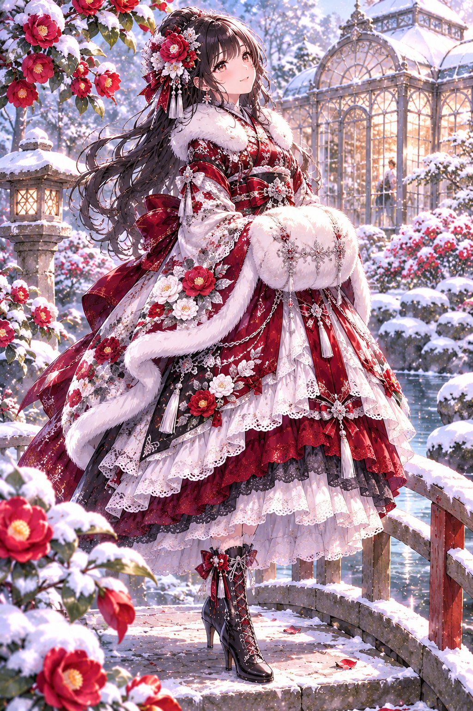
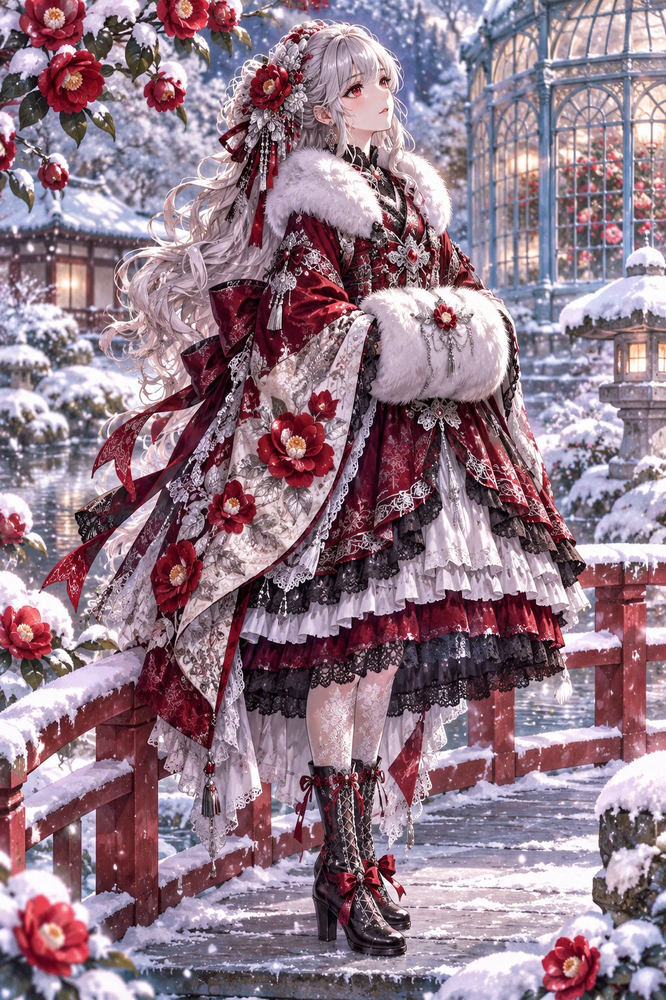
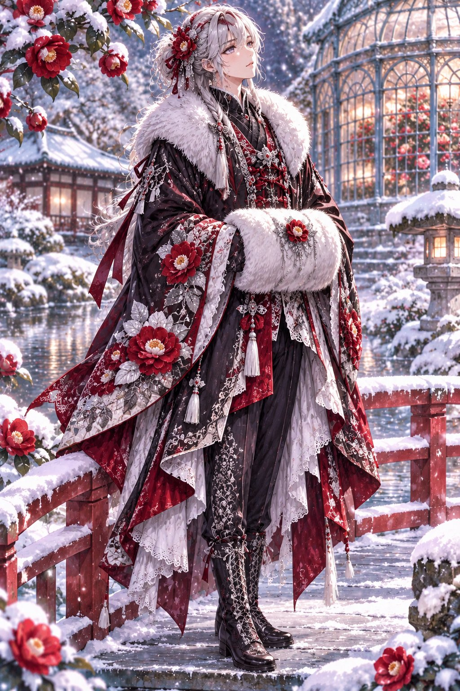

# 雪椿の冬和ロリ：雪中日式庭园的红椿和风洛丽塔（男女两版 #ゆきプロンプト）

- 原帖链接：https://x.com/AIXyu1v/status/2118954108577370600
- 作者：ゆき　AIイラストXで収益化（@AIXyu1v）
- 时间：2026-11-07 14:30 (UTC+8 / Asia/Taipei)
- 互动摘要：点赞 84 · 转发 9 · 回复 4 · 引用 16 · 书签 24 · 浏览 40353（采集快照：2026-11-09 09:10 UTC+8）
- 模型/工具：未注明（作者在回复中称交给「チャッピー」即 ChatGPT 生成）
- 标签：二次元
- 媒体路径：
  - `media/images/2118954108577370600_1.jpg`（）
  - `media/images/2118954108577370600_2.jpg`（）
  - `media/images/2118954108577370600_3.jpg`（）
- 入库日期：2026-11-09
- prompt 来源：https://x.com/AIXyu1v/status/2118954110938697841, https://x.com/AIXyu1v/status/2118954112662552888
- 备注：prompt 在作者两条自回复：【女性用プロンプト】与【男性用プロンプト】，均明确写 adult。两段依次原样摘录。

## prompt 原文

```text
【女性用プロンプト】
Masterpiece anime illustration, full-body portrait of a beautiful adult Japanese woman in an elegant winter wa-lolita outfit, standing gracefully on a small stone bridge.

Deep crimson, snow white, ink black, and silver color palette. Luxurious layered kimono-inspired lolita dress with wide sleeves embroidered with red camellias, delicate black lace, fluffy white fur trim, a rich crimson obi, intricate silver ornaments, and a softly flared skirt.

Long glossy black hair with a silver camellia hairpin, gentle eyes, serene expression, rosy cheeks from the cold.

Both hands tucked naturally inside a soft white fur muff held at her waist, quietly admiring the snowy garden.

Snow-covered Japanese garden, blooming red camellias, elegant Western-style glass conservatory in the background, stone lanterns, softly falling snow, delicate winter sunlight.

Cinematic composition, exquisite fabric details, refined atmosphere, natural anatomy, no extra people, no text, no watermark.
```

```text
【男性用プロンプト】
Masterpiece anime illustration, full-body portrait of a handsome adult Japanese man in an elegant winter wa-ouji outfit, standing on a snow-covered stone bridge.

Deep crimson, snow white, ink black, and silver palette. Luxurious tailored black tailcoat with wide kimono-inspired sleeves embroidered with red camellias, intricate silver patterns, delicate black lace, fluffy white fur collar and cuffs, a rich crimson obi-style sash, fitted trousers, and polished black boots.

Dark auburn hair with soft layered bangs, silver camellia hair ornament, refined features, calm crimson eyes, gentle expression.

Both hands tucked naturally inside a white fur muff held at his waist, quietly admiring the snowy scenery.

Snow-covered Japanese garden, blooming red camellias, traditional stone lanterns, elegant Western glass conservatory glowing warmly in the background, softly falling snow.

Cinematic winter lighting, exquisite embroidery, graceful masculine silhouette, natural anatomy, no extra people, no text, no watermark.
```

---

个人学习归档，非商业。prompt 与媒体版权归原作者 @AIXyu1v，引用请回到原帖。
