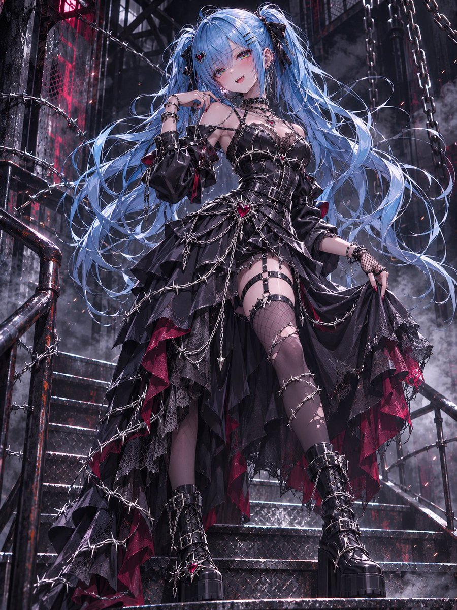
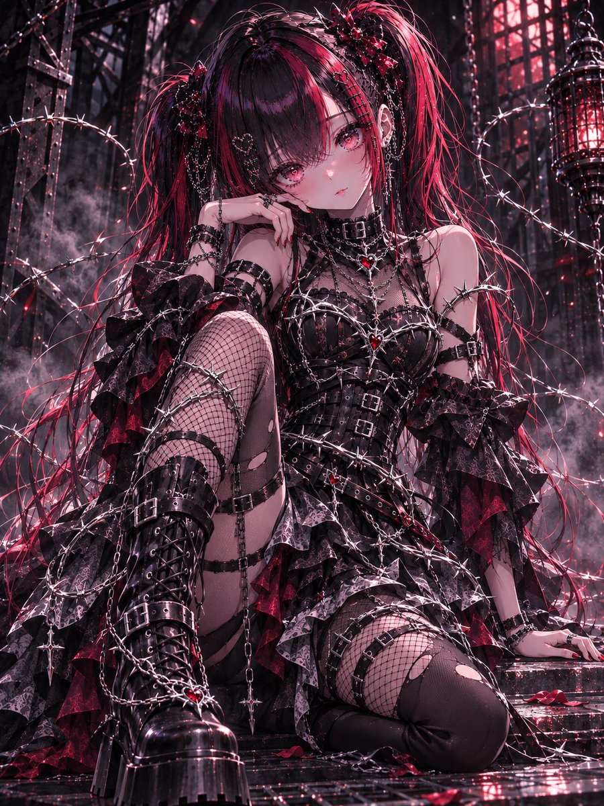
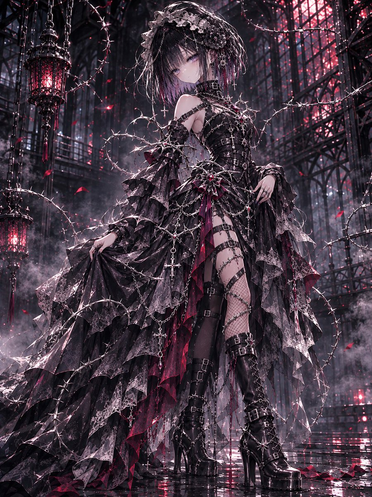
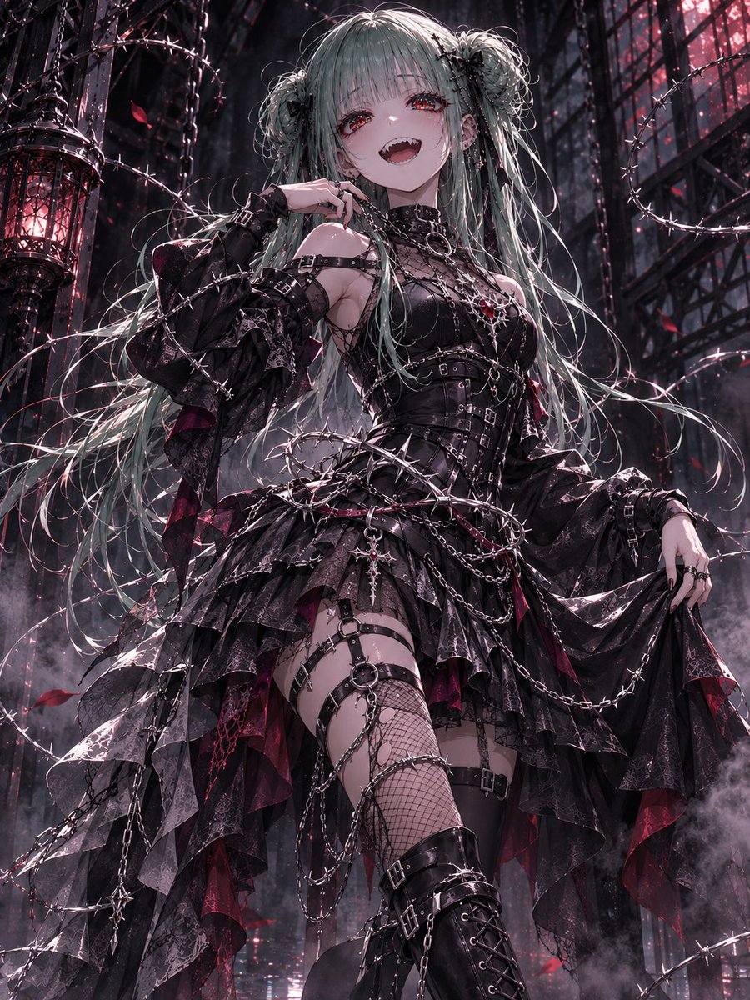

# BARBED WIRE COUTURE：荆棘铁丝哥特朋克衣装（#るん衣装プロンプト 第264弾）

- 原帖链接：https://x.com/ENJU1123PIPI/status/2119384440262860980
- 作者：るんちゃん（@ENJU1123PIPI）
- 时间：2026-11-08 19:00 (UTC+8 / Asia/Shanghai)
- 互动摘要：点赞 123 · 转发 33 · 回复 7 · 引用 10 · 书签 16 · 浏览 3370（采集快照：2026-11-09 20:10 UTC+8）
- 模型/工具：未注明（角色参考图驱动的通用衣装 prompt）
- 标签：二次元
- 媒体路径：
  - `media/images/2119384440262860980_1.jpg`（）
  - `media/images/2119384440262860980_2.jpg`（）
  - `media/images/2119384440262860980_3.jpg`（）
  - `media/images/2119384440262860980_4.jpg`（）
- 入库日期：2026-11-09
- 备注：prompt 位于作者自回复（2119384441831452849）；作者自回复里原文英文。

## prompt 原文

```text
BARBED WIRE COUTURE

Use the attached character as the absolute identity reference. Preserve their face, hairstyle, hair color, eye color, body proportions, accessories, personality, and gender presentation. Redesign only the outfit.

Create an original dark fantasy couture outfit combining barbed wire, gothic punk fashion, chains, and dangerous elegance.

Color palette: Black, charcoal, gunmetal, silver, with subtle crimson accents.

Outfit: A sharply tailored black corset or fitted upper garment, asymmetrical layered skirt or structured bottoms, ornate buckles, metallic belts, flowing fabric panels, and heavy platform boots. Integrate sculptural silver barbed wire into the collar, sleeves, waist, and skirt edges. Add thorn-shaped ornaments, draped chains, intricate lace, leather textures, asymmetric stockings, and delicate crimson gemstones.

The design should feel luxurious, rebellious, fashionable, and slightly dangerous rather than resembling torture equipment.

Pose: Confident and expressive, with natural body movement. One hand resting near the waist, collar, or decorative chains, the other relaxed or gently lifting the outfit. Choose a visually striking camera angle that complements the character’s original proportions.

Background: Atmospheric industrial-gothic architecture, iron structures, hanging chains, subtle sparks, drifting smoke, wet reflective surfaces, and dramatic crimson lighting.

Art style: Masterpiece anime illustration, ultra-detailed costume design, refined expressive linework, sharp dimensional shading, intricate metallic reflections, realistic fabric folds, luminous eyes, cinematic lighting, rich textures, elegant composition, 8K quality.

Single character, standalone vertical 3:4 illustration. No identity changes, anatomy errors, malformed hands, extra limbs, text, logos, or watermarks.
```

---

个人学习归档，非商业。prompt 与图片版权归原作者 @ENJU1123PIPI，引用请回到原帖。
