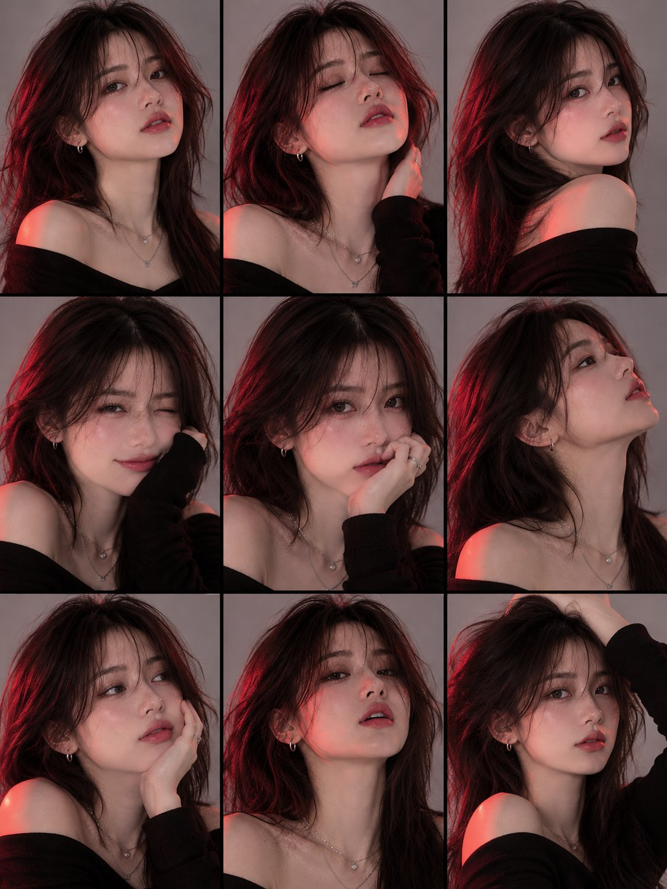

# 红光侧打的短发 bob 时尚人像（GPT Image 2.6 via Higgsfield）

- 原帖链接：https://x.com/saniaspeaks_/status/2119391748426469769
- 作者：𝗦𝗮𝗻𝗶𝗮（@saniaspeaks_）
- 时间：2026-11-08 19:29 (UTC+8 / Asia/Taipei)
- 互动摘要：点赞 47 · 转发 2 · 回复 23 · 引用 0 · 书签 20 · 浏览 1172（采集快照：2026-11-09 09:10 UTC+8）
- 模型/工具：GPT Image 2.6（经 Higgsfield）
- 标签：真人
- 媒体路径：
  - `media/images/2119391748426469769_1.jpg`（）
- 入库日期：2026-11-09
- prompt 来源：https://x.com/saniaspeaks_/status/2119391748426469769
- 备注：prompt 即主帖正文（含 Negative Prompt），整段摘录。配图为 9 宫格多姿态样张。

## prompt 原文

```text
GPT image 2.6 via higgsfield 

Prompt 
Ultra-Realistic Cinematic Fashion Portrait
A stunning young East Asian woman with a short, messy black bob haircut and wispy bangs, wearing a black off-shoulder top, delicate silver layered necklaces, small silver hoop earrings and multiple silver rings.
She tilts her head slightly backward with her eyes softly closed, lips slightly parted and an elegant, dreamy expression. One hand rests gracefully beneath her chin, fingers gently touching her jawline.

Lighting: Dramatic, intense crimson-red light illuminating one side of her face, neck, hand and collarbones, creating bold shadows and striking contrast against her dark outfit.

Background: Minimalist plain light-grey studio background with large negative space above her head.

Camera & Composition: Vertical 9:16 portrait, subject positioned in the lower half of the frame, close-up fashion editorial photography, slightly low camera angle, natural tousled hair movement, soft motion blur around the hair, realistic skin texture, cinematic contrast, subtle film grain, high-end magazine aesthetic.

Style: Moody, artistic, mysterious, minimalist, photorealistic, dramatic red-and-black color grading, professional studio photography.

Negative Prompt: Cartoon, anime, plastic skin, excessive retouching, distorted hands, extra fingers, unnatural anatomy, harsh overexposure, text, watermark.
```

---

个人学习归档，非商业。prompt 与媒体版权归原作者 @saniaspeaks_，引用请回到原帖。
