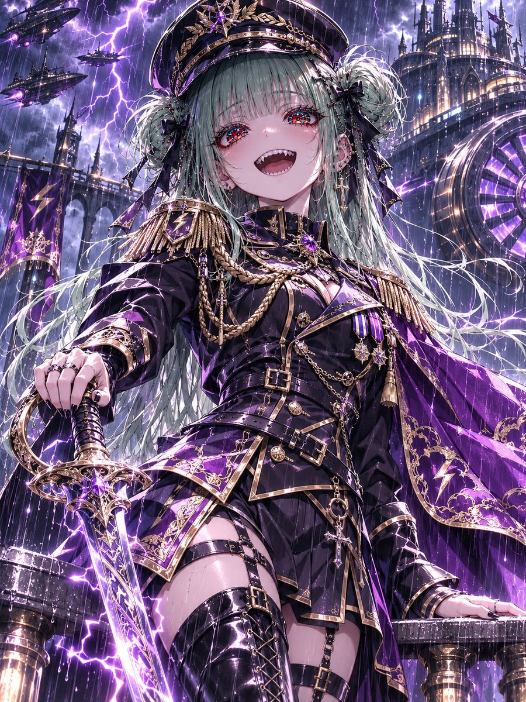
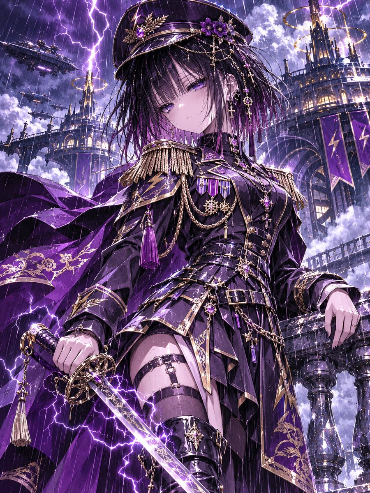
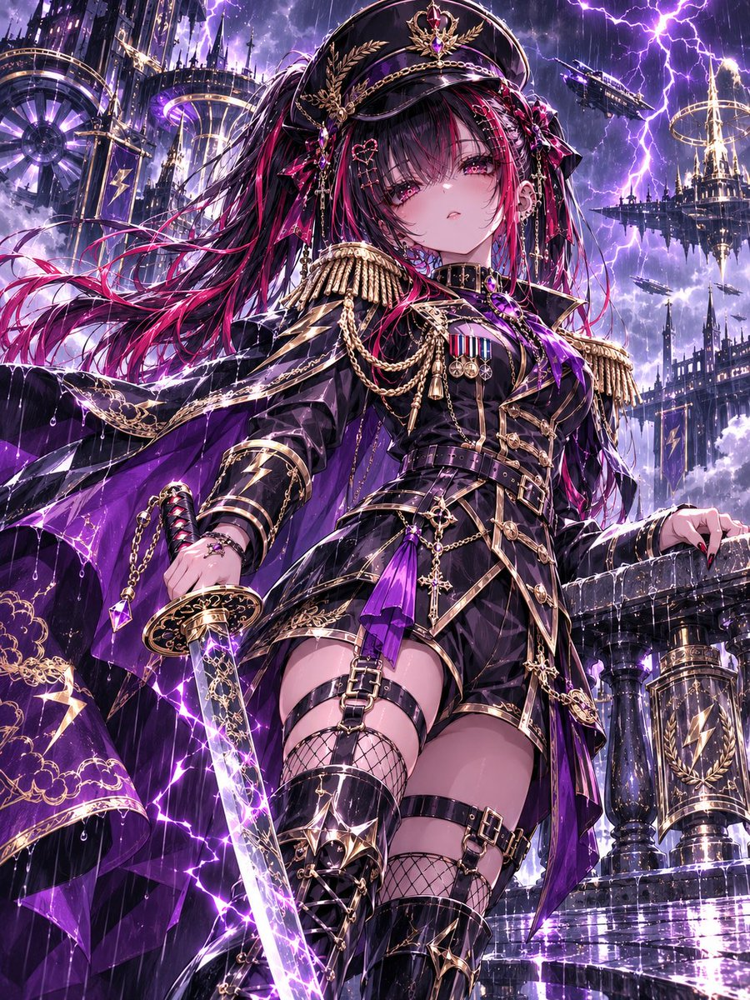
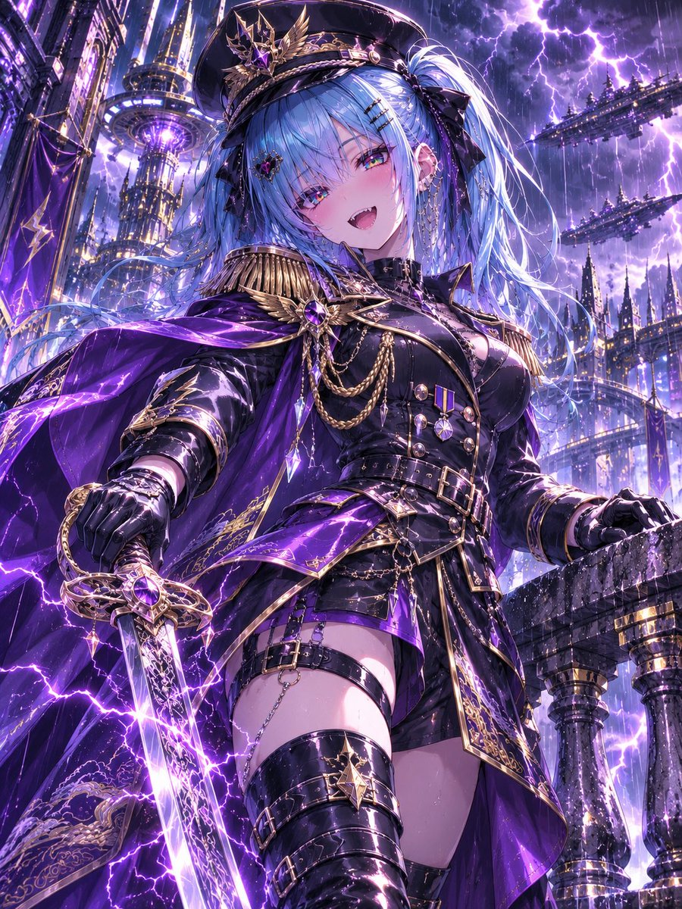

# 雷霆皇帝近卫：紫金军服雷电军官（#るん衣装プロンプト 第265弾）

- 原帖链接：https://x.com/ENJU1123PIPI/status/2119558083743514693
- 作者：るんちゃん（@ENJU1123PIPI）
- 时间：2026-11-09 06:30 (UTC+8 / Asia/Shanghai)
- 互动摘要：点赞 91 · 转发 32 · 回复 4 · 引用 6 · 书签 10 · 浏览 1863（采集快照：2026-11-09 20:10 UTC+8）
- 模型/工具：未注明（角色参考图驱动的通用衣装 prompt）
- 标签：二次元
- 媒体路径：
  - `media/images/2119558083743514693_1.jpg`（）
  - `media/images/2119558083743514693_2.jpg`（）
  - `media/images/2119558083743514693_3.jpg`（）
  - `media/images/2119558083743514693_4.jpg`（）
- 入库日期：2026-11-09
- 备注：prompt 位于作者自回复（2119558085169525147）。

## prompt 原文

```text
THUNDER EMPEROR’S IMPERIAL GUARD — LIGHTNING OFFICER

Use the attached character as the absolute identity reference. Preserve their face, hairstyle, original hair and eye colors, body proportions, head-to-body ratio, accessories, gender presentation, and personality. Redesign only the outfit and environment.

Dress the character as an elite lightning commander in a luxurious black, deep-violet, and antique-gold military uniform. Feature a fitted high-collar jacket, sharp lapels, elaborate gold braiding, lightning-engraved epaulettes, polished medals, jeweled clasps, layered belts, tailored lower garments, reinforced knee-high officer boots, an ornate peaked cap, and an asymmetrical purple cape embroidered with storm motifs.

Equip a single imperial saber with intricate golden engravings and violet lightning coursing along its blade. The character grips the weapon naturally while standing on a rain-soaked balcony overlooking a colossal floating military citadel.

Surround the scene with towering gothic spires, giant turbines, airborne warships, illuminated golden conductors, violent thunderclouds, and electric storms. Wet stone reflects the brilliant flashes of lightning.

Dramatic low three-quarter camera angle, wind-swept hair and cape, confident commanding expression, dynamic yet anatomically accurate pose.

Crisp expressive anime outlines, refined cel shading, intricate fabric folds, realistic metallic reflections, luminous multilayered gemstone irises, cinematic storm lighting, atmospheric depth, exceptional detail.

Vertical 3:4 composition, ultra-high resolution, masterpiece quality, one character only, no text, no extra limbs, no extra fingers, accurate anatomy.
```

---

个人学习归档，非商业。prompt 与图片版权归原作者 @ENJU1123PIPI，引用请回到原帖。
