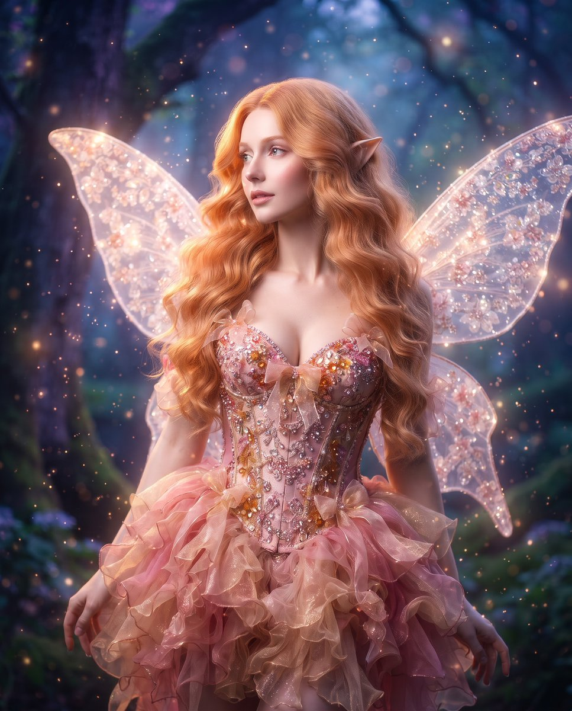

# 粉金暖琥珀色魔法妖精：编辑大片风人像（4:5）

- 原帖链接：https://x.com/Monaqbuv/status/2119731739044000139
- 作者：Mona（@Monaqbuv）
- 时间：2026-11-09 18:00 (UTC+8 / Asia/Shanghai)
- 互动摘要：点赞 10 · 转发 0 · 回复 7 · 引用 1 · 书签 0 · 浏览 208（采集快照：2026-11-09 20:10 UTC+8）
- 模型/工具：未注明
- 标签：真人
- 媒体路径：
  - `media/images/2119731739044000139_1.jpg`（）
- 入库日期：2026-11-09
- 备注：原文含 `[span_N](start_span)` 之类残留标记，按原样保留。

## prompt 原文

```text
A high-fashion editorial portrait of a fair-skinned woman with delicate, ethereal features, styled as a magical fantasy fairy. She has long, voluminous wavy hair in a rich, vibrant shade of warm strawberry blonde/copper, with subtle pointed fairy ear prosthetics peeking through[span_1](start_span)[span_1](end_span). She wears an elaborate, sparkling couture corset and layered ruffled skirt in shades of pink, shimmering gold, and warm amber, accented with delicate bows and intricate crystal beading[span_2](start_span)[span_2](end_span). Large, translucent, glowing fairy wings with intricate floral and glitter patterns span out behind her shoulders[span_3](start_span)[span_3](end_span). Her expression is dreamy and gentle as she gazes off to the side[span_4](start_span)[span_4](end_span). The background is a moody, magical twilight setting with soft, warm atmospheric rim lighting and sparkling bokeh particles that highlight the shimmering textures of her costume and hair. Shot on medium format, cinematic soft lighting, sharp focus, high-end editorial finish, vertical aspect ratio 4:5[span_5](start_span)[span_5](end_span).
```

---

个人学习归档，非商业。prompt 与图片版权归原作者 @Monaqbuv，引用请回到原帖。
