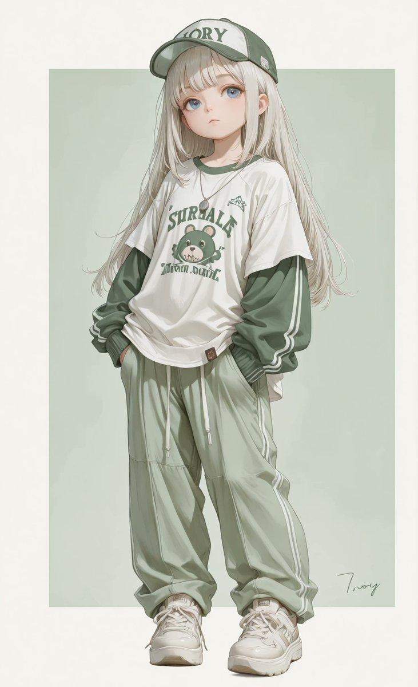
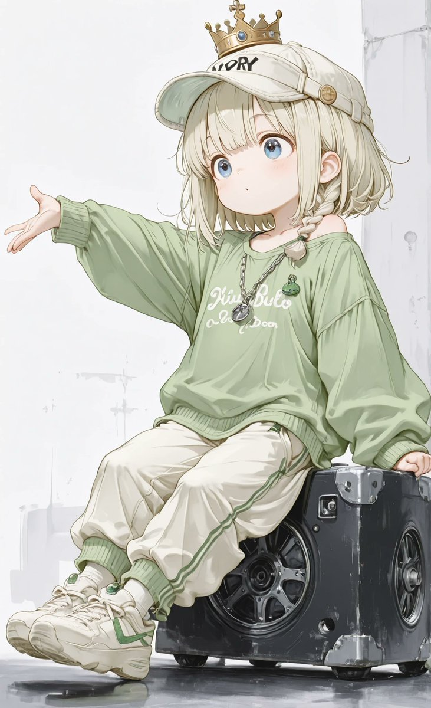
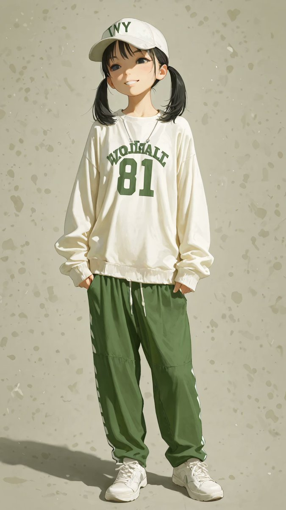
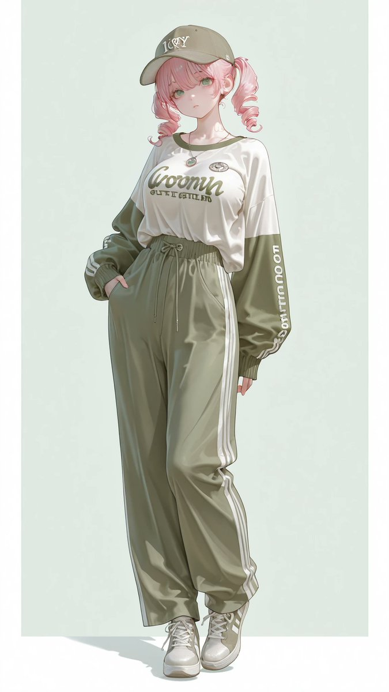

# 宽松运动休闲：橄榄绿卫衣 + 象牙阔腿裤 + 棒球帽（衣装 prompt）

- 原帖链接：https://x.com/AliceLavli/status/2119746825691492536
- 作者：アリス服飾店（@AliceLavli）
- 时间：2026-11-09 19:00 (UTC+8 / Asia/Shanghai)
- 互动摘要：点赞 45 · 转发 12 · 回复 0 · 引用 1 · 书签 12 · 浏览 586（采集快照：2026-11-09 20:10 UTC+8）
- 模型/工具：未注明（通用；作者写可用于 SD / SeaArt / PixAI / ChatGPT / Gemini / Grok / Midjourney / niji）
- 标签：二次元
- 媒体路径：
  - `media/images/2119746825691492536_1.jpg`（）
  - `media/images/2119746825691492536_2.jpg`（）
  - `media/images/2119746825691492536_3.jpg`（）
  - `media/images/2119746825691492536_4.jpg`（）
- 入库日期：2026-11-09
- 备注：prompt 在原帖正文；此处只摘 prompt 段，前面两段作者说明未收。

## prompt 原文

```text
oversized olive green cotton sweatshirt over plain white cotton T shirt, solid olive green crewneck with narrow ribbed neckband, dropped shoulders and wide long sleeves, thick ribbed cuffs and broad ribbed hem, loose hip length sweatshirt with softly folded fabric, white T shirt extending slightly below sweatshirt hem, ivory cotton wide leg trousers with elastic waistband and concealed side pockets, full length straight trouser legs with generous width from hips to ankles, plain ivory woven fabric and neatly stitched hems covering upper shoes, white athletic sneakers with white mesh uppers and white suede panels, flat white laces threaded through small eyelets, sturdy white rubber midsoles and clearly defined solid rubber tread, brown cotton baseball cap with rounded six panel crown and curved fabric covered visor, stitched panel seams and small embroidered ventilation holes, fabric covered top button and white letter embroidery on front panel, adjustable fabric strap at back, thin silver chain necklace with small round metal pendant
```

---

个人学习归档，非商业。prompt 与图片版权归原作者 @AliceLavli，引用请回到原帖。
