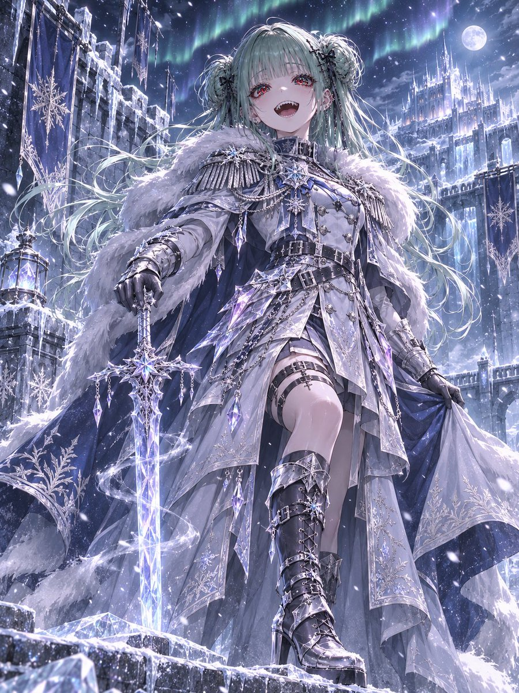
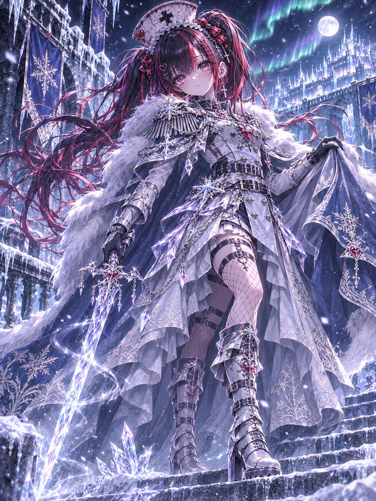
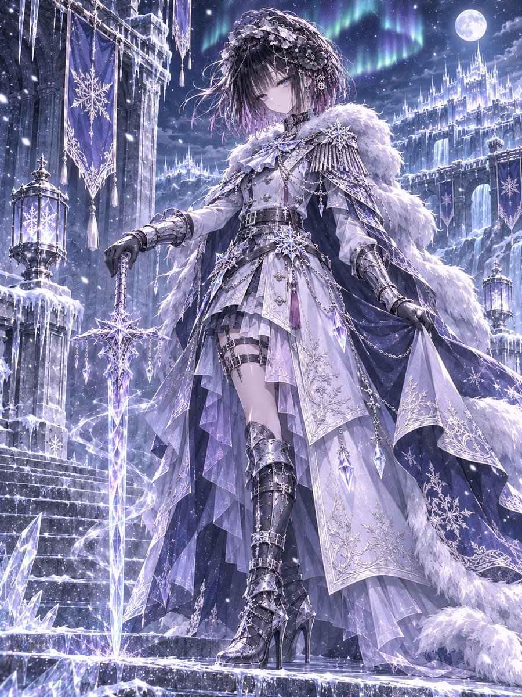
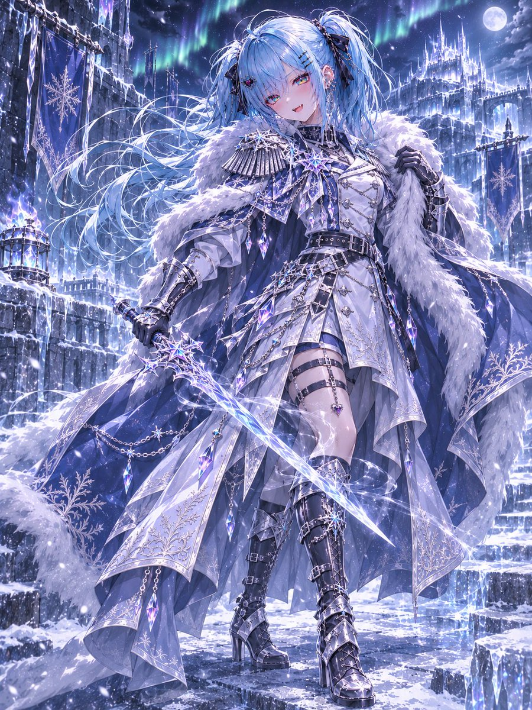

# 霜晶北境元帅：冰雪军服骑士（#るん衣装プロンプト 第266弾）

- 原帖链接：https://x.com/ENJU1123PIPI/status/2119746827872297024
- 作者：るんちゃん（@ENJU1123PIPI）
- 时间：2026-11-09 19:00 (UTC+8 / Asia/Shanghai)
- 互动摘要：点赞 29 · 转发 12 · 回复 4 · 引用 3 · 书签 4 · 浏览 724（采集快照：2026-11-09 20:10 UTC+8）
- 模型/工具：未注明（角色参考图驱动的通用衣装 prompt）
- 标签：二次元
- 媒体路径：
  - `media/images/2119746827872297024_1.jpg`（）
  - `media/images/2119746827872297024_2.jpg`（）
  - `media/images/2119746827872297024_3.jpg`（）
  - `media/images/2119746827872297024_4.jpg`（）
- 入库日期：2026-11-09
- 备注：prompt 位于作者自回复（2119746829646540830）。

## prompt 原文

```text
FROST CRYSTAL NORTHERN COMMANDER — IMPERIAL WINTER GENERAL

Use the attached character as the sole identity reference. Preserve their face, hairstyle, hair color, eye color, body proportions, accessories, gender presentation, and distinctive personality. Never alter their identity or head-to-body ratio.

Transform the character into a supreme commander of a frozen northern empire.

Design an elaborate imperial winter military uniform in white, icy blue, silver, and crystal lavender. Include a fitted high-collar officer coat, structured shoulders, snowflake epaulettes, silver clasps, military medals, layered belts, frost embroidery, armored gauntlets, elegant commander boots, and a luxurious fur-lined cape. Add translucent crystal armor, delicate icicle ornaments, and realistic wool, leather, metal, and fur textures.

Equip the character with a magnificent transparent ice crystal sword, glowing with frozen energy, surrounded by swirling frost and sparkling snowflakes.

Place them within a majestic northern ice fortress featuring frozen battlements, towering crystalline walls, imperial banners, snow-covered citadel spires, and shimmering auroras beneath a moonlit winter sky.

Use a noble, commanding pose with natural cape and hair movement. Cinematic three-quarter or full-body composition, dramatic perspective, refined anime linework, luminous multilayered gemstone eyes, sharp cel shading, detailed fabric folds, realistic material reflections, and atmospheric cold lighting.

One character only. Vertical 3:4 composition. Ultra-detailed 8K anime illustration. No text, no collage, no extra limbs, no extra fingers, no anatomical errors.
```

---

个人学习归档，非商业。prompt 与图片版权归原作者 @ENJU1123PIPI，引用请回到原帖。
