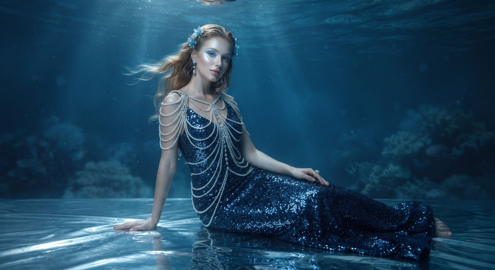

# 深蓝亮片美人鱼礼服：水下高定人像

- 原帖链接：https://x.com/Monaqbuv/status/2119747833448616178
- 作者：Mona（@Monaqbuv）
- 时间：2026-11-09 19:04 (UTC+8 / Asia/Shanghai)
- 互动摘要：点赞 5 · 转发 0 · 回复 3 · 引用 1 · 书签 0 · 浏览 103（采集快照：2026-11-09 20:10 UTC+8）
- 模型/工具：未注明
- 标签：真人
- 媒体路径：
  - `media/images/2119747833448616178_1.jpg`（）
- 入库日期：2026-11-09

## prompt 原文

```text
A cinematic, high-fashion underwater portrait of a stunning Asian female model posing gracefully as a modern mermaid. She is wearing an elaborate, shimmering dark blue sequined mermaid gown adorned with cascading layers of intricate pearl body chains and shoulder drape accessories. Her dark hair is wet and styled loosely, accented with delicate blue floral hairpins and shimmering pearl-drop earrings. Her makeup features cool-toned, ethereal blue eyeshadow and a luminous, glowing complexion. She is seated on a shimmering metallic silver, water-like reflective surface with gentle ripples. The background is a moody, deep oceanic blue with soft underwater lighting, caustic light patterns filtering from above, and subtle hazy water textures, captured in an upscale editorial photography style, 8k resolution, photorealistic, sharp focus.
```

---

个人学习归档，非商业。prompt 与图片版权归原作者 @Monaqbuv，引用请回到原帖。
