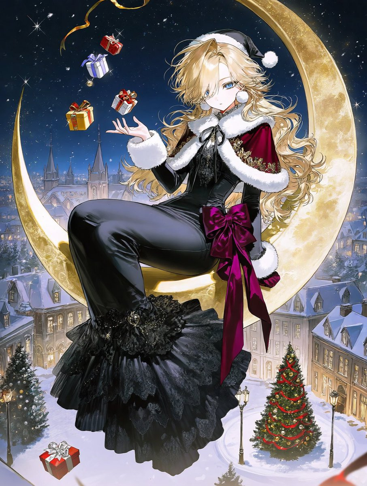
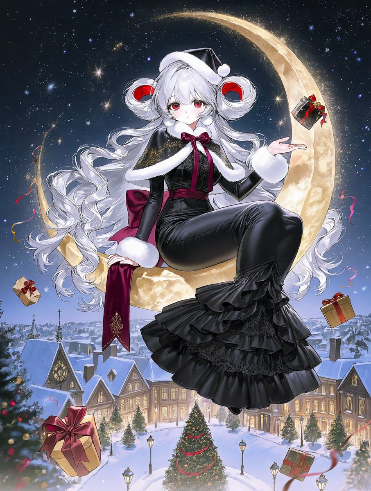
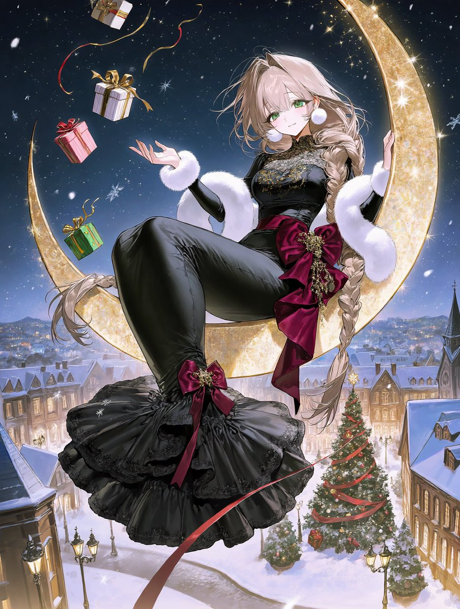
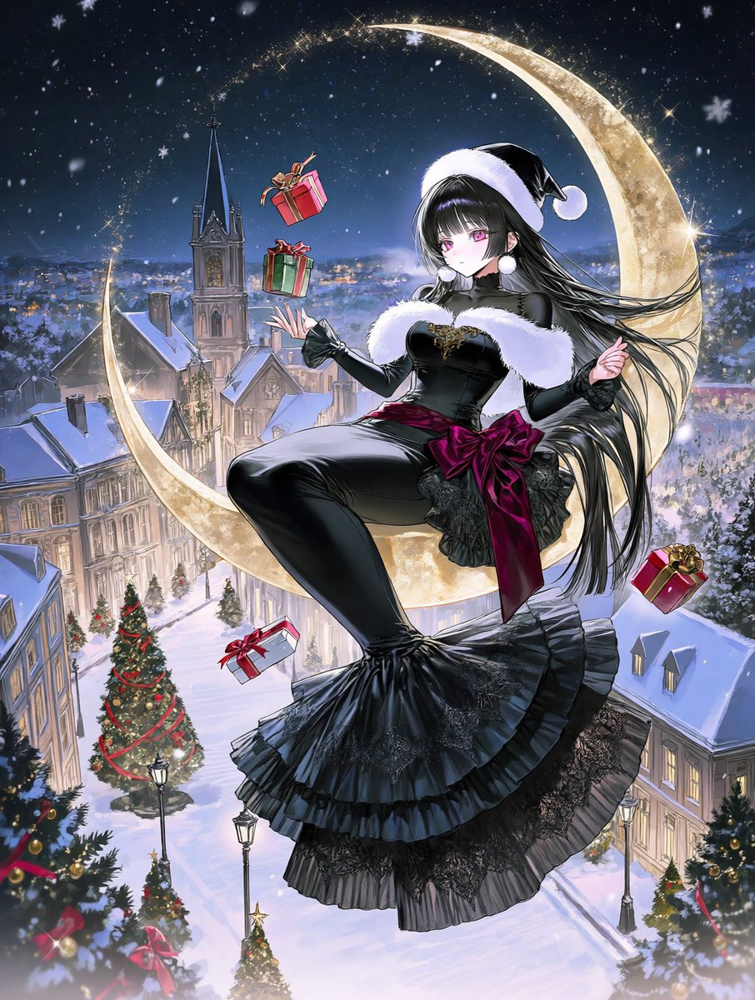

# 美人鱼剪影 × 黑色圣诞服：坐在金色月牙上抛礼物（#プロンプト配布）

- 原帖链接：https://x.com/Lulu_2nya0/status/2119753896457597095
- 作者：蜜（@Lulu_2nya0）
- 时间：2026-11-09 19:28 (UTC+8 / Asia/Shanghai；帖子有编辑，ID 为最终版本)
- 互动摘要：点赞 11 · 转发 0 · 回复 0 · 引用 2 · 书签 6 · 浏览 337（采集快照：2026-11-09 20:10 UTC+8）
- 模型/工具：未注明（日系 AI 插画）
- 标签：二次元
- 媒体路径：
  - `media/images/2119753896457597095_1.jpg`（）
  - `media/images/2119753896457597095_2.jpg`（）
  - `media/images/2119753896457597095_3.jpg`（）
  - `media/images/2119753896457597095_4.jpg`（）
- 入库日期：2026-11-09
- 备注：帖子曾编辑（早先版本 ID 2119745238453641524，内容相同）；入库以最终版本 ID 为准。

## prompt 原文

```text
outfit:
luxurious black mermaid gown, elegant fitted bodice, graceful fishtail silhouette, dramatically flared skirt, layered flowing black lace and delicate frills, rich wine-red velvet ribbons, fluffy pure white fur trim around the neckline and wrists, large burgundy waist ribbon, intricate golden embroidery, delicate christmas ornaments, fluffy white pom-pom earrings, small black santa hat with white fur trim, elegant festive accessories,

composition:
a beautiful girl sitting gracefully sideways on a gigantic golden crescent moon suspended in the night sky, her long mermaid skirt cascading elegantly over the curved moon, one hand tossing a beautifully wrapped christmas present toward the snowy town below, capturing the exact moment the gift leaves her fingertips, several gift boxes floating and falling through the air, colorful ribbons fluttering in the wind, graceful playful pose, full body visible, dynamic flowing fabric,

background:
vast breathtaking winter christmas night scenery, deep midnight navy-blue sky filled with countless sparkling stars, delicate snowflakes falling throughout the entire scene, a magnificent snow-covered european christmas town stretching into the distance, beautiful victorian-style buildings, steep snow-covered rooftops, elegant church spires, warm golden lights glowing from countless windows, grand christmas trees decorated with red ribbons and golden ornaments, sparkling festive illuminations throughout the streets, ornate vintage street lamps, snow-covered plazas, tiny warmly illuminated houses in the far distance, magnificent decorated christmas tree in the town square,

atmosphere and details:
magical golden stardust surrounding the crescent moon, soft moonlight illuminating the girl’s silhouette, sparkling snowflakes catching the light, floating christmas presents with elaborate ribbons and bows, beautiful contrast between deep black, wine red, pure white and antique gold, enchanting festive atmosphere, rich environmental storytelling, intricate foreground details, detailed middle ground, expansive atmospheric background, cinematic depth, sophisticated composition, beautifully rendered scenery,
```

---

个人学习归档，非商业。prompt 与图片版权归原作者 @Lulu_2nya0，引用请回到原帖。
