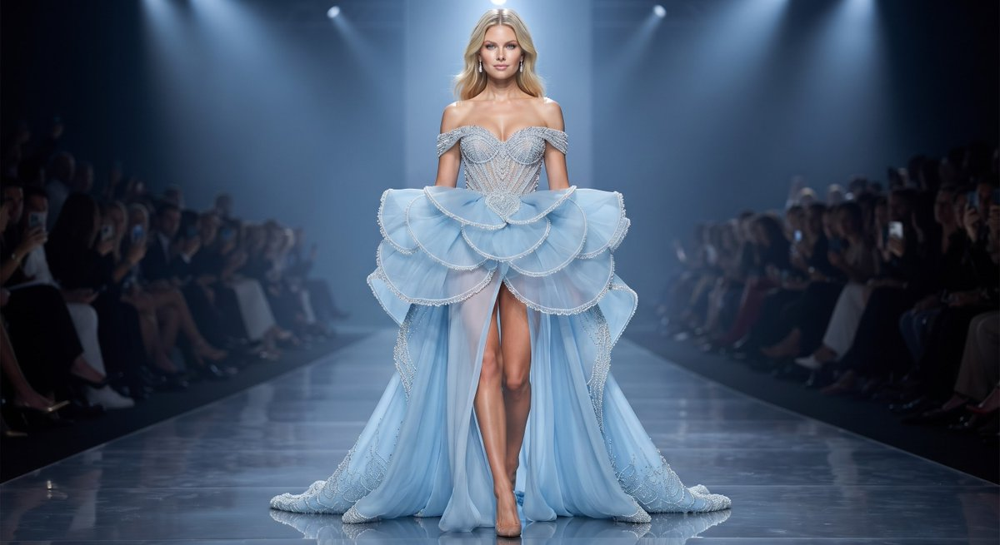

# 行走的百合花：粉白花瓣高定长裙全身时尚大片

- 原帖链接：https://x.com/Monaqbuv/status/2119757409870848051
- 作者：Mona（@Monaqbuv）
- 时间：2026-11-09 19:42 (UTC+8 / Asia/Shanghai)
- 互动摘要：点赞 6 · 转发 0 · 回复 0 · 引用 0 · 书签 0 · 浏览 46（采集快照：2026-11-09 20:10 UTC+8）
- 模型/工具：未注明
- 标签：真人
- 媒体路径：
  - `media/images/2119757409870848051_1.jpg`（）
- 入库日期：2026-11-09
- 备注：原文末尾有残留标记 `<ctrl46>}`，按原样保留。

## prompt 原文

```text
A full-body fashion editorial photograph of a stunning woman, styled to resemble a walking lily flower. She is wearing a dramatic, bespoke couture gown that is an intricate interpretation of a pink and white lily. The bodice is sculpted from large, layered petals with pink gradients, forming a sweetheart neckline and a prominent, petal-shaped shoulder piece on her right side, complete with delicate stamen details. The skirt features a high, revealing leg slit, and the cascading, multi-layered fabric mimics the soft, curved edges and textured surface of lily petals, blending pink and white hues with subtle shimmer. She wears delicate white strappy heels and has her dark hair in an elegant, textured updo, with statement earrings. Her makeup is refined with a bold lip. She stands confidently with one hand on her hip on a polished marble floor, in front of a large, textured stone wall under warm, dramatic studio lighting that casts a long, elegant shadow behind her. The focus is sharp on the textures of the dress and her pose. The overall composition is high-end and artistic, capturing a blend of nature and haute couture.<ctrl46>}
```

---

个人学习归档，非商业。prompt 与图片版权归原作者 @Monaqbuv，引用请回到原帖。
