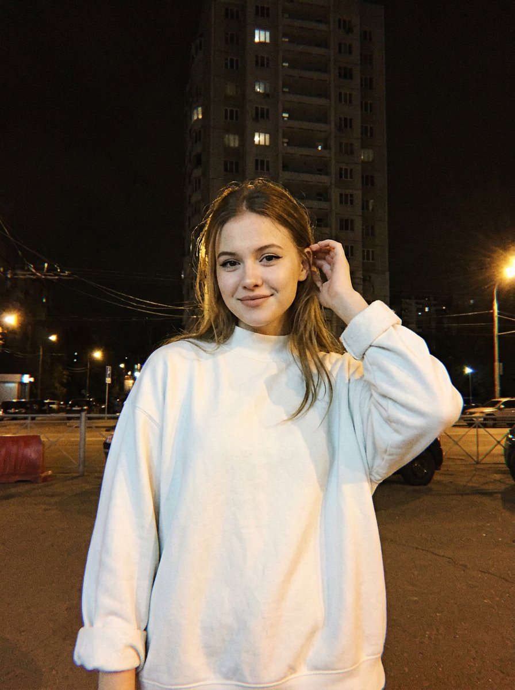

# 2012 年 iPhone 5 夜街自拍质感：低角度半身人像（自我形象 prompt）

- 原帖链接：https://x.com/dreamydigiarts/status/2119422186440311126
- 作者：dreamy digital arts（@dreamydigiarts）
- 时间：2026-11-08 21:30 (UTC+8 / Asia/Taipei)
- 互动摘要：点赞 46 · 转发 0 · 回复 2 · 引用 0 · 书签 29 · 浏览 1222（采集快照：2026-11-10 20:30 UTC+8）
- 模型/工具：Nano Banana 2（经 WeryAI）
- 标签：真人
- 媒体路径：
  - `media/images/2119422186440311126_1.jpg`（）
- 入库日期：2026-11-10
- prompt 来源：https://x.com/dreamydigiarts/status/2119422186440311126
- 备注：prompt 即主帖正文「Prompt 👇」之后部分，原样摘录；写法是「I, with my own appearance」，需配本人照片。

## prompt 原文

```text
iPhone 5 photo, strong film grain + digital noise, high ISO noise, chromatic aberration, low-quality smartphone camera 2012.  A realistic waist-up portrait, shot from a frontal low-angle perspective looking upward on a nighttime street. I, with my own appearance, stand in the center of the frame, slightly raising my right hand toward my head and touching the hair behind my ear with my fingers, while looking at the camera with a slight smile. The hair is styled loosely with a center part, partially falling down over the shoulders, with a few sparse strands slightly blowing around the face with motion blur.  I am wearing a voluminous light milk-white oversized sweatshirt with a stand-up collar and rolled-up sleeve cuffs.  Makeup: black eyeliner, thick eyelashes, and a nude matte shade on the lips.  Background: a dark night sky, with a tall high-rise building rising behind me, featuring a few illuminated windows; wires, a barrier, and the roadway of the street are visible below.  Lighting: dim, warm yellowish artificial light from the side, illuminating the right side of the figure, while the surrounding background remains in deep darkness.  Characteristic grain, digital noise, and blurred details of nighttime photography taken with an old smartphone.
```

---

个人学习归档，非商业。prompt 与媒体版权归原作者 @dreamydigiarts，引用请回到原帖。
