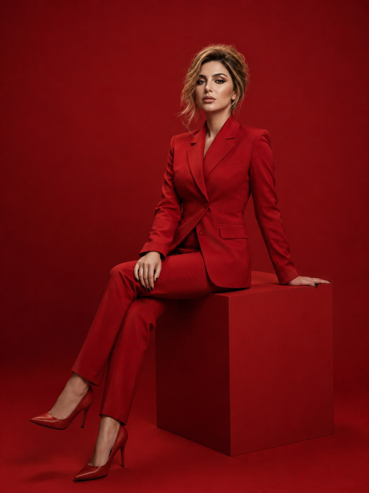
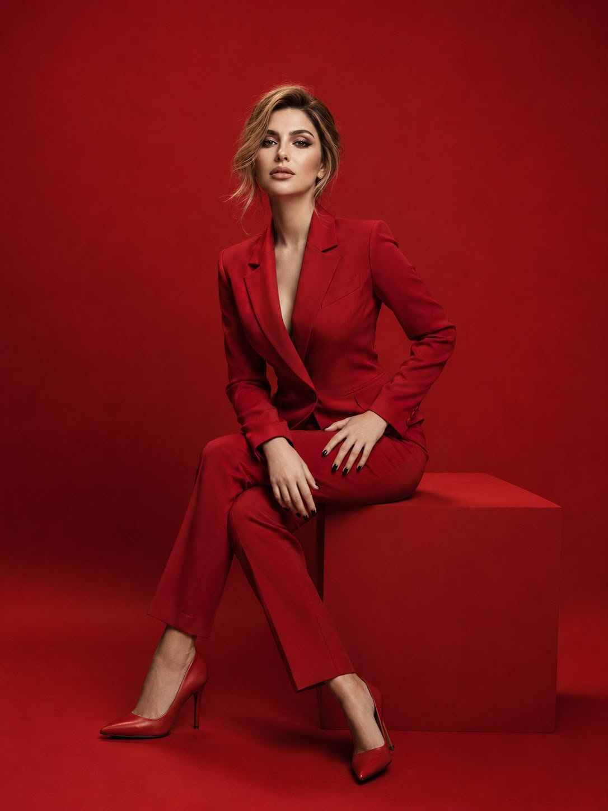

# 全红单色影棚的奢牌时装大片：红西装坐几何台座（参考图保脸 prompt）

- 原帖链接：https://x.com/mehvishs25/status/2119445727273525375
- 作者：Meem（@mehvishs25）
- 时间：2026-11-08 23:03 (UTC+8 / Asia/Taipei)
- 互动摘要：点赞 60 · 转发 6 · 回复 14 · 引用 1 · 书签 33 · 浏览 1796（采集快照：2026-11-10 09:05 UTC+8）
- 模型/工具：GPT Image 2.5（ChatGPT 内）
- 标签：真人
- 媒体路径：
  - `media/images/2119445727273525375_1.jpg`（）
  - `media/images/2119445727273525375_2.jpg`（）
- 入库日期：2026-11-10
- prompt 来源：https://x.com/mehvishs25/status/2119445727273525375
- 备注：prompt 即主帖正文（含 Negative Prompt），需配一张人物参考图，整段摘录。

## prompt 原文

```text
GPT Image 2.5 on ChatGPT

Prompt:
Create a photorealistic luxury fashion campaign featuring the exact same woman from the uploaded reference image. Preserve her original facial identity, facial structure, skin tone, and recognizable features without alteration.

She has beautifully styled blonde hair in a polished, elegant updo with a few soft strands framing her face. She wears a striking crimson-red fitted blazer with a sculpted silhouette, matching high-waisted tailored trousers and elegant pointed-toe heels. Seated gracefully on a minimalist geometric red pedestal, she poses with one leg extended slightly forward and the other crossed, one hand resting casually on her thigh. Her expression is confident, composed, and effortlessly glamorous.

The setting is a monochromatic crimson studio with a seamless red backdrop and floor, subtle tonal variations, and dramatic softbox lighting that creates refined shadows. Luxury magazine editorial photography, sophisticated styling, rich color grading, realistic skin texture, intricate fabric details, sharp focus, full-body composition, vertical 3:4 portrait.

Negative Prompt: altered facial identity, different person, distorted anatomy, extra fingers, deformed hands, unnatural proportions, blurry face, artificial skin, text, logos, watermark, distracting background objects.
```

---

个人学习归档，非商业。prompt 与媒体版权归原作者 @mehvishs25，引用请回到原帖。
