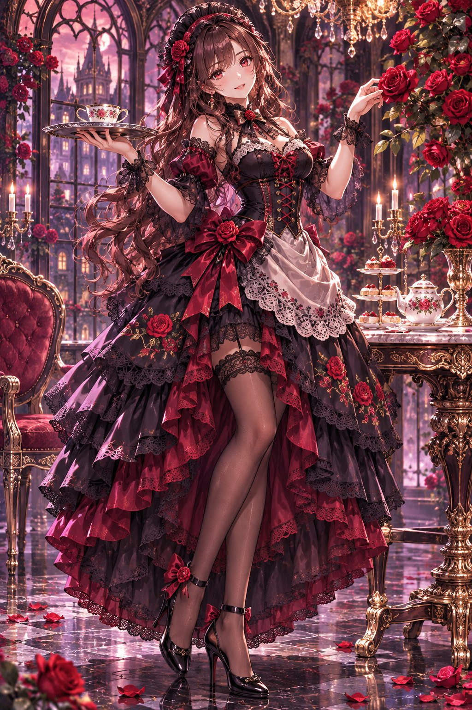
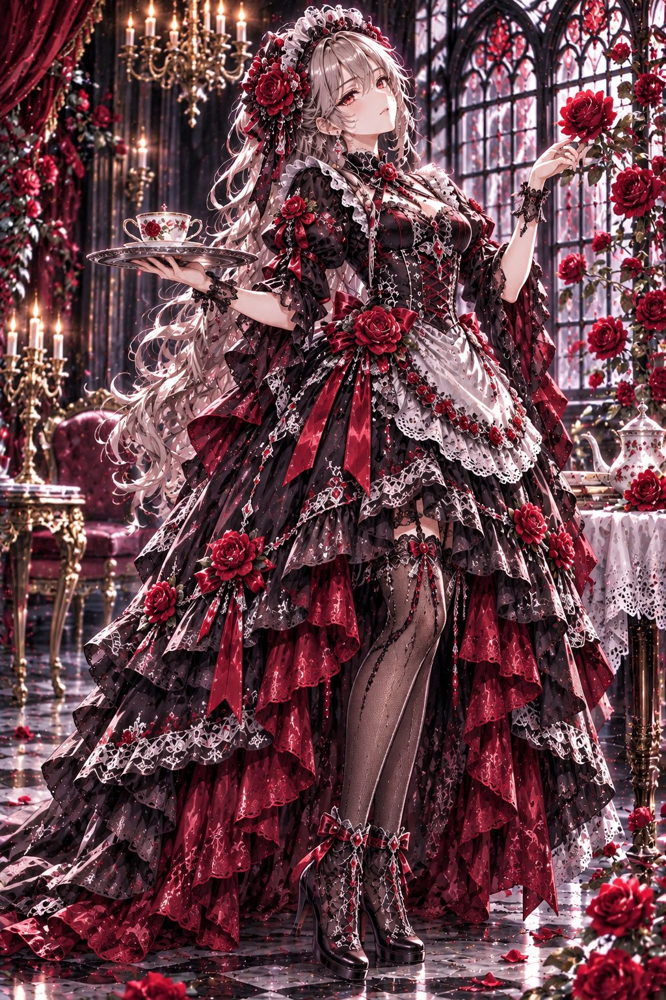
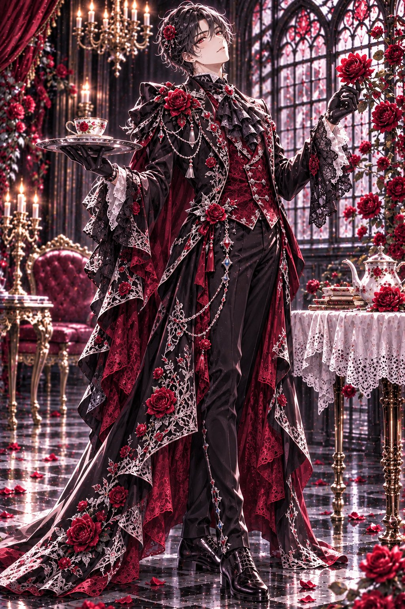

# 深红×漆黑哥特玫瑰女仆 / 管家（男女两版 #ゆきプロンプト）

- 原帖链接：https://x.com/AIXyu1v/status/2119598979910676570
- 作者：ゆき　AIイラストXで収益化（@AIXyu1v）
- 时间：2026-11-09 09:12 (UTC+8 / Asia/Taipei)
- 互动摘要：点赞 73 · 转发 16 · 回复 3 · 引用 12 · 书签 17 · 浏览 2904（采集快照：2026-11-10 09:05 UTC+8）
- 模型/工具：未注明（日系 AI 插画通用 prompt）
- 标签：二次元
- 媒体路径：
  - `media/images/2119598979910676570_1.jpg`（）
  - `media/images/2119598979910676570_2.jpg`（）
  - `media/images/2119598979910676570_3.jpg`（）
- 入库日期：2026-11-10
- prompt 来源：https://x.com/AIXyu1v/status/2119599158701228037, https://x.com/AIXyu1v/status/2119599278851235973
- 备注：prompt 在作者两条自回复：【薔薇メイド】与【薔薇バトラー】，均明确写 adult。两段依次原样摘录。

## prompt 原文

```text
【薔薇メイド】
Masterpiece anime illustration, full-body portrait of a beautiful adult woman wearing an elegant gothic rose maid outfit.

Deep crimson and jet-black color palette. Luxurious black velvet maid dress with crimson rose embroidery, delicate black lace, layered ruffled skirt, fitted corset waist, puffed sleeves, satin ribbons, rose-shaped brooches, and an ornate lace apron.

Long wavy dark auburn hair, ruby-red eyes, soft mysterious smile, black lace maid headdress decorated with small crimson roses.

Standing gracefully beside an antique tea table, one hand holding a silver tray with a porcelain teacup, the other gently touching a blooming red rose.

Magnificent gothic mansion, grand arched windows, climbing crimson roses, antique chandeliers, dark marble floor, scattered rose petals, warm candlelight.

Cinematic lighting, exquisite fabric details, elegant natural pose, beautiful composition, no extra people, no text, no watermark.
```

```text
【薔薇バトラー】
Masterpiece anime illustration, full-body portrait of a handsome adult man wearing an elegant gothic rose butler outfit.

Deep crimson and jet-black color palette. Luxurious tailored black velvet tailcoat with intricate crimson rose embroidery, delicate black lace cuffs, a rich crimson brocade waistcoat, silk cravat, silver rose brooch, ornamental chains, fitted black trousers, and polished leather boots.

Stylish wavy midnight-black hair, ruby-red eyes, refined masculine features, a calm mysterious smile, and a small crimson rose hair ornament.

Standing gracefully beside an antique tea table, one gloved hand holding a silver tray with a porcelain teacup, the other gently touching a blooming red rose.

Magnificent gothic mansion, grand arched windows, climbing crimson roses, antique chandeliers, dark marble floor, scattered rose petals, warm candlelight.

Cinematic lighting, exquisite embroidery, elegant masculine silhouette, natural anatomy, no extra people, no text, no watermark.
```

---

个人学习归档，非商业。prompt 与媒体版权归原作者 @AIXyu1v，引用请回到原帖。
