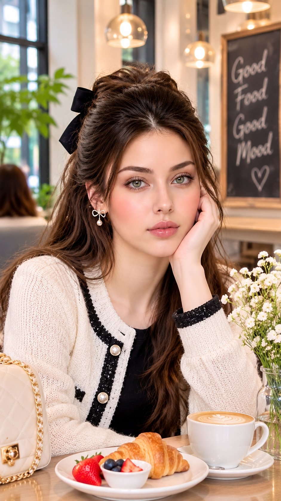

# 韩系咖啡馆早餐人像：奶油针织开衫 + 黑色大蝴蝶结半扎发（参考图换脸型 prompt）

- 原帖链接：https://x.com/Lianaalane/status/2119663410174644671
- 作者：liana（@Lianaalane）
- 时间：2026-11-09 13:28 (UTC+8 / Asia/Taipei)
- 互动摘要：点赞 158 · 转发 5 · 回复 39 · 引用 0 · 书签 6 · 浏览 10909（采集快照：2026-11-10 09:05 UTC+8）
- 模型/工具：GPT Image（ChatGPT 内）
- 标签：真人
- 媒体路径：
  - `media/images/2119663410174644671_1.jpg`（）
- 入库日期：2026-11-10
- prompt 来源：https://x.com/Lianaalane/status/2119663410174644671
- 备注：prompt 即主帖正文，需配一张人脸参考图，整段摘录。

## prompt 原文

```text
GPT image on chatgpt 

Prompt:
A beautiful Korean girl sitting elegantly in a cozy, luxurious modern café, enjoying a delicious morning breakfast. She has the same beautiful face as the reference image, fair glowing Korean glass skin, beautiful greenish eyes, naturally thick eyebrows, soft pink lips, and delicate facial features. Her long, silky dark brown hair is styled in a gorgeous Korean half-up hairstyle with a large elegant black bow and soft face-framing strands. She is wearing a stylish cream knitted cardigan with black detailing over a black top, paired with delicate pearl bow earrings. She is sitting gracefully at a wooden café table, resting one hand gently against her cheek while looking directly at the camera with a soft, charming expression. On the table there is a freshly baked golden croissant, fresh strawberries, blueberries, a beautiful cup of cappuccino with latte art, and a small vase of white flowers. The background features a warm aesthetic Korean café with beautiful pendant lights, green plants, large glass windows, and a chalkboard displaying Good Food Good Mood. Ultra-realistic photography, natural soft lighting, flawless skin texture, elegant Korean fashion, cinematic composition, professional DSLR photography, highly detailed, 9:16 vertical portrait, 4K quality.
```

---

个人学习归档，非商业。prompt 与媒体版权归原作者 @Lianaalane，引用请回到原帖。
