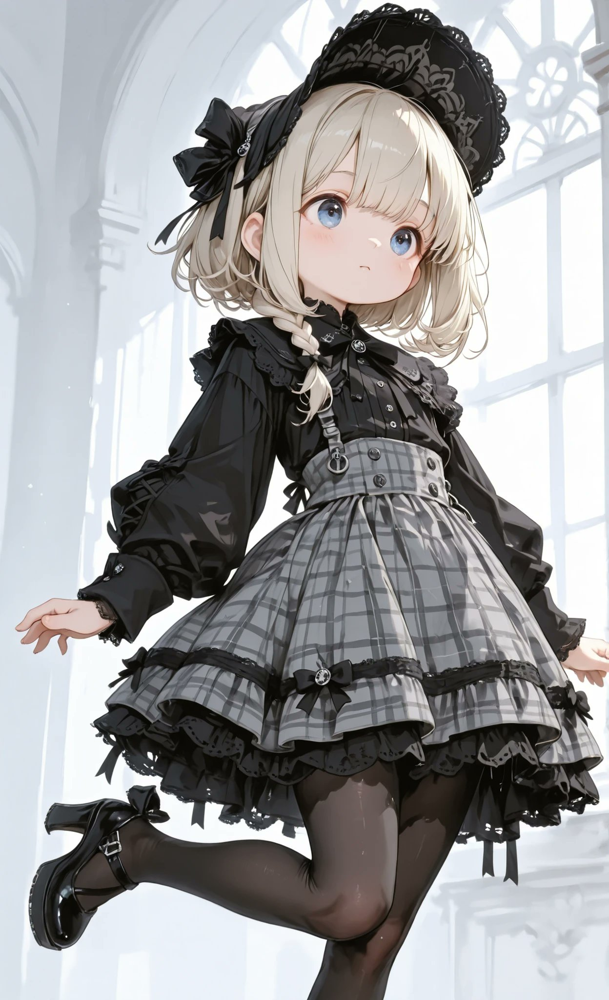
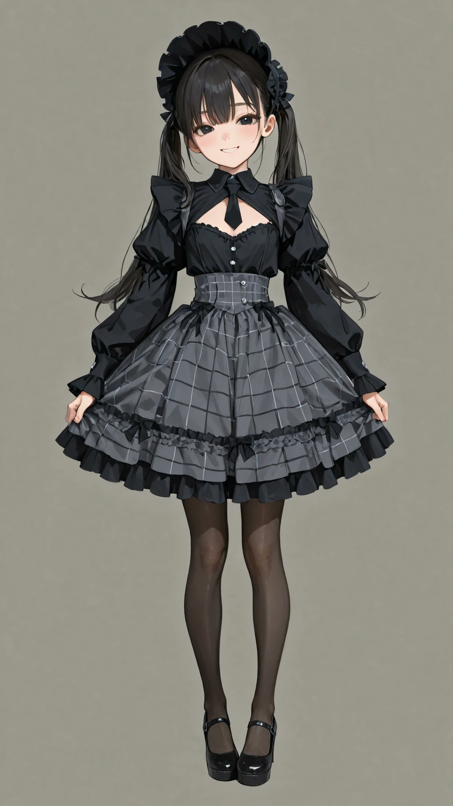
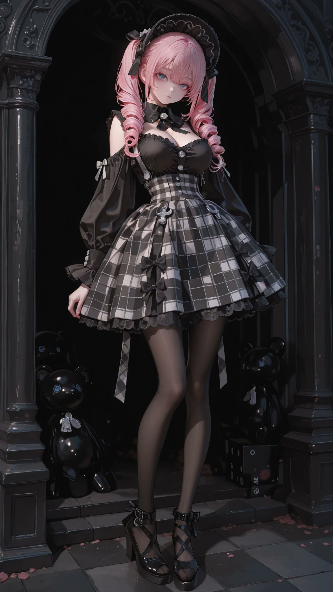

# 黑灰格纹哥特洛丽塔：背带裙 + 灯笼袖衬衫 + 蕾丝软帽（衣装 prompt）

- 原帖链接：https://x.com/AliceLavli/status/2119686426740789531
- 作者：アリス服飾店（@AliceLavli）
- 时间：2026-11-09 15:00 (UTC+8 / Asia/Taipei)
- 互动摘要：点赞 248 · 转发 41 · 回复 4 · 引用 17 · 书签 78 · 浏览 6494（采集快照：2026-11-10 20:30 UTC+8）
- 模型/工具：未注明（通用；作者写可用于 SD / SeaArt / PixAI / ChatGPT / Gemini / Grok / Midjourney / niji）
- 标签：二次元
- 媒体路径：
  - `media/images/2119686426740789531_1.jpg`（）
  - `media/images/2119686426740789531_2.jpg`（）
  - `media/images/2119686426740789531_3.jpg`（）
  - `media/images/2119686426740789531_4.jpg`（）
- 入库日期：2026-11-10
- prompt 来源：https://x.com/AliceLavli/status/2119686426740789531
- 备注：prompt 即主帖正文第三段（英文衣装描述），原样摘录；前两段日文为介绍语。

## prompt 原文

```text
black and gray plaid jumper dress layered over black long sleeve blouse, fitted sleeveless plaid bodice with broad shoulder straps and gently squared neckline, dense charcoal black and ivory tartan checks, curved princess seams shaping bodice, defined natural waist with narrow matching plaid waistband, small horizontal plaid waist tabs secured by silver buttons at both sides, full calf length plaid skirt with generous gathered volume and broad flowing folds, wide solid black gathered ruffle around skirt hem, black blouse with high neckline and broad pointed collar, large black ribbon bow tied beneath collar with long flat tails, small pearl buttons down upper blouse front, softly puffed sleeve heads and long voluminous bishop sleeves gathered into narrow fitted black cuffs, smooth matte black blouse fabric, rounded black bonnet with gathered lace edging and small side ribbon bows, sheer black tights, black Mary Jane platform pumps with rounded toes and single instep straps, small silver buckles and thick block heels
```

---

个人学习归档，非商业。prompt 与媒体版权归原作者 @AliceLavli，引用请回到原帖。
