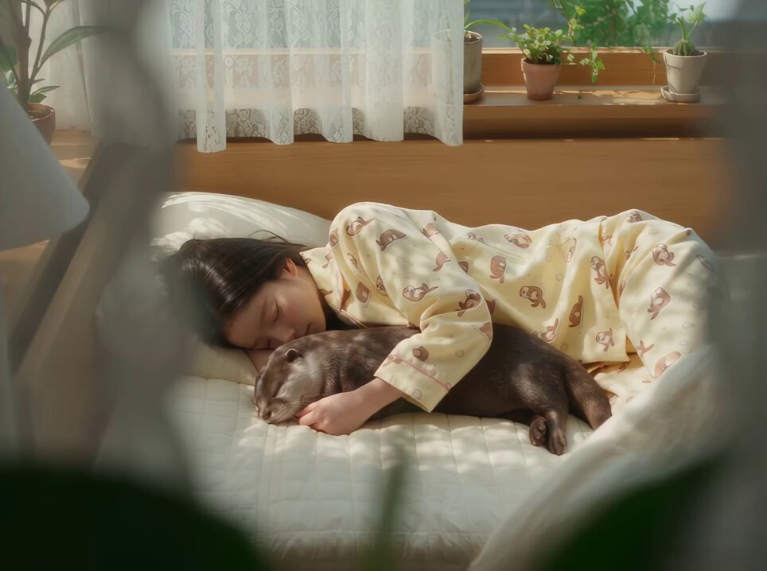

# 「只想安静过个早晨」：睡衣女孩、水獭与黑球头访客的 20 秒悬疑喜剧短片

- 原帖链接：https://x.com/Hassanlaurent/status/2119696395720654912
- 作者：Hassan（@Hassanlaurent）
- 时间：2026-11-09 15:39 (UTC+8 / Asia/Taipei)
- 互动摘要：点赞 54 · 转发 4 · 回复 18 · 引用 0 · 书签 18 · 浏览 1319（采集快照：2026-11-10 20:30 UTC+8）
- 模型/工具：Seedance 2.5（视频）
- 标签：真人
- 媒体路径：
  - `media/video-stills/2119696395720654912_still.jpg`（视频封面截图，）
  - 视频本体未入库，仅保留原帖链接：https://x.com/Hassanlaurent/status/2119696395720654912
- 入库日期：2026-11-10
- prompt 来源：https://x.com/Hassanlaurent/status/2119696395720654912
- 备注：prompt 即主帖正文「Prompt:」之后的分镜脚本（7 个镜头 + 视觉/音频/一致性要求），原样摘录。视频仅保留原帖链接。

## prompt 原文

```text
AI VIDEO GENERATION PROMPT — 20 SECONDS | 9:16 | 4K | 24 FPS

Create a 20-second ultra-photorealistic cinematic mystery-comedy short film with a soft Japanese/Korean drama aesthetic. Natural lighting, realistic human movements, detailed facial expressions, atmospheric suspense, shallow depth of field, and professional cinematography.

CHARACTER CONSISTENCY LOCK:

- A beautiful young East Asian woman with long straight dark hair.
- Wearing yellow cream-colored pajamas with cute animal prints.
- A small, adorable dark-brown otter sleeping beside her.
- A mysterious tall man wearing a formal black business suit, white shirt, and black tie. His head is replaced by a perfectly round glossy black sphere featuring white Korean lettering.

SCENE 1 (0–3 SECONDS): PEACEFUL MORNING

Wide cinematic shot of a cozy Japanese-style bedroom. Warm morning sunlight enters through sheer white curtains. A young woman sleeps peacefully on a white bed, hugging a cute brown otter. Green plants sit near the window. Camera slowly pushes toward the sleeping pair.

SCENE 2 (3–6 SECONDS): CLOSE-UP

Extreme close-up of the girl's peaceful sleeping face beside the otter. The otter remains completely relaxed with its eyes closed. Soft sunlight falls across their faces. Dreamy cinematic depth of field.

SCENE 3 (6–9 SECONDS): WAKING UP

The girl slowly opens her eyes, realizes something, and gently lifts her head. She looks sleepy and confused. The otter remains on the pillow. She sits up and looks toward the bedroom door.

SCENE 4 (9–12 SECONDS): MYSTERIOUS WALK

Rear tracking shot of the girl walking barefoot through a warmly lit wooden Japanese hallway. Her long hair moves naturally. The atmosphere becomes slightly mysterious. She approaches the closed entrance door.

SCENE 5 (12–15 SECONDS): WHO IS THERE?

Medium close-up of the girl standing at the entrance. She cautiously reaches toward the door handle and whispers, "Who is it?" She slowly opens the door. Dramatic suspenseful pause.

SCENE 6 (15–18 SECONDS): THE UNEXPECTED VISITOR

POV shot from inside the apartment. Standing outside is a mysterious man in a perfectly tailored dark business suit. Instead of a human head, he has a large shiny black spherical head with bold white Korean lettering. He stands completely still, facing the girl. Slightly absurd yet mysterious cinematic atmosphere.

SCENE 7 (18–20 SECONDS): COMEDIC ENDING

Cut back to the bedroom. The girl is suddenly back in bed beside the sleeping otter, pulling the white blanket over them. The peaceful bedroom atmosphere returns. End with a perfectly composed wide shot and a subtle humorous mystery vibe.

VISUAL STYLE:
Ultra-realistic live-action cinematography, premium Korean drama aesthetics, warm natural morning sunlight, soft shadows, realistic skin texture, detailed fabric, beautiful wooden interiors, smooth camera movement, subtle film grain, cinematic color grading, natural character animation.

AUDIO DESIGN:
Soft morning ambience, gentle birds outside, quiet blanket movement, subtle footsteps, suspenseful low-volume music near the door, a soft door handle click, and a brief mysterious cinematic sound when the visitor appears.

IMPORTANT CONSISTENCY RULES:
Maintain identical character faces, hairstyles, pajamas, otter appearance, bedroom layout, and lighting throughout. No character morphing, no extra people, no distorted anatomy, no random camera jumps, no cartoon effects, and no unwanted text overlays.
```

---

个人学习归档，非商业。prompt 与媒体版权归原作者 @Hassanlaurent，引用请回到原帖。
