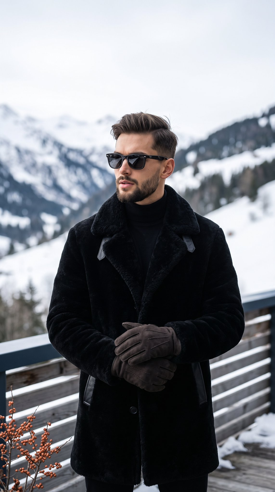

# 阿尔卑斯阳台冬季男装大片：黑色羊羔毛大衣 + 墨镜（带色值的精细 prompt）

- 原帖链接：https://x.com/pictsbyai/status/2119706055076942142
- 作者：Picts by AI（@pictsbyai）
- 时间：2026-11-09 16:18 (UTC+8 / Asia/Taipei)
- 互动摘要：点赞 44 · 转发 5 · 回复 18 · 引用 0 · 书签 15 · 浏览 901（采集快照：2026-11-10 20:30 UTC+8）
- 模型/工具：Gemini Nano Banana 2.1（Gemini App）
- 标签：真人
- 媒体路径：
  - `media/images/2119706055076942142_1.jpg`（）
- 入库日期：2026-11-10
- prompt 来源：https://x.com/pictsbyai/status/2119706055076942142
- 备注：prompt 即主帖正文，含色值与相机参数，原样摘录。

## prompt 原文

```text
An adult male with warm beige skin (#D2A183) stands centered in a medium-scale portrait, wearing a plush jet-black (#121214) shearling overcoat with leather collar tabs over a black turtleneck. His dark brown hair is styled in a tapered side-part quiff with short sides above the ears, a 3-inch swept-back wavy top, a matte finish, and minor crown flyaways, paired with a groomed short full beard and mustache. Featuring neutral eyebrows and slightly parted lips in a confident, posed expression, he angles his head slightly left to look off-camera behind dark wayfarer sunglasses. Standing straight-on with level shoulders, his hands are clad in charcoal-brown (#332B28) suede-leather gloves and clasped at his waist, with his relaxed left hand and gently curved fingers resting over his right wrist. Set on an outdoor alpine balcony with weathered grey-brown solid wood flooring, the foreground features a dark navy top rail over weathered grey horizontal wooden slats dusted with snow, alongside dried winterberry twigs (Ilex verticillata) bearing muted orange-red berry clusters in the bottom left corner. The subject is against a blurred background of snow-covered alpine slopes, dark rock ridges, and evergreen tree lines. Illuminated by a bright, cool, overcast sky (#EAECEF) from above and front-left with snow bounce fill, the scene exhibits medium-to-high contrast, soft short gray shadows under the chin, coat folds, and railing, and preserved highlights across the forehead, nose bridge, sunglass frames, and coat shoulders. Shot as a tack-sharp, realistic digital photograph on a full-frame camera with an 85mm prime lens at f/2.8, 1/1000s, and ISO 100 (+0.7 EV), the luxury alpine menswear editorial incorporates cool desaturated monochromatic grading, lifted blacks, highlight recovery, and a shallow depth of field, framed in a 9:16 vertical portrait aspect ratio.
```

---

个人学习归档，非商业。prompt 与媒体版权归原作者 @pictsbyai，引用请回到原帖。
