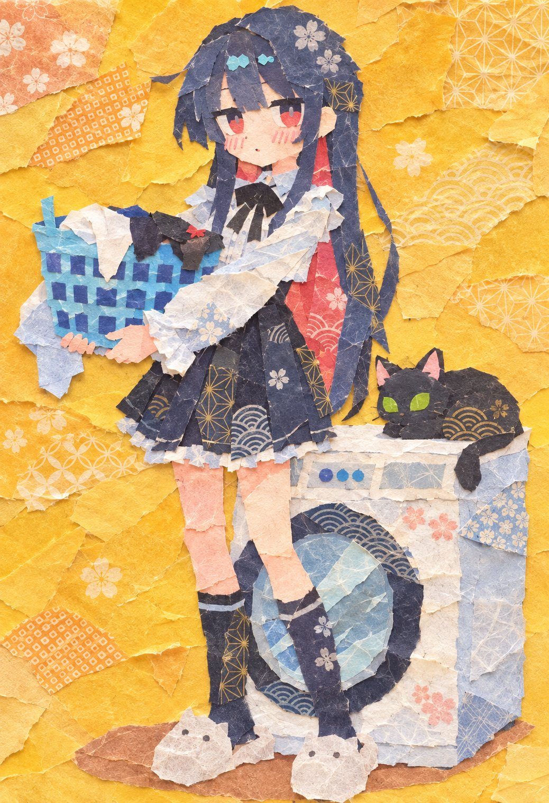

# 和纸拼贴风画风转换：把插画/漫画改成手工和纸 collage（意图拙朴版）

- 原帖链接：https://x.com/AI_Illust_000/status/2119717788197716352
- 作者：シトラス(柑橘系)（@AI_Illust_000）
- 时间：2026-11-09 17:04 (UTC+8 / Asia/Taipei)
- 互动摘要：点赞 486 · 转发 70 · 回复 4 · 引用 10 · 书签 212 · 浏览 17225（采集快照：2026-11-10 09:05 UTC+8）
- 模型/工具：GPT Image 等支持参考图的画风转换模型（作者提到 GPT-Image）
- 标签：二次元
- 媒体路径：
  - `media/images/2119717788197716352_1.jpg`（）
- 入库日期：2026-11-10
- prompt 来源：https://x.com/AI_Illust_000/status/2119717791293231576
- 备注：prompt 在作者自回复（长文日文，分【元画像の再現】【アートスタイル】【和紙の質感と模様】【輪郭と陰影】等段），原样摘录。用法：附一张原图后发送。

## prompt 原文

```text
添付画像を、可愛らしい日本のアニメアートと、日本の伝統的な和紙コラージュを融合させたイラストに変換してください。

【元画像の再現】

元画像に描かれているキャラクターの容姿、髪型、表情、衣装、ポーズ、構図、主要な配色を維持してください。キャラクターの特徴や魅力を損なわず、画風と素材表現だけを大胆に変換してください。

ただし、元画像を綺麗に忠実再現しすぎず、完成度の高い洗練された仕上がりではなく、意図的に荒く、不器用で、少し下手なくらいの素朴な表現へ大きく変化させてください。

【アートスタイル】

可愛らしく親しみやすい日本のアニメイラスト。柔らかな曲線、愛らしい表情、洗練されすぎない素朴なキャラクターデザイン。

ただし、通常のアニメ塗りやデジタルペイントではなく、色や模様の異なる和紙を一枚ずつ切り抜き、重ね合わせ、貼り付けることで完成させた、精巧すぎないハンドメイドのペーパーコラージュアートとして表現してください。

【和紙の質感と模様】

すべての色面を、実際の和紙を切り抜いた紙片として構成してください。

和紙には、繊細な小花柄、麻の葉、青海波、鹿の子、七宝模様などの日本の伝統文様を自然に取り入れてください。

無地の和紙、繊維が透ける薄い和紙、細かな模様が印刷された千代紙を組み合わせ、色彩と質感に豊かな変化を持たせてください。

紙の繊維、微細な凹凸、柔らかな毛羽立ち、印刷のかすれなど、実物の和紙ならではの有機的な素材感を表現してください。

【輪郭と陰影：最重要】

インクやペンによる線画は一切使用しないでください。

キャラクターの外輪郭、顔のパーツ、髪の房、衣装のしわ、装飾の境界など、すべての輪郭は、異なる和紙の色面同士の境界と、重なり合った紙が生み出す自然な陰影によって形成してください。

紙の厚み、重なり具合、切り口のわずかな凹凸によって、ごく細く繊細な影から、やや幅の広い柔らかな影まで、不規則で有機的な輪郭を作ってください。

輪郭に相当する影の太さは決して均一にせず、部分的に途切れたり、紙の色や模様になじんだりする自然な表現にしてください。

輪郭を黒い線で代用せず、紙そのものの立体感と色の差によって形状を認識できるようにしてください。

【意図的に荒く下手くそな表現】

全体を丁寧に作り込みすぎず、意図的に荒く、不器用で、少し下手なくらいの素朴な仕上がりにしてください。

紙の切り方はあえて少し雑で、輪郭はきれいに整いすぎず、ガタつき、歪み、形の甘さ、わずかなズレを含ませてください。

顔のパーツ配置、髪の毛のまとまり、衣装のディテール、模様の貼り合わせも、少しアンバランスで、素人の手作業らしい拙さを持たせてください。

左右対称であるべき箇所も少しずれていて構いません。紙片の重なりも完全には揃えず、端が少し浮いていたり、切り口が甘かったり、貼る位置がわずかにずれていたりするようにしてください。

ただし、何が描かれているか分からなくなるほど崩しすぎず、キャラクターのモチーフや元画像の内容は十分に判別できる範囲に保ってください。

「上手ではないが味がある」「子どもの工作や素人の手作り作品のような愛嬌がある」方向性を重視してください。

【キャラクターの描写】

瞳、まつ毛、口元、髪の毛などの細部も、描き込まれた線ではなく、小さく切り抜かれた和紙の形状と色面の組み合わせで表現してください。

顔は可愛らしい日本のアニメキャラクターらしい魅力を保ちつつ、平面的な紙のパーツを巧みに組み合わせた、やや不器用で素朴な造形にしてください。

髪の毛は一本ずつ描かず、曲線的に切り抜かれた複数の和紙を重ねて、自然な毛束と柔らかな立体感を作ってください。ただし、整いすぎず、少しラフで不揃いな印象にしてください。

【仕上がり】

繊細な手仕事の温かみ、和紙の美しい模様、紙片が重なり合う奥行き、可愛らしいアニメ表現、そして少し拙い手作り感が調和した、高品質すぎない味のあるコラージュイラスト。

紙の層による陰影は柔らかく自然に。過度な立体感や強いドロップシャドウは避け、手作業で少し不器用に貼り合わせた作品のように仕上げてください。

【避ける表現】

黒い輪郭線、均一なアウトライン、ペン画、インク線、通常のアニメ塗り、セルシェーディング、デジタルブラシの筆跡、ベクターイラストのような均一な境界線、単に紙のテクスチャを上から重ねただけの表現、過度な3D表現、プラスチックのような質感、完璧すぎる仕上がり、整いすぎた精密なクラフト作品。
```

---

个人学习归档，非商业。prompt 与媒体版权归原作者 @AI_Illust_000，引用请回到原帖。
