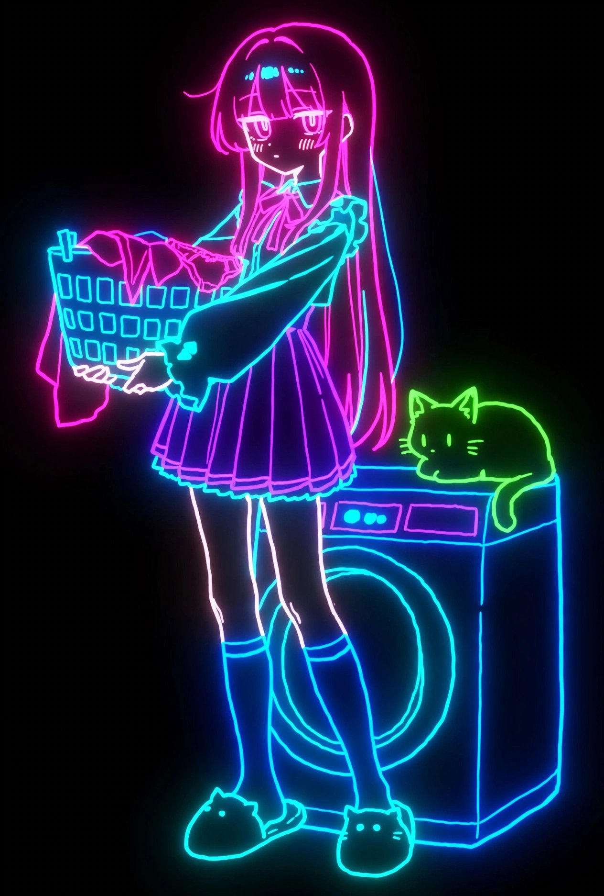

# 霓虹灯管线稿画风转换模板（7 项分段，可改写）

- 原帖链接：https://x.com/AI_Illust_000/status/2119800248893861947
- 作者：シトラス(柑橘系)（@AI_Illust_000）
- 时间：2026-11-09 22:32 (UTC+8 / Asia/Taipei)
- 互动摘要：点赞 209 · 转发 24 · 回复 1 · 引用 4 · 书签 102 · 浏览 5457（采集快照：2026-11-10 09:05 UTC+8）
- 模型/工具：GPT-Image / Muse（作者注明）
- 标签：二次元
- 媒体路径：
  - `media/images/2119800248893861947_1.jpg`（）
- 入库日期：2026-11-10
- prompt 来源：https://x.com/AI_Illust_000/status/2119800251909595297
- 备注：prompt 在作者自回复，按 线画/塗り/質感/色彩/陰影/デフォルメ/ディテール密度 分段的模板，原样摘录。作者称 prompt 较长放在串里；本次只检索到这一条自回复。

## prompt 原文

```text
画風変換テンプレート

元画像のキャラクターの特徴を維持し、以下の画風に変換してください。

元キャラクターを識別できる特徴的な要素のみを残し、形状や装飾を大胆に簡略化してください。ネオン管を模した線画だけでキャラクターを構成する、日本のデジタルアニメ風ネオンアートとして表現してください。

1. 線画

線の太さ： 太めで均一感のある、丸みを帯びたネオン管のような輪郭線。細かな補助線を省略し、少ない線で形状を表現する。

線の強弱： 基本的には一定の太さを維持する。線を意図的にところどころ途切れさせ、途切れた部分の両端を滑らかな丸形にする。連続した輪郭にこだわらず、線の省略によって軽快なリズムを生み出す。

線の色： 鮮やかな蛍光ピンク、シアン、ブルー、パープルなどのネオンカラー。部分的に色を切り替え、発光しているような明るい線を使用する。

2. 塗り

塗りの技法： 基本的に面の塗りを使用しない。キャラクターの輪郭と主要な内部構造をネオン線画だけで表現する。

色の境界： 塗り分けによる境界を作らず、発光する輪郭線によって形状を区別する。線のない部分は背景に溶け込ませる。

ぼかし・グラデーション： 線の中心は明るく鮮明にし、周囲に向かってネオン光が柔らかく拡散するグラデーションを施す。線そのものの形状はぼかさず、光彩部分だけを滑らかにぼかす。

3. 質感

ブラシの質感： 滑らかでデジタル的な、均質な発光ライン。手描きのざらつきや筆跡を排除する。

表面の質感： 立体的な物体の表面質感を省略し、透明感のある光の線だけで構成する。

素材の表現： ネオンチューブやLEDライトを連想させる発光表現。衣服や髪などの素材の違いは描き込まず、線の形状と配色で区別する。

4. 色彩

色調： 蛍光ピンク、シアン、紫、青を中心としたサイバーポップなネオン配色。暗い背景に鮮やかな光が浮かび上がる色彩設計。

彩度・明度： 極めて高彩度・高明度の発光色を使用する。背景は黒または限りなく黒に近い暗色とする。

コントラスト： 暗い背景と明るいネオン線の強いコントラスト。線の中心と周囲の光彩にも明度差を設ける。

5. 陰影

光の表現： 線画そのものが光源となり、輪郭から周囲へ柔らかい光彩が広がる。ネオン特有のブルーム効果を強調する。

影の表現： 一般的なセル影や立体的な陰影を使用しない。暗い背景との対比によってキャラクターの存在感を表現する。

ハイライト： ネオン線の中心部分を白に近い明度で輝かせ、外側に向かって鮮やかな色の光が広がるようにする。

6. デフォルメ

頭身・体型： 日本のデジタルアニメイラストを基調とした、ややデフォルメされた頭身と体型。元キャラクターの特徴的なシルエットを維持しつつ、形状を簡略化する。

顔・目の比率： アニメ調の大きめの目と簡略化された顔立ち。表情を識別するために必要な線だけを残し、目・鼻・口を最小限の輪郭線で表現する。

立体感： 平面的でグラフィカルな表現。立体的な陰影や細かな構造よりも、ネオン線による輪郭とシルエットを優先する。

7. ディテール密度

全体の描き込み量： 低密度でミニマルな構成。元キャラクターを識別できる特徴的な部分のみを残し、それ以外の細部は大胆に省略する。

髪・顔の描き込み： 髪型を象徴する外側の輪郭と主要な毛束だけを描く。顔は目や表情を特徴づける線を優先し、細かな描き込みは行わない。

衣装・装飾の描き込み： 元キャラクターを象徴する衣装の形状や特徴的な装飾だけを残す。細かな縫い目、模様、質感表現などは削除し、少数の太いネオン線に置き換える。
```

---

个人学习归档，非商业。prompt 与媒体版权归原作者 @AI_Illust_000，引用请回到原帖。
