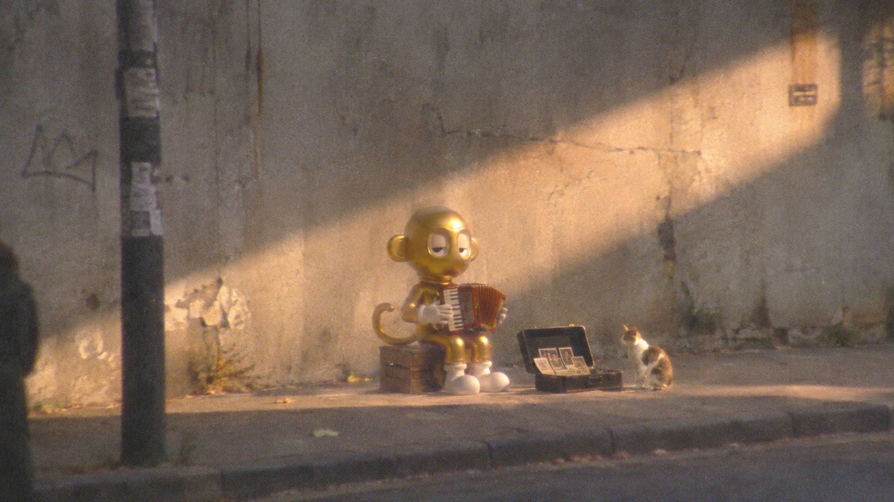

# 2005 年廉价摄像机偷拍感：参考角色在街头做怪事（found footage 风）

- 原帖链接：https://x.com/edizkan_/status/2119844038228541743
- 作者：Edizkan ⭕🦇（@edizkan_）
- 时间：2026-11-10 01:26 (UTC+8 / Asia/Taipei)
- 互动摘要：点赞 40 · 转发 7 · 回复 9 · 引用 12 · 书签 3 · 浏览 2556（采集快照：2026-11-10 20:30 UTC+8）
- 模型/工具：ChatGPT 图像生成（作者推荐）
- 标签：其它
- 媒体路径：
  - `media/images/2119844038228541743_1.jpg`（）
- 入库日期：2026-11-10
- prompt 来源：https://x.com/edizkan_/status/2119844038228541743
- 备注：prompt 即主帖正文「Prompt 👇」之后部分，原样摘录；需上传一张参考角色图。

## prompt 原文

```text
Create a cinematic yet  low-quality candid street photograph of the uploaded reference character, captured from a distance on a quiet urban sidewalk against a large, plain, weathered concrete wall. Scene & Action: The character is doing something unexpectedly strange, funny, or fascinating in the street. Invent a unique, spontaneous activity that creates an interesting visual story. The moment feels completely accidental, like someone happened to witness something bizarre and quickly took a photo before it disappeared. Camera & Composition: Shot secretly from across the street using an old consumer camera with heavy digital zoom. The character occupies only 15–25% of the image, positioned off-center. Lots of empty wall and pavement surround the subject. Slightly awkward framing, imperfect horizon, occasional cropped pedestrians at the edges. The street feels mostly empty. Found Footage Quality (CRITICAL): The image must look like a degraded frame from a forgotten 2005 street video, captured on a cheap digital camcorder.

Strong analog-style grain
Slight motion blur and imperfect focus
Soft, smeared edges from excessive digital zoom
Faint chromatic bleeding and washed-out colors
Uneven exposure, crushed shadows, dull highlights
Subtle frame ghosting and imperfect image stabilization

Cinematic Lighting: Natural late-afternoon sunlight hits the wall diagonally, creating a strong division between light and shadow. The character falls within a narrow pocket of interesting light, while the surrounding street remains muted. The composition feels cinematic by accident, not through artificial dramatic lighting. Color Grade: Faded concrete greys, dusty beige, muted greens, dirty warm highlights, slightly cool shadows. Subtle nostalgic color separation, low saturation, imperfect white balance. Focus: The character remains recognizable but never perfectly sharp. Image degradation must affect the entire frame, including the character. Avoid the appearance of a perfectly rendered 3D character composited onto a blurry photographic background. Character Identity: Preserve the exact reference character's proportions, eye shape, silhouette, original materials, colors, and facial structure. Do not humanize, redesign, or add missing facial features or limbs. Final Aesthetic: A strangely beautiful, slightly unsettling, unintentionally cinematic moment captured through a terrible camera. Something that could become a viral internet image because the situation is so unusual, not because the photography is good. No HDR, no clean digital rendering, no professional photography sharpness, no glossy 3D appearance, no artificial cinematic effects. ar 16:9
```

---

个人学习归档，非商业。prompt 与媒体版权归原作者 @edizkan_，引用请回到原帖。
